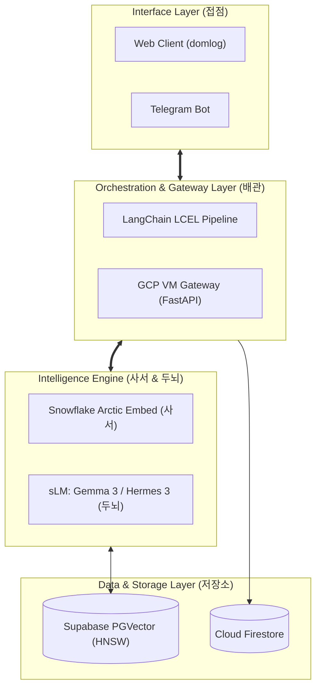

## 1. 서론: "나무만 보지 않고 숲을 먼저 본다"

수많은 AI 및 RAG 튜토리얼이 프롬프트 몇 줄이나 파이썬 코드 조각부터 시작합니다. 하지만 실제 엔터프라이즈 환경에서 지능형 어시스턴트를 개발할 때 엔지니어가 마주하는 진짜 벽은 코드 문법이 아닙니다.

> *"이 거대한 데이터는 어디서 수집되어 어떻게 저장되는가?"*  
> *"임베딩 모델과 추론 LLM은 물리적으로 어떻게 분리되어 협력하는가?"*  
> *"그리고 분산된 컴포넌트 사이에서 일어나는 수많은 블랙박스 장애를 어떻게 디버깅할 것인가?"*

본 연재는 단편적인 코드 조각을 외우는 대신, 실제 프로덕션에서 가동 중인 **`assist` 지능형 분산 엣지 시스템의 전체 아키텍처 지도**를 펼쳐놓고 시스템을 이루는 세 기둥의 분업 원리부터 차근차근 뜯어봅니다.

---

### 선행 인프라 아티클 (지식 사다리)

본 아키텍처는 앞선 연재에서 검증된 두 가지 핵심 엔지니어링 기반 위에 구축되었습니다:
1. **[브라우저 제로 트러스트 게이트웨이](https://domlog.vercel.app/posts/browser-zero-trust-supabase-was-gateway)**: 브라우저 번들에서 데이터베이스 URL과 API 키를 100% 격리한 단일 WAS 게이트웨이 설계
2. **[하이브리드 데이터 영속화](https://domlog.vercel.app/posts/firestore-hybrid-persistence-zero-cost-migration)**: 정형 관계형 데이터(Supabase RDBMS)와 비정형 문서(Cloud Firestore NoSQL)의 책임 분리

이 견고한 데이터 계층 위에, 이제 **"지능형 검색과 추론"**을 담당하는 AI 인프라가 얹어집니다.

---

## 2. 전체 아키텍처 조망: assist 분산 파이프라인

`assist` 시스템은 무거운 중앙 클라우드에 종속되지 않고, **경량 엣지 게이트웨이(GCP VM)**와 **온디맨드 고성능 연산 노드(Colab GPU)**를 보안 터널로 결합한 분산 아키텍처를 채택하고 있습니다.

<div className="rounded-xl overflow-hidden bg-slate-950/90 border border-slate-800/90 shadow-inner my-6">
  <div className="text-[11px] font-mono font-semibold text-slate-400 flex items-center justify-between px-3.5 py-1.5 bg-slate-900/80 border-b border-slate-800/80">
    <div className="flex items-center gap-1.5">
      <span className="w-1.5 h-1.5 rounded-full bg-sky-400"></span>
      <span className="text-sky-300 font-bold">&lt;시스템 아키텍처 / 데이터 흐름도&gt;</span>
    </div>
    <span className="text-[10px] text-slate-500 font-normal">assist Distributed Edge Architecture v1.0</span>
  </div>

  <div className="p-4 sm:p-5">



  </div>
</div>

---

## 3. 핵심 컴포넌트 3총사의 명확한 분업

위 다이어그램에서 데이터가 흐르는 길목마다 각 컴포넌트는 철저히 단 하나의 책임만을 수행합니다.

### 1) Snowflake Arctic Embed의 역할: "고속 경량 사서(Librarian)"
- **소속 레이어**: 임베딩 및 벡터 색인 계층
- **본질**: 문장을 읽고 그 의미를 **768차원의 숫자 벡터 좌표**로 변환하는 데 특화된 모델
- **왜 필요한가**: 수천 페이지의 기술 문서와 취약점 리포트를 거대 LLM에게 통째로 넘기면 컨텍스트 윈도우 한계와 엄청난 지연 시간(Latency)이 발생합니다. Snowflake Arctic Embed는 가벼운 엣지 CPU 환경에서도 문서를 밀리초(ms) 단위로 색인하여, 나중에 질문이 들어왔을 때 관련 문서를 0.05초 만에 찾아내는 사서 역할을 수행합니다.
- **투명성 원칙**: 중국계 모델(Qwen, BAAI 등)의 공급망 보안 리스크를 원천 배제하기 위해, 미국 Snowflake의 오픈 아키텍처 모델을 표준으로 채택했습니다 ([ADR 0004](https://github.com/initbtn/assist/blob/main/docs/architecture-decision-record/0004-non-chinese-slm-dual-model-evaluation.md)).

### 2) sLM (Small Language Model)의 역할: "정밀 추론 두뇌(Expert)"
- **소속 레이어**: 지능 및 가중치 추론 계층
- **대표 모델**:
  - **Google Gemma 3 (12B)**: 고도의 논리적 독해력과 자연스러운 한국어 문맥 처리에 특화된 주력 모델
  - **Nous Hermes 3 (Meta Llama-3.1-8B 기반)**: Meta의 Llama 3을 바탕으로 에이전트 도구 호출(Function Calling)과 정형 출력을 정밀 미세조정(Fine-Tuning)한 초경량 모델
- **본질**: 사서(Snowflake)가 서고에서 뽑아온 3~5개의 핵심 문서와 사용자의 질문을 종합하여, **"이 코드에 왜 취약점이 존재하고, 어떻게 패치해야 하는지"**를 논리적으로 추론하고 합성합니다.

### 3) LangChain LCEL의 역할: "블랙박스 구간의 투명한 배관공(Plumbing)"
- **소속 레이어**: 오케스트레이션 및 데이터 제어 계층
- **본질**: 분산된 컴포넌트들을 유닉스 파이프 연산자(`|`)로 엮어내는 결합재

많은 개발자가 *"LangChain은 그냥 LLM API 래퍼 라이브러리가 아닌가?"*라고 오해합니다. 하지만 프로덕션 관점에서 LangChain의 진짜 존재 이유는 **"LLM 전달 과정에서 발생하는 거대한 블랙박스 구간을 해체하고 디버깅하기 위한 계측 도구"**입니다.

---

## 4. 왜 LangChain이 필요한가? 3대 블랙박스의 해체

순수하게 LLM API를 직접 호출하면 코드는 간결해 보이지만, 실제 배포 후에는 3가지 맹점이 드러납니다:

1. **입력 블랙박스**: 시스템 지침, RAG 검색 결과 청크, 대화 히스토리가 합쳐져 모델에 들어가는데, *최종적으로 프롬프트에 몇 글자가 어떻게 조립되었는지* 확인하기 어렵습니다.
2. **네트워크 & 연산 블랙박스**: 엣지 게이트웨이와 Colab GPU 연산 노드 사이에서 스트리밍 토큰이 끊기거나 지연될 때 어디서 병목이 생겼는지 추적하기 어렵습니다.
3. **출력 블랙박스**: 모델이 내놓는 것은 단순한 문자열(String)일 뿐입니다. 모델이 마크다운이나 잡담을 조금만 섞어도 JSON 파서가 깨지며 백엔드가 중단됩니다.

LangChain v0.3 LCEL은 모든 컴포넌트를 표준 **`Runnable`** 인터페이스로 일원화하여, 파이프라인 중간에 아무런 부작용 없이 계측 코드를 끼워 넣을 수 있게 합니다.

```python
# 인라인 디버깅 파이프 예시: LLM으로 전달되는 최종 프롬프트를 투명하게 검사
from langchain_core.runnables import RunnableLambda

def inspect_prompt(prompt_value):
    print(f"\n[TRACE] LLM 입력 프롬프트 실측 크기: {len(prompt_value.to_string())} bytes")
    return prompt_value # 다음 단계로 무손실 전달

# 파이프 중간에 계측기를 꽂아 블랙박스를 투명화
transparent_chain = prompt_template | RunnableLambda(inspect_prompt) | slm_model | structured_parser
```

---

## 5. 연재 로드맵 안내

숲을 확인했으니, 이제 개별 나무들의 깊은 원리와 실전 구현으로 나아갑니다:

- **[Series 2편] Snowflake Arctic Embed와 RAG**:
  - 문맥 손실을 방어하는 Contextual Chunking 기법
  - Supabase PGVector의 HNSW 인덱스와 코사인 유사도 검색 원리
- **[Series 3편] Gemma 3 vs LLaMA 3(Hermes 3) 심층 대조**:
  - 12B vs 8B 실측 벤치마크 (추론 속도 vs 결함 탐지율의 트레이드오프)
  - Hermes는 LLaMA를 어떻게 미세조정(SFT/DPO)했는가?
- **[Series 4편] LangChain LCEL & Structured Output 실전**:
  - 분산 엣지 파이프라인을 1줄의 고성능 스트림으로 결합하는 실무 테크닉

다음 2편에서는 텍스트를 고차원 공간의 기하학적 좌표로 바꾸어내는 **Snowflake Arctic Embed의 벡터 검색 원리**를 집중 탐구합니다!
