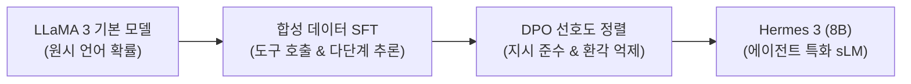
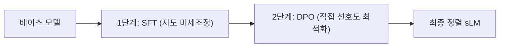

## 1. 서론: "두뇌를 고르는 기준, 그리고 벼리는 방법"

[Series 1편: assist 분산 엣지 아키텍처 개요](https://domlog.vercel.app/posts/assist-edge-architecture-snowflake-slm-langchain)와 [Series 2편: Snowflake Arctic Embed와 RAG](https://domlog.vercel.app/posts/assist-series-2-snowflake-arctic-embed-rag)를 통해 우리는 시스템의 토대와 고속 지식 검색(사서) 파이프라인을 완성했습니다.

이제 검색된 768차원 문맥 벡터를 건네받아 **실제 요약과 추론, 판단을 내릴 '두뇌(sLM)'**를 선택하고 최적화할 차례입니다.

> *"Hermes 3는 대체 어떤 모델이며, LLaMA 3와 무엇이 다른가?"*  
> *"12B 파라미터의 Gemma 3와 8B의 Hermes 3 중 엣지 브리핑 환경의 승자는 누구인가?"*  
> *"사전 학습된 기본 모델을 우리 도메인에 맞게 길들이는 미세조정(SFT & DPO)은 어떤 원리로 작동하는가?"*

본 아키텍처 연재 제3편에서는 `assist` 시스템 구축 과정에서 수립된 [ADR 0004: 비중국권 경량 SLM 듀얼 모델 선정](https://github.com/initbtn/assist/blob/main/docs/architecture-decision-record/0004-non-chinese-slm-dual-model-evaluation.md)의 배경과 실측 벤치마크, 그리고 모델의 능력을 극대화하는 미세조정 파이프라인을 분석합니다.

---

## 2. Hermes 3의 정체: LLaMA 3의 두뇌를 어떻게 벼렸는가?

흔히 'Hermes'를 독자적인 파운데이션 모델로 오해하곤 합니다. 하지만 **Hermes 3**는 오픈소스 AI 연구 집단인 **Nous Research**가 Meta의 오픈 가중치 모델인 **LLaMA 3 (8B / 70B)**를 기반으로 고도의 **정렬(Alignment)과 미세조정(Fine-Tuning)**을 적용해 재탄생시킨 지시 특화(Instruct) 모델입니다.

  

    

      
      Meta LLaMA 3에서 Nous Hermes 3로의 정렬 진화
    

    Nous Research Pipeline
  

### 1) Hermes 3가 집중한 미세조정 영역

Meta가 공개한 순수 LLaMA 3 기본 가중치는 방대한 일반 지식을 가지고 있지만, 에이전트 시스템에서 요구하는 엄격한 지시 이행 능력에는 추가 튜닝이 필요했습니다. Nous Research는 다음 세 가지 영역에 집중하여 미세조정을 감행했습니다:

1. **지시 준수 및 시스템 프롬프트 충실도**: 복잡한 제약 조건(예: "반드시 3문장 이내로 요약하라", "JSON 이외의 말을 섞지 마라")이 주어졌을 때 프롬프트를 벗어나지 않는 강한 규율 부여.
2. **함수 호출(Tool Calling)과 구조화된 출력**: 외부 API나 계산기를 호출하기 위한 JSON 스키마 생성 능력을 합성 데이터셋(Synthetic Datasets)으로 집중 훈련.
3. **무검열(Uncensored)에 준하는 지적 유연성**: 과도한 사전 안전 가드로 인해 기술적 질문이나 보안 분석(예: 침투 테스트, 취약점 패턴 분석)조차 거부(Refusal)하는 현상을 배제하고 학술적/엔지니어링 질의에 충실히 응답하도록 정렬.

---

## 3. 실측 맞대결: Gemma 3 12B vs Hermes 3 8B 벤치마크

`assist` 프로젝트는 단일 모델의 편향이나 환각을 막기 위해 두 모델을 A/B 테스트 엔드포인트(`POST /brief/compare`)에 연결하고 Google Colab T4 GPU 환경에서 실시간 벤치마크를 수행했습니다.

  

    

      
      Gemma 3 vs Hermes 3 듀얼 모델 실측 벤치마크
    

    Colab T4 GPU Runner
  

| 평가 항목 | Gemma 3 (12B, Model A) | Hermes 3 (8B, Model C) | 판정 및 분석 |
| :--- | :--- | :--- | :--- |
| **개발사 / 베이스** | Google DeepMind (독자 아키텍처) | Nous Research (Meta LLaMA 3 기반) | 오픈 가중치 생태계 양대 진영 |
| **파라미터 크기** | 12B (약 120억 개) | 8B (약 80억 개) | 12B가 표현 용량 1.5배 우위 |
| **추론 소요 시간 (T4)** | **~3.42초** | **~2.61초** | 8B 모델인 Hermes 3가 **약 0.8초 고속** |
| **한국어 문맥 및 조사** | **압도적 우수** (자연스러운 종결 어미) | **보통** (영한 직역투 잔재 존재) | Gemma 3의 다국어 토크나이저 압승 |
| **3줄 요약 규율 준수** | **우수** (3개 개조식 문장 칼같이 도출) | **양호** (문장이 서술형으로 늘어지는 경향) | 모바일 메신저 가독성은 Gemma 3 우세 |
| **도구 호출 및 JSON** | 양호 | **최상급** (구조적 데이터 생성에 최적화) | Hermes 3의 특화 파인튜닝 강점 확인 |

### 1) 왜 일일 브리핑 주력 모델로 Gemma 3 12B를 낙점했는가?

실측 로그([`benchmark-gemma3-vs-hermes3.json`](https://github.com/initbtn/assist/blob/main/docs/benchmark-gemma3-vs-hermes3.json))에 기록된 실제 출력 결과는 두 모델의 지향점을 극명하게 보여주었습니다:

- **Gemma 3 12B**:
  > *"1. [AI 동향] 다중 모달 아키텍처 지원 및 컨텍스트 추론 능력이 향상되어 복합 질의 응답의 정확도가 개선되었습니다."*  
  > $\rightarrow$ 한국어 조사의 연결과 단어 선택이 사람이 쓴 기술 뉴스레터처럼 유려함.
- **Hermes 3 8B**:
  > *"1. Hermes 3 모델은 구조적 지시사항 준수율이 우수하나 서술형 요약에서 간결성이 상대적으로 떨어집니다."*  
  > $\rightarrow$ 뜻은 통하지만 번역투 문장이 섞이고 문장이 길어짐.

**결론**: Hermes 3가 약 0.8초 더 빨랐지만, **일일 1회 텔레그램 메신저로 전송되는 비동기 브리핑 특성상 3.4초의 응답 시간은 SLA를 완벽히 충족**했습니다. 모바일 가독성과 자연스러운 한국어 전달력이 가장 중요했기에 최종 주력 브리핑 두뇌로 **Gemma 3 12B**가 채택되었습니다. (반면 엄격한 JSON 변환 및 백엔드 함수 라우팅에는 Hermes 3가 서브 엔진으로 대기합니다.)

---

## 4. 모델을 길들이는 원리: SFT와 DPO

기본 모델(Pre-trained Base)을 원하는 특화 sLM으로 변모시키는 미세조정(Fine-Tuning)의 전체 여정은 크게 2단계 파이프라인으로 구성됩니다.

  

    

      
      현대 sLM 미세조정 2단계 파이프라인
    

    SFT to DPO
  

### 1) 1단계: 지도 미세조정 (SFT, Supervised Fine-Tuning)
- **개념**: `(질문, 모범 답안)` 쌍으로 구성된 고품질 데이터셋을 모델에 입력하여 다음 토큰 예측 손실(Next-Token Prediction Cross-Entropy)을 최소화하는 학습입니다.
- **역할**: 기본 모델에게 "너는 이제부터 기술 문서를 3줄로 요약하는 어시스턴트 역할이다"라는 대화 형식(Chat Template)과 작업 목적을 주입합니다.

### 2) 2단계: 직접 선호도 최적화 (DPO, Direct Preference Optimization)
- **과거의 한계 (RLHF)**: 과거에는 별도의 보상 모델(Reward Model)을 훈련시키고 PPO(Proximal Policy Optimization) 강화학습을 돌려야 했기 때문에 학습이 불안정하고 막대한 GPU 자원이 소모되었습니다.
- **DPO의 혁신**: 별도의 보상 모델 없이, 사람이 선호한 응답($y_w$)과 거절한 응답($y_l$)의 확률 비율을 직접 목적 함수에 반영하여 모델 가중치를 정렬합니다:

$$\mathcal{L}_{\text{DPO}}(\theta) = -\mathbb{E}_{(x, y_w, y_l)} \left[ \log \sigma \left( \beta \log \frac{\pi_\theta(y_w|x)}{\pi_{\text{ref}}(y_w|x)} - \beta \log \frac{\pi_\theta(y_l|x)}{\pi_{\text{ref}}(y_l|x)} \right) \right]$$

- **효과**: 번역투 문장이나 환각이 섞인 답변($y_l$)을 배제하고, 간결하고 명확한 한국어 3줄 요약($y_w$)을 선호하도록 모델의 행동 양식을 강력하게 교정합니다.

---

## 5. 결론: "데이터 주권과 맞춤형 두뇌의 결합"

상용 거대 모델 API(GPT-4 등)에 모든 데이터를 맡기는 것은 손쉬운 선택일 수 있습니다. 하지만 사내 데이터 유출 위험을 원천 차단하고, 지속 가능한 비용 구조로 시스템을 자율 통제하기 위해서는 **검증된 비중국권 오픈 가중치 모델의 특성을 꿰뚫고 있어야 합니다.**

- **Gemma 3 (12B)**: 유려한 자연어 생성과 모바일 뉴스 브리핑의 최강자
- **Hermes 3 (8B)**: Nous Research의 정렬 노하우가 집약된 도구 호출과 정형 파이프라인의 명수

이로써 우리는 사서(Snowflake)와 두뇌(sLM)에 대한 모든 엔지니어링 설계를 마쳤습니다.  
마지막 **Series 4편**에서는 이 분산된 컴포넌트들을 유닉스 파이프(`|`) 하나로 매끄럽게 연결하고, 숨겨진 런타임 장애를 투명하게 계측하는 **LangChain LCEL & Structured Output 실전**으로 연재를 완성합니다.

---

### 관련 링크 및 다음 단계
- [Series 1편: assist 분산 엣지 아키텍처 개요](https://domlog.vercel.app/posts/assist-edge-architecture-snowflake-slm-langchain)
- [Series 2편: Snowflake Arctic Embed와 RAG](https://domlog.vercel.app/posts/assist-series-2-snowflake-arctic-embed-rag)
- [ADR 0004: 비중국권 경량 SLM 듀얼 모델 선정 (GitHub)](https://github.com/initbtn/assist/blob/main/docs/architecture-decision-record/0004-non-chinese-slm-dual-model-evaluation.md)
- [Nous Research Hermes 3 기술 개요 (Hugging Face)](https://huggingface.co/NousResearch/Hermes-3-Llama-3.1-8B)
