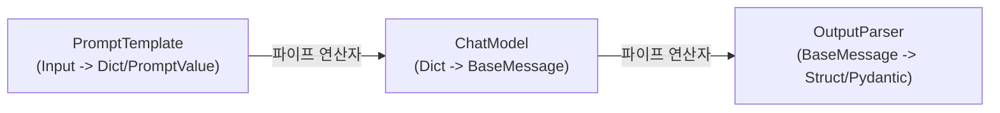

## 1. 계기: "왜 레거시 LangChain 코드는 프로덕션에서 악몽이 되었을까?"

2023년 초 LangChain이 처음 등장했을 때, 생태계는 폭발적으로 성장했지만 실제 백엔드에 도입한 엔지니어들은 금세 깊은 피로감에 빠졌습니다.

```python
# 과거 레거시 방식: 블랙박스 LLMChain
from langchain.chains import LLMChain
from langchain.prompts import PromptTemplate

chain = LLMChain(llm=llm, prompt=prompt)
result = chain.run(text="...") # 도대체 내부에서 어떤 타입이 오가는가?
```

레거시 LangChain은 수많은 파생 체인 클래스(`LLMChain`, `SequentialChain`, `TransformChain`, `RetrievalQA`...)를 남발했고, 다음과 같은 심각한 프로덕션 결함을 드러냈습니다.

1. **타입 안정성 부재와 블랙박스 딕셔너리**: 각 체인 노드가 주고받는 입출력이 `dict[str, Any]` 형태의 임의 키값으로 엮여 있어, 런타임에 `KeyError`가 터지기 전까지는 파이프라인의 오류를 정적 분석할 수 없었습니다.
2. **비동기(Async) 및 스트리밍 지원의 단절**: 비동기 배치(`abatch`), 스트리밍(`astream`), 동기 실행(`invoke`)을 각각 다른 인터페이스로 호출해야 했고, 중간 단계 스트리밍 훅이 극도로 복잡했습니다.
3. **Pydantic v2 및 구조화된 응답(Structured Output) 처리의 조잡함**: LLM에게 JSON 포맷을 강제하기 위해 프롬프트 말미에 지저분한 정규식이나 불완전한 파서를 덧붙여야 했고, 모델이 조금만 잡담을 섞어도 파싱 에러(`OutputParserException`)로 전체 서버가 죽었습니다.

LangChain 팀은 v0.2와 v0.3에 이르러 이 모든 레거시 체인을 전면 폐기(Deprecated)하고, 유닉스 파이프 연산자(`|`)를 기반으로 하는 **LCEL (LangChain Expression Language)**과 **Runnable 프로토콜**, 그리고 모델 레벨의 **`with_structured_output`**으로 아키텍처를 대통합했습니다.

---

## 2. LCEL의 본질: Runnable 인터페이스와 파이프 연산자(`|`)

LCEL의 핵심은 매우 단순합니다. 파이프라인을 구성하는 모든 구성 요소(프롬프트, 모델, 파서, 커스텀 함수)가 단 하나의 표준 인터페이스인 **`Runnable`**을 구현하는 것입니다.

<div className="rounded-xl overflow-hidden bg-slate-950/90 border border-slate-800/90 shadow-inner my-6">
  <div className="text-[11px] font-mono font-semibold text-slate-400 flex items-center justify-between px-3.5 py-1.5 bg-slate-900/80 border-b border-slate-800/80">
    <div className="flex items-center gap-1.5">
      <span className="w-1.5 h-1.5 rounded-full bg-emerald-400"></span>
      <span className="text-emerald-300 font-bold">&lt;LCEL 데이터 변환 파이프라인&gt;</span>
    </div>
    <span className="text-[10px] text-slate-500 font-normal">Runnable Protocol</span>
  </div>

  <div className="p-4 sm:p-5">



  </div>
</div>

모든 `Runnable` 객체는 파이프 연산자(`|`)를 통해 체이닝되며, 자동으로 다음 4가지 핵심 메서드를 완벽히 보장합니다:

- `invoke` / `ainvoke`: 단일 입력 동기/비동기 호출
- `batch` / `abatch`: 병렬 최적화된 동기/비동기 일괄 처리
- `stream` / `astream`: 토큰 단위 실시간 스트리밍
- `astream_events`: 중간 노드의 실행 이벤트를 세부 모니터링하는 프로덕션용 스트리밍

더 이상 복잡한 래퍼 클래스를 외울 필요가 없습니다. 입력을 받아 출력을 내는 모든 것은 `Runnable` 하나로 통합됩니다.

---

## 3. 실전 구축: `assist` 백엔드의 CVE 보안 취약점 정형화 파이프라인

이 철학이 실제 프로덕션에서 어떻게 구현되는지, 우리가 운영 중인 `assist` 지능형 백엔드의 실제 CVE 보안 취약점 분석 파이프라인 코드를 통해 살펴봅니다.

보안 공시 사이트에서 긁어온 비정형 CVE 취약점 영문 텍스트를 입력받아, 프론트엔드가 즉시 렌더링할 수 있는 **정형화된 보안 레코드(Pydantic Schema)**로 추출하는 태스크입니다.

### 3-1. 도메인 스키마 정의 (`Pydantic v2`)

```python
from pydantic import BaseModel, Field
from typing import List, Optional

class SecurityAnalysisResult(BaseModel):
    """CVE 취약점 분석 및 한국어 방어 대책 정형 스키마"""
    cve_id: str = Field(description="CVE 식별자 (예: CVE-2026-1234)")
    severity: str = Field(description="심각도 (CRITICAL, HIGH, MEDIUM, LOW)")
    cwe_ids: List[str] = Field(description="연관된 CWE 번호 목록 (예: ['CWE-79', 'CWE-89'])")
    affected_packages: List[str] = Field(description="영향받는 패키지 또는 소프트웨어 명칭")
    vulnerability_summary_ko: str = Field(description="취약점의 발생 원인과 파급 효과에 대한 한국어 정밀 요약 (1~2문장)")
    mitigation_action_ko: str = Field(description="개발자가 즉시 조치해야 할 구체적인 보안 패치 및 코드 수정 방안")
```

### 3-2. LCEL 체인 합성 (`Prompt | Model.with_structured_output`)

LangChain v0.3에서는 복잡한 출력 파서를 직접 체이닝할 필요조차 없습니다. OpenAI, Anthropic, Google Gemini 및 최신 오픈소스 sLM(Gemma 3, Hermes 3)이 제공하는 네이티브 Tool Calling / JSON Mode 기능을 추상화한 **`with_structured_output`**을 사용합니다.

```python
from langchain_core.prompts import ChatPromptTemplate
from langchain_google_genai import ChatGoogleGenerativeAI
from langchain_core.runnables import RunnablePassthrough

# 1. 시스템 프롬프트 템플릿
prompt = ChatPromptTemplate.from_messages([
    ("system", """당신은 최고 수준의 시큐어코딩 및 보안 취약점 분석 전문가입니다.
주어진 CVE 공시 영문 원문을 정밀하게 분석하여, 개발자가 즉시 이해하고 조치할 수 있는 
정형화된 보안 메타데이터와 명확한 한국어 액션 가이드를 도출하세요."""),
    ("human", "다음 CVE 취약점 데이터를 분석해 주세요:\n\n{raw_cve_text}")
])

# 2. 모델 바인딩 및 Pydantic 스키마 주입
llm = ChatGoogleGenerativeAI(model="gemini-2.0-flash", temperature=0.1)
structured_llm = llm.with_structured_output(SecurityAnalysisResult)

# 3. 우아하고 간결한 단 1줄의 LCEL 체인
cve_analysis_chain = prompt | structured_llm
```

### 3-3. 실행 및 실측 검증

```python
raw_bulletin = """
CVE-2026-31920: A flaw was found in the authorization middleware of the User Profile API.
When a crafted JWT payload containing empty claim scopes is processed, the system defaults
to wildcard superuser permissions, allowing remote unauthenticated attackers to elevate privileges.
Affects package: auth-gateway-core versions < 2.4.1.
"""

result: SecurityAnalysisResult = cve_analysis_chain.invoke({"raw_cve_text": raw_bulletin})

print(f"[{result.severity}] {result.cve_id}")
print(f"영향 패키지: {result.affected_packages}")
print(f"조치 방안: {result.mitigation_action_ko}")
```

**실측 출력 결과:**
```text
[CRITICAL] CVE-2026-31920
영향 패키지: ['auth-gateway-core < 2.4.1']
조치 방안: auth-gateway-core 패키지를 2.4.1 이상으로 긴급 패치하고, JWT 토큰 검증 시 빈 클레임 스코프에 대해 기본 거부(Default Deny) 정책이 적용되도록 미들웨어 코드를 수정해야 합니다.
```

정규식을 거치거나 불안정한 JSON 문자열 파싱을 시도하지 않아도, 결과 객체는 이미 완벽하게 정적 타입 검사를 통과하는 `SecurityAnalysisResult` 인스턴스로 반환됩니다.

---

## 4. 실무 디버깅 팁: 체인의 속을 들여다보는 법

LCEL을 쓸 때 개발자들이 가장 많이 묻는 질문은 **"파이프라인 중간에 어떤 데이터가 흐르는지 어떻게 디버깅하나요?"**입니다.

### 팁 1: `RunnableLambda`를 활용한 인라인 인스펙션
파이프라인 중간에 아무런 부작용 없이 로깅을 꽂고 싶다면 파이썬 함수나 람다를 그대로 파이프에 연결할 수 있습니다.

```python
from langchain_core.runnables import RunnableLambda

def inspect_prompt(prompt_value):
    print(f"\n[DEBUG] LLM으로 전달되는 실제 프롬프트:\n{prompt_value.to_string()}\n")
    return prompt_value # 다음 체인으로 그대로 통과

debug_chain = prompt | RunnableLambda(inspect_prompt) | structured_llm
```

### 팁 2: `RunnablePassthrough.assign`을 통한 맥락 보존
이전 단계의 원본 입력을 잃어버리지 않고 최종 단계까지 유지해야 할 때, 딕셔너리를 재조합하는 대신 `assign`을 사용하면 코드가 극도로 깔끔해집니다.

```python
enrich_chain = RunnablePassthrough.assign(
    analyzed=cve_analysis_chain
)
# 결과: {"raw_cve_text": "...", "analyzed": SecurityAnalysisResult(...)}
```

---

## 5. 다음 단계: Vector DB와 실전 보안 RAG로의 확장

이번 1편에서는 LangChain v0.3의 척추인 LCEL과 Pydantic 기반 구조화된 출력을 확립했습니다. 

하지만 LLM의 자체 지식만으로는 세상에 매일 쏟아지는 수만 개의 최신 CVE 취약점과 조직 내부의 보안 가이드라인을 모두 기억할 수 없습니다. 

- **2편 예고**: *"Vector DB의 본질: 임베딩 벡터와 청킹(Chunking) 전략 제대로 이해하기"*
  - 코사인 유사도와 HNSW 인덱스의 원리
  - 왜 무식한 고정 길이 청킹은 검색 품질을 망치는가? (Contextual Header 주입 기법)
  - Supabase `pgvector` 기반 보안 위협 벡터 인덱스 설계
- **3편 예고**: *"LangChain + Vector DB로 완성하는 실전 제로 트러스트 보안 RAG"*
  - `assist` 백엔드의 GCP VM과 Colab sLM 수명주기 데몬을 결합하여, 소스코드를 올리면 방어 취약점과 패치 코드를 즉시 제안하는 엔터프라이즈 RAG 완성

단단한 기본기 위에 결합되는 다음 편의 실전 벡터 엔지니어링을 기대해 주세요!
