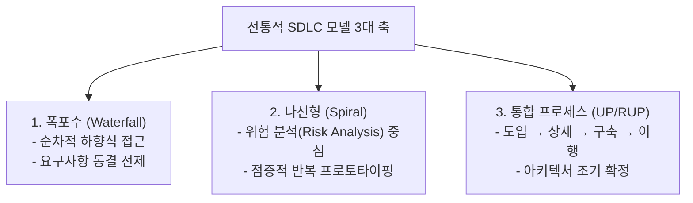

## 1. 출제 유형 개요: SDLC 프로세스 모델의 핵심 축

NCS M1(개발 프로세스) 영역에서 전통적 생명주기 모델은 **각 모델이 탄생한 목적(위험 대응, 변경 수용 등)**과 **단계별 핵심 산출물 및 특징 짝짓기**를 묻는 문제가 반복 출제됩니다.

---

## 2. 모델별 핵심 비교표 및 기출 오답 포인트

| 모델 | 핵심 메커니즘 | 단계별 프로세스 | 가장 빈출되는 시험 오답 함정 |
| :--- | :--- | :--- | :--- |
| **폭포수 (Waterfall)** | 고전적 순차 모델 (선행 단계 승인 후 다음 단계 진입) | 타당성검토 → 계획 → 요구분석 → 설계 → 구현 → 시험 → 유지보수 | *"사용자의 요구사항 변경에 유연하게 대응할 수 있다"* (X → 변경 수용 불가, 피드백 지연) |
| **나선형 (Spiral)** | 보헴(Boehm) 제안, **위험(Risk) 최소화** 목적 | **계획 수립 → 위험 분석 → 공학 개발 → 고객 평가** | *"위험 분석 단계 없이 시제품을 바로 배포한다"* (X) / 4단계 순서를 거꾸로 섞음 |
| **통합 프로세스 (UP/RUP)** | 유스케이스 기반, **아키텍처 중심**, 반복·점증 | **도입(Inception) → 상세(Elaboration) → 구축(Construction) → 이행(Transition)** | 상세 단계(Elaboration)에서 비즈니스 모델만 수립하고 아키텍처를 뒤로 미룬다고 왜곡 (X) |

---

## 3. 실전 기출 정밀 해설 (대표 2선)

### Q1. 통합 프로세스(UP) 4단계 식별형 (2020 국가직 7급)
> **Q. 소프트웨어 개발 단계를 시간의 흐름에 따라 네 개의 범주(도입, 상세, 구축, 이행)로 나누고, 각 범주마다 요구사항 도출부터 배포까지의 개발 작업을 반복하는 모델은?**  
> ① 나선형 모델  
> ② 폭포수 모델  
> ③ 통합 프로세스(UP) 모델  
> ④ RAD 모델  
> **공인 정답: ③**  
> **해설**: 도입(Inception), 상세(Elaboration), 구축(Construction), 이행(Transition) 4단계를 정의하고, 각 단계마다 반복(Iteration)을 수행하며 특히 **상세 단계에서 시스템 아키텍처를 조기에 확정**하는 모델은 **통합 프로세스(Unified Process)**입니다.

### Q2. 나선형 모델 4단계 순서형 (정보처리기사)
> **Q. 보헴이 제안한 나선형 모델(Spiral Model)의 프로젝트 수행 순서로 옳은 것은?**  
> ① 계획 수립 → 위험 분석 → 개발 및 검증 → 고객 평가  
> ② 위험 분석 → 계획 수립 → 고객 평가 → 개발 및 검증  
> ③ 계획 수립 → 개발 및 검증 → 위험 분석 → 고객 평가  
> ④ 고객 평가 → 계획 수립 → 위험 분석 → 개발 및 검증  
> **공인 정답: ①**  
> **해설**: 나선 회전마다 먼저 목표와 제약조건을 세우는 **계획 수립** → 대안을 식별하고 기술적 위험을 해소하는 **위험 분석** → 시제품 제작 및 **공학 개발** → 결과를 검토하는 **고객 평가** 순서로 진행됩니다.
