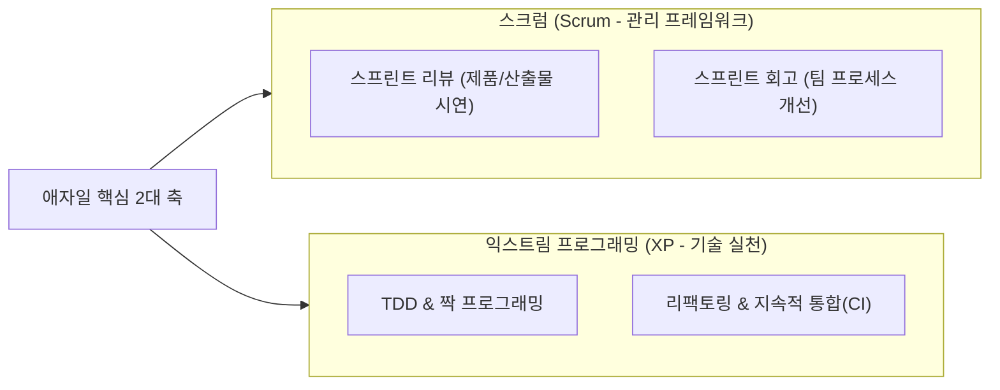

## 1. 출제 유형 개요: 애자일 가치 왜곡과 프랙티스 매핑

NCS M1 애자일 영역에서는 **애자일 선언문의 상대적 가치 순서를 뒤집는 말장난 문항**과 **스크럼(Scrum)의 관리적 이벤트 vs XP(Extreme Programming)의 엔지니어링 실천법**을 대조하는 문제가 100% 출제됩니다.

---

## 2. 애자일 선언문 4대 가치 족집게 함정표

애자일은 왼쪽 가치를 부정하는 것이 아니라, **오른쪽 가치에 더 높은 우선순위**를 둡니다:

| 공식 애자일 가치 (우선시됨) | 기출에 출제되는 대표 오답 (가치 전도) |
| :--- | :--- |
| **개인과 상호작용** (Individuals & interactions) | "프로세스와 도구를 최우선시한다" (X) |
| **동작하는 소프트웨어** (Working software) | "포괄적인 문서화와 완벽한 명세 작성을 우선한다" (X) |
| **고객과의 협력** (Customer collaboration) | "엄격한 계약 협상과 SLA 준수를 우선한다" (X) |
| **변화에 대응하기** (Responding to change) | "초기에 수립된 고정 계획을 엄격히 따른다" (X) |

---

## 3. 스크럼(Scrum) vs XP 프랙티스 완벽 대조

### 3.1 스크럼 이벤트: 리뷰 vs 회고의 결정적 차이
- **스프린트 리뷰 (Sprint Review)**: 대상 = **제품 (Product)**. 1~4주 동안 개발한 완료 산출물을 PO 및 이해관계자에게 직접 시연(Demo)하고 피드백을 받아 제품 백로그를 조정함.
- **스프린트 회고 (Sprint Retrospective)**: 대상 = **사람 & 프로세스 (People & Process)**. 팀이 일한 방식, 협업 도구, 커뮤니케이션 문제점을 되돌아보고 다음 스프린트에서 개선할 Action Item을 도출함.

### 3.2 XP(Extreme Programming) 12대 실천 프랙티스 족집게 분류
- **개발 실천 (엔지니어링)**:
  - **TDD (테스트 주도 개발)**: 코드를 작성하기 전에 실패하는 단위 테스트 케이스를 먼저 작성.
  - **짝 프로그래밍 (Pair Programming)**: 2인 1조로 한 컴퓨터에서 드라이버와 내비게이터로 코딩.
  - **리팩토링 (Refactoring)**: 외부 기능 변경 없이 내부 구조를 개선하여 가독성과 유지보수성 향상.
  - **단순 설계 (Simple Design)**: 현재 요구사항만을 충족하는 가장 단순한 아키텍처 채택.
- **관리 및 통합 실천**:
  - **소규모 릴리스 (Small Releases)**: 잦은 배포를 통해 고객에게 빠른 가치 전달.
  - **지속적 통합 (CI, Continuous Integration)**: 코드를 매일 여러 번 공유 저장소에 머지 및 자동 빌드.
  - **공동 코드 소유권 (Collective Code Ownership)**: 팀 내 누구든지 어떤 코드라도 수정 가능.
  - **주 40시간 작업 (Sustainable Pace)**: 개발자의 지속 가능한 생산성을 위해 초과 근무 지양.

---

## 4. 실전 기출 정밀 해설 (대표 2선)

### Q1. 애자일 가치 왜곡 오답형 (정보처리기사)
> **Q. 다음 중 애자일(Agile) 소프트웨어 개발에 대한 설명으로 틀린 것은?**  
> ① 공정과 도구보다 개인과의 상호작용을 더 가치 있게 여긴다.  
> ② 동작하는 소프트웨어보다는 포괄적인 문서를 가치 있게 여긴다.  
> ③ 계약 협상보다는 고객과의 협력을 가치 있게 여긴다.  
> ④ 계획을 따르기보다 변화에 대응하기를 가치 있게 여긴다.  
> **공인 정답: ②**  
> **해설**: 애자일 선언문은 **포괄적인 문서보다 '동작하는 소프트웨어'**를 더 가치 있게 여깁니다.

### Q2. XP 실천 방법 판별형 (2021 국가직 7급)
> **Q. 다음 특징을 가지는 소프트웨어 개발 방법론은?**  
> 
> > ○ 리팩토링(Refactoring)  
> > ○ 사용자 스토리(User Story)  
> > ○ 소규모 릴리즈(Small Release)  
> > ○ 짝 프로그래밍(Pair Programming)  
> > ○ 테스트 우선 개발(Test-first Development)  
> 
> ① COCOMO  
> ② 익스트림 프로그래밍(XP)  
> ③ 통합 프로세스(UP)  
> ④ 폭포수 모델  
> **공인 정답: ② 익스트림 프로그래밍(XP)**
