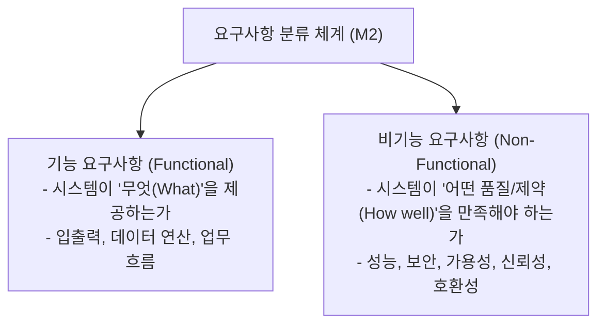

## 1. 출제 유형 개요: 기능 vs 비기능 요구사항 판별

NCS M2(요구사항 분석)에서 가장 오답률이 높은 유형은 **"비기능적 제약조건을 기능처럼 포장한 보기"**를 골라내지 못하는 것입니다.

---

## 2. 기능 vs 비기능 요구사항 핵심 대조표

| 비교 축 | 기능 요구사항 (Functional) | 비기능 요구사항 (Non-Functional) |
| :--- | :--- | :--- |
| **핵심 질문** | "시스템이 **어떤 서비스나 연산**을 수행하는가?" | "시스템이 **어떤 제약과 품질 기준**으로 동작하는가?" |
| **명세 내용** | 비즈니스 로직, 데이터베이스 CRUD, 화면 인터페이스, 알림 전송 | 응답 시간, 동시 처리량, 24시간 가용성, 암호화 알고리즘, 규제 준수 |
| **대표 서술 동사** | ~를 등록한다, ~를 조회한다, ~를 계산한다, ~를 전송한다 | ~이내에 응답해야 한다, ~를 보장해야 한다, ~규격을 준수해야 한다 |

### 기출 킬러 예시로 보는 1:1 대조:
1. **[기능]**: *"사용자가 결제 완료 시 주문 상세 내역과 영수증 PDF를 이메일로 발송해야 한다."* (서비스 행위)
2. **[비기능 (성능)]**: *"동시 접속자 10,000명 환경에서 검색 결과는 2초 이내에 반환되어야 한다."* (성능 지표)
3. **[비기능 (보안)]**: *"사용자의 비밀번호와 주민등록번호는 단방향 해시 및 AES-256으로 암호화하여 저장해야 한다."* (보안 제약)
4. **[비기능 (가용성)]**: *"시스템은 연간 99.99% 이상의 고가용성을 유지해야 한다."* (품질 속성)

---

## 3. 실전 기출 정밀 해설 (대표 2선)

### Q1. 비기능 요구사항 식별형 (2020 국가직 7급)
> **Q. 다음 중 비기능적 요구사항에 해당하는 것은?**  
> ① 금융 거래 시 거래 내역을 저장하고 영수증을 발행해야 한다.  
> ② 시스템은 초당 500건 이상의 트랜잭션을 처리할 수 있어야 한다.  
> ③ 관리자는 회원의 권한을 수정하고 탈퇴시킬 수 있어야 한다.  
> ④ 시스템은 회원의 생년월일을 기준으로 적합한 보험 상품을 추천해야 한다.  
> **공인 정답: ②**  
> **해설**: 초당 트랜잭션 처리량(TPS)과 같은 처리 속도/성능에 대한 기준은 **비기능 요구사항**입니다. ①, ③, ④는 시스템이 제공하는 구체적인 서비스 기능입니다.

### Q2. 유스케이스 명세서 품질 항목 오류형 (2022 국가직 7급)
> **Q. 유스케이스 명세서를 구성하는 항목에 대한 설명으로 옳지 않은 것은?**  
> ① 개요는 유스케이스가 제공하는 기능을 나타내며 사용자 액터까지 표현해야 한다.  
> ② 이벤트 흐름(시나리오)은 유스케이스 기능에 대한 액터와 시스템 간의 대화이다.  
> ③ 기능 요구사항은 성능, 신뢰성, 보안성, 가용성 등 여러 요구 품질 요소를 나타낸다.  
> ④ 후행 조건은 유스케이스의 수행 완료 후에 만족되어야 하는 상태나 수치의 바뀐 모습이다.  
> **공인 정답: ③**  
> **해설**: 성능, 신뢰성, 보안성, 가용성은 '기능 요구사항'이 아니라 **'비기능 요구사항(품질 속성)'**입니다.
