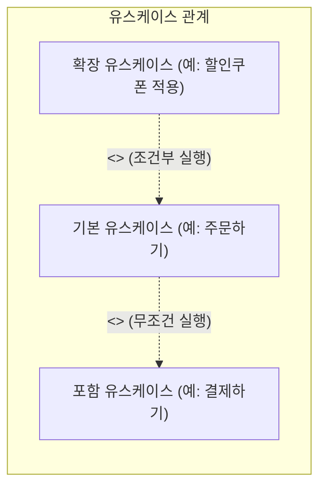

## 1. 출제 유형 개요: 유스케이스 관계와 자료흐름도(DFD)

유스케이스 다이어그램에서는 **화살표의 방향성과 필수성(`<<include>>` vs `<<extend>>`)**을 묻는 문제가 핵심이며, 구조적 분석 도구인 **자료흐름도(DFD)의 4대 요소 기호 짝짓기**가 콤팩트하게 출제됩니다.

---

## 2. 유스케이스 관계: `<<include>>` vs `<<extend>>` 완벽 구별법

| 관계 | 실행 필수성 | 화살표 방향 (절대 주의!) | 실무 및 기출 대표 사례 |
| :---: | :---: | :---: | :--- |
| **포함 관계 (`<<include>>`)** | **100% 필수** (기준 유스케이스 실행 시 무조건 함께 수행) | **기준 유스케이스 → 포함된 유스케이스** (기준이 포함 대상을 가리킴) | - `[글 작성]` 시 `[로그인]` - `[계좌 이체]` 시 `[본인 인증]` |
| **확장 관계 (`<<extend>>`)** | **조건부 선택** (특정 확장점 이벤트가 발생할 때만 부가 수행) | **확장 유스케이스 → 기준 유스케이스** (**확장하는 쪽에서 기준을 가리킴!**) | - `[결제]` 시 `[포인트 사용]` - `[파일 전송]` 중 오류 시 `[재전송]` |

> **[화살표 방향 암기 비법]**  
> - `include`: 기준이 "너(포함) 꼭 데려갈게" 하고 가리킴 (→)  
> - `extend`: 부가 기능이 "내가 너(기준)를 확장해 줄게" 하고 기준을 가리킴 (→)

---

## 3. DFD (자료흐름도) 4대 구성 요소 표기법

| 요소 | 기능 및 의미 | Yourdon/DeMarco 표기법 | Gane/Sarson 표기법 |
| :--- | :--- | :---: | :---: |
| **프로세스 (Process)** | 입력을 출력으로 변환하는 연산 처리 | **원 (Circle)** | 모서리가 둥근 사각형 |
| **자료 흐름 (Data Flow)** | 데이터가 이동하는 경로 및 방향 | **화살표 (Arrow)** | 화살표 (Arrow) |
| **자료 저장소 (Data Store)** | 데이터가 머무르는 물리적/논리적 저장소 (DB, 파일) | **평행선 (Open Rectangle)** | 한쪽이 트인 직사각형 |
| **단말 / 외부 엔티티 (Terminator)** | 시스템 외부의 데이터 발생지 및 도착지 | **사각형 (Square)** | 이중 사각형 |

---

## 4. 실전 기출 정밀 해설 (대표 2선)

### Q1. 유스케이스 다이어그램 설명 오류형 (2022 국가직 7급)
> **Q. 유스케이스 다이어그램에 대한 설명으로 옳지 않은 것은?**  
> ① 시스템 외부의 액터들은 서로 관계를 형성하지 않는다.  
> ② 시스템과 상호작용하는 외부 시스템은 액터로 표현한다.  
> ③ 유스케이스들의 공통 호출 서비스는 `<<include>>` 관계로 유스케이스를 구성한다.  
> ④ 유스케이스들의 선택적 서비스는 `<<extend>>` 관계로 유스케이스를 구성한다.  
> **공인 정답: ①**  
> **해설**: 시스템 외부의 액터들 간에도 **일반화(Generalization) 관계(상속)**를 형성할 수 있습니다. (예: '관리자' 액터는 '일반 사용자' 액터의 모든 권한을 상속받는 일반화 관계 형성 가능)

### Q2. DFD 표기 형태 오류형 (정보처리기사)
> **Q. 자료흐름도(DFD)의 각 요소별 표기 형태의 연결이 옳지 않은 것은? (Yourdon/DeMarco)**  
> ① Process - 원(Circle)  
> ② Data Flow - 화살표(Arrow)  
> ③ Data Store - 삼각형(Triangle)  
> ④ External Entity - 사각형(Square)  
> **공인 정답: ③** (자료 저장소는 평행선 또는 한쪽이 열린 직사각형으로 표기합니다.)
