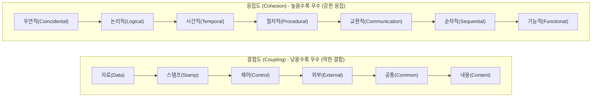

## 1. 출제 유형 개요: 모듈 독립성 (Coupling vs Cohesion)

소프트웨어 설계 원칙인 **"낮은 결합도(Low Coupling), 높은 응집도(High Cohesion)"**를 기반으로, 단계별 서열 순서를 묻는 문항과 실제 함수 코드 스니펫을 보고 결합도 종류를 맞히는 문제가 매년 출제됩니다.



---

## 2. 결합도 6단계 암기 공식: "자 - 스 - 제 - 외 - 공 - 내" (약함 $\rightarrow$ 강함)

| 순위 | 결합도 명칭 | 데이터 교환 방식 | 기출 판별 시그니처 |
| :---: | :--- | :--- | :--- |
| **1 (최우수)** | **자료 (Data)** | 단일 원시 값(int, float 등) 전달 | 파라미터로 단순 값만 교환, 모듈 독립성 최고 |
| **2** | **스탬프 (Stamp)** | 배열, 구조체, 객체 레퍼런스 전달 | 모듈에 필요하지 않은 필드까지 함께 노출됨 |
| **3** | **제어 (Control)** | 제어 플래그(Flag), 분기 신호 전달 | 호출 측이 **호출받은 모듈의 내부 분기 로직을 직접 결정** |
| **4** | **외부 (External)** | 외부 프로토콜, 통신 인터페이스 공유 | 외부 시스템 포맷이나 통신 장비에 종속됨 |
| **5** | **공통 (Common)** | 전역 변수(Global Variable) 영역 공유 | 여러 모듈이 동일한 전역 메모리를 직접 읽고 수정 |
| **6 (최악)** | **내용 (Content)** | 타 모듈의 내부 코드, 라벨 직접 점프 | 다른 모듈의 내부 변수나 메모리 영역을 직접 수정 |

---

## 3. 응집도 7단계 암기 공식: "우 - 논 - 시 - 절 - 교 - 순 - 기" (약함 $\rightarrow$ 강함)

- **기능적 (Functional) [최우수]**: 모듈 내 모든 요소가 **오직 하나의 단일 목적**만을 수행 (`Math.sqrt()`).
- **순차적 (Sequential)**: 한 요소의 **출력 데이터가 다음 요소의 입력 데이터**로 직결됨.
- **교환적 / 통신적 (Communication)**: **동일한 입력 자료**를 바탕으로 서로 다른 출력을 도출함.
- **절차적 (Procedural)**: 정해진 순서대로 실행되지만 요소 간 데이터 연결은 없음.
- **시간적 (Temporal)**: 특정 시점(초기화 `init()`, 종료 `dispose()`)에 함께 수행되어야 할 기능들을 묶음.
- **논리적 (Logical)**: 비슷한 성격의 작업(예: 모든 입출력 처리 기능)을 하나의 모듈에 모아둠.
- **우연적 (Coincidental) [최악]**: 아무런 논리적 연관 없이 무작위로 묶여 있는 상태.

---

## 4. 실전 기출 정밀 해설 (대표 2선)

### Q1. 제어 결합도 C언어 코드 판별형 (2022 국가직 7급)
> **Q. 다음 두 함수 A()와 B() 사이에 형성되는 결합도로 옳은 것은?**  
> ```c
> int A() {
>     int a;
>     ...
>     B(a);
>     ...
> }
> int B(int x) {
>     ...
>     if (x > 0) /* send data */
>     else       /* receive data */
> }
> ```  
> ① 내용 결합 ② 자료 결합 ③ 스탬프 결합 ④ 제어 결합  
> **공인 정답: ④ 제어 결합**  
> **해설**: 함수 B 내부에서 넘겨받은 매개변수 `x`의 부호(`x > 0`)에 따라 데이터 송신(send) 또는 수신(receive)의 처리 흐름을 분기하고 있습니다. 파라미터가 단순 데이터가 아니라 **모듈의 실행 제어 플래그** 역할을 하므로 **제어 결합도(Control Coupling)**입니다.

### Q2. 결합도 순서 배열형 (2020 국가직 7급)
> **Q. 소프트웨어 설계 시 결합도가 낮은(우수한) 것부터 순서대로 바르게 나열한 것은?**  
> ① 자료 $\rightarrow$ 스탬프 $\rightarrow$ 제어 $\rightarrow$ 외부 $\rightarrow$ 공통 $\rightarrow$ 내용  
> ② 내용 $\rightarrow$ 공통 $\rightarrow$ 외부 $\rightarrow$ 제어 $\rightarrow$ 스탬프 $\rightarrow$ 자료  
> ③ 자료 $\rightarrow$ 제어 $\rightarrow$ 스탬프 $\rightarrow$ 공통 $\rightarrow$ 외부 $\rightarrow$ 내용  
> ④ 내용 $\rightarrow$ 외부 $\rightarrow$ 공통 $\rightarrow$ 제어 $\rightarrow$ 스탬프 $\rightarrow$ 자료  
> **공인 정답: ①** ('자스제외공내' 암기 공식으로 3초 만에 득점)
