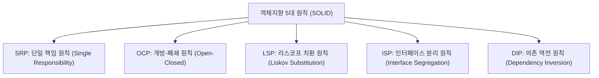

## 1. 출제 유형 개요: SOLID 설계 원칙의 실전 판별

NCS M3 객체지향 영역에서는 로버트 마틴(Robert C. Martin)의 **SOLID 5대 원칙의 영문/한글 명칭 정의**와 함께, **원칙을 위반한 클래스 다이어그램이나 코드 스니펫**을 주고 위반된 원칙을 고르는 문제가 집중 출제됩니다.

---

## 2. SOLID 5대 원칙별 위반 신호(Code Smell) & 리팩터링 매핑표

| 원칙 | 핵심 정의 | 위반 신호 (코드에서 발견되는 악취) | 해결 리팩터링 방향 |
| :---: | :--- | :--- | :--- |
| **SRP** | 클래스는 **단 하나의 변경 이유**만 가져야 함 | 한 클래스에 비즈니스 연산, DB 저장(`save()`), UI 출력(`print()`)이 함께 존재 | 역할별 분리: `PayCalculator`, `PayRepository`, `PayPrinter` |
| **OCP** | **확장에는 열려 있고, 수정에는 닫혀** 있어야 함 | 새로운 유형(예: VIP 할인) 추가 시 기존 `if-else` 또는 `switch` 문을 계속 뜯어고침 | 할인 인터페이스 도입 후 다형성(Polymorphism)을 통해 새 클래스 추가 |
| **LSP** | **서브타입은 언제나 슈퍼타입을 대체**할 수 있어야 함 | 자식 클래스 메서드에서 `throw new UnsupportedOperationException()`을 던지거나 부모의 불변식을 파괴 | 잘못된 상속 제거, 합성(Composition) 사용 또는 인터페이스 분리 |
| **ISP** | 클라이언트는 **자신이 사용하지 않는 메서드에 의존하지 않아야** 함 | 인터페이스 하나에 메서드가 20개라 특정 구현체가 필요 없는 메서드를 빈 껍데기(`{}`)로 둠 | 인터페이스 분할 (작고 구체적인 인터페이스 여러 개로 쪼갬) |
| **DIP** | **고수준 모듈은 저수준 모듈에 의존하면 안 되며 추상화에 의존** | Service 클래스가 구체적인 DB 구현체 `new MySQLRepository()`를 직접 생성하여 결합 | 인터페이스 `Repository`에 의존하고, 구체 클래스는 외부에서 주입(DI)받음 |

---

## 3. 실전 기출 정밀 해설 (대표 2선)

### Q1. 클래스 설계 원칙 판별형 (2022 국가직 7급)
> **Q. 다음 클래스 다이어그램은 객체지향 설계에서 한 대학의 학과별 기말고사 평균 점수를 계산하기 위해 특정 원칙을 적용한 사례이다. 해당 설계 원칙으로 옳은 것은?**  
> (기존: `학과평균점수` 클래스가 학생 정보 파싱, 과목별 합산, 성적 출력까지 전부 담당 $\rightarrow$ 개선: `점수계산기`, `학생성적저장소`, `성적출력기`로 분할)  
> ① 개방 폐쇄의 원칙 (OCP)  
> ② 의존 관계 역전의 원칙 (DIP)  
> ③ 인터페이스 분리의 원칙 (ISP)  
> ④ 단일 책임 원칙 (SRP)  
> **공인 정답: ④ 단일 책임 원칙 (SRP)**  
> **해설**: 한 클래스가 부담하던 복수의 책임(계산, 저장, 출력)을 분리하여 각각 단 하나의 변경 이유만을 가지도록 재설계한 것은 **단일 책임 원칙(Single Responsibility Principle)**입니다.

### Q2. 클래스 설계 원칙 바른 설명형 (정보처리기사)
> **Q. 클래스 설계 원칙에 대한 설명으로 가장 옳은 것은?**  
> ① 단일 책임 원칙은 하나의 클래스가 여러 개의 책임을 완벽히 수행하도록 하는 것이다.  
> ② 개방 폐쇄 원칙은 기능 확장을 위해서 기존 코드를 직접 수정하는 것을 권장한다.  
> ③ 리스코프 치환 원칙은 자식 클래스는 최소한 자신의 부모 클래스에서 가능한 행위는 수행할 수 있어야 함을 의미한다.  
> ④ 의존 역전 원칙은 구체 클래스가 다른 구체 클래스에 직접 의존하도록 강제하는 것이다.  
> **공인 정답: ③**  
> **해설**: 리스코프 치환 원칙(LSP)은 상위 타입의 객체를 하위 타입의 객체로 치환하더라도 프로그램의 정확성이 깨지지 않아야 함을 뜻합니다.
