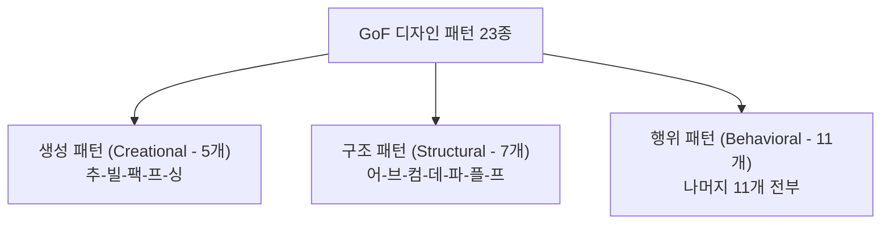

## 1. 출제 유형 개요: GoF 디자인 패턴 23종

디자인 패턴은 시험에 **"어떤 범주에 속하는가?(개수 세기/분류)"**와 **"비슷해 보이는 두 패턴의 설계 의도 차이점"**이라는 명확한 2가지 출제 공식이 존재합니다.

---

## 2. 23종 패턴 초고속 암기 공식

### 2.1 생성 패턴 (5개): "추 - 빌 - 팩 - 프 - 싱"
- **추**상 팩토리 (Abstract Factory)
- **빌**더 (Builder)
- **팩**토리 메서드 (Factory Method)
- **프**로토타입 (Prototype)
- **싱**글톤 (Singleton)

### 2.2 구조 패턴 (7개): "어 - 브 - 컴 - 데 - 파 - 플 - 프"
- **어**댑터 (Adapter)
- **브**릿지 (Bridge)
- **컴**포지트 (Composite)
- **데**코레이터 (Decorator)
- **파**사드 (Facade)
- **플**라이웨이트 (Flyweight)
- **프**록시 (Proxy)

### 2.3 행위 패턴 (11개): 나머지 전부
- 책임 연쇄(Chain of Resp.), 커맨드(Command), 인터프리터(Interpreter), 이터레이터(Iterator), 중재자(Mediator), 메멘토(Memento), 옵저버(Observer), 상태(State), 전략(Strategy), 템플릿 메서드(Template Method), 비지터(Visitor)

---

## 3. 헷갈리기 쉬운 쌍둥이 패턴 핵심 대조표

| 비교 쌍 | 패턴 A | 패턴 B | 시험 판별 핵심 차이 (Keyword) |
| :--- | :--- | :--- | :--- |
| **인터페이스 호환 vs 독립 확장** | **Adapter** | **Bridge** | **Adapter**: 이미 존재하는 호환되지 않는 인터페이스를 변환(적응). **Bridge**: 구현(Implementation)과 추상화(Abstraction)를 분리하여 독립 확장. |
| **기능 장식 vs 접근 제어** | **Decorator** | **Proxy** | **Decorator**: 객체에 동적으로 새로운 책임/기능을 덧붙임(장식). **Proxy**: 실제 객체에 대한 접근을 제어(가상화, 캐싱, 보안 권한 대리). |
| **알고리즘 교체 vs 뼈대 유지** | **Strategy** | **Template Method** | **Strategy**: 알고리즘 자체를 인터페이스로 캡슐화하여 런타임에 통째로 교체. **Template Method**: 상위 클래스에서 알고리즘의 골격(템플릿)을 정의하고 세부 단계만 하위에서 오버라이딩. |

---

## 4. 실전 기출 정밀 해설 (대표 2선)

### Q1. 패턴 분류 및 개수 계산형 (2022 국가직 7급)
> **Q. 다음 디자인 패턴들을 GoF 패턴 분류에 따라 구분하였을 때, 생성 패턴, 구조 패턴, 행위 패턴의 개수를 순서대로 바르게 나열한 것은?**  
> 
> > Abstract Factory, Adapter, Bridge, Builder, Composite, Decorator, Iterator, Mediator, Observer, Prototype, Proxy, Singleton, Strategy, Visitor  
> 
> ① 3, 5, 6  
> ② 4, 5, 5  
> ③ 5, 3, 6  
> ④ 6, 4, 4  
> **공인 정답: ② (4, 5, 5)**  
> **해설**:  
> 1. 생성 패턴(추빌팩프싱): Abstract Factory, Builder, Prototype, Singleton = **4개**  
> 2. 구조 패턴(어브컴데파플프): Adapter, Bridge, Composite, Decorator, Proxy = **5개**  
> 3. 행위 패턴(나머지): Iterator, Mediator, Observer, Strategy, Visitor = **5개**

### Q2. 구조 패턴 판별형 (정보처리기사)
> **Q. GoF 디자인 패턴 중 구조(Structural) 패턴에 속하지 않는 것은?**  
> ① Adapter ② Bridge ③ Visitor ④ Facade  
> **공인 정답: ③ Visitor** (Visitor는 행위 패턴입니다.)
