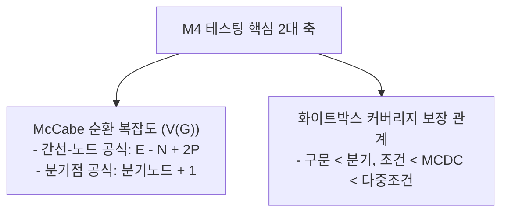
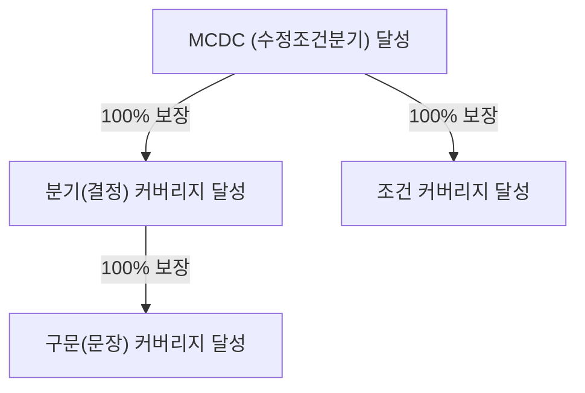

## 1. 출제 유형 개요: 순환 복잡도와 화이트박스 커버리지

NCS M4 테스팅 영역에서 가장 점수 변별력이 높은 파트는 **순환 복잡도 수치 계산**과 **테스트 커버리지 간의 포함 관계 명제 진위 판별**입니다.

---

## 2. McCabe 순환 복잡도 (Cyclomatic Complexity) 계산 3법

독립적인 기본 경로(Basis Path)의 수를 구하는 3가지 공식입니다. 문제 조건에 맞춰 가장 빠른 공식을 적용합니다:

| 공식 번호 | 공식 명칭 | 수식 | 적용 상황 |
| :---: | :--- | :--- | :--- |
| **공식 1** | **간선-노드 기본 공식** | $$V(G) = E - N + 2P$$ | 그래프의 간선($E$)과 노드($N$) 수가 직접 제시되었을 때 |
| **공식 2** | **분기 노드 공식 (초고속)** | $$V(G) = \text{조건 분기문(Predicate Nodes)} + 1$$ | 코드(`if`, `while`, `for`)나 분기점 노드 개수가 눈에 보일 때 |
| **공식 3** | **닫힌 영역 공식** | $$V(G) = \text{닫힌 영역(Region)의 개수} + 1$$ | 평면 그래프의 둘러싸인 면적 개수를 셀 수 있을 때 |

> **[주의: 복잡도 정의 오답 함정]**  
> *"순환 복잡도는 각 모듈의 fan-out(제어도)을 측정하는 것이다?"* $\rightarrow$ **오답 X (제어 흐름 그래프의 독립 경로 수를 측정합니다)**

---

## 3. 화이트박스 커버리지 4단계 상호 보장 관계 (시험 절대 공식)

1. **구문 커버리지 (Statement)**: 코드의 모든 실행 가능한 문장이 적어도 한 번은 실행됨.
2. **분기 커버리지 (Branch/Decision)**: 전체 조건식의 결과가 참(True)과 거짓(False)을 적어도 한 번씩 수행함.
3. **조건 커버리지 (Condition)**: 전체 조건식 내부의 개별 조건식들이 각각 참/거짓을 적어도 한 번씩 가짐.
4. **수정 조건/분기 커버리지 (MC/DC)**: 각 개별 조건식이 다른 조건식에 영향받지 않고 **전체 결과에 독립적으로 영향을 미치는** 조합을 검증.

### 시험에 나오는 3대 판별 명제:
- **[거짓]** 분기 커버리지를 달성하면 조건 커버리지를 달성한다. (전체 결과만 참/거짓이면 개별 조건은 한쪽으로 쏠릴 수 있음)
- **[거짓]** 조건 커버리지를 달성하면 분기 커버리지를 달성한다. (개별 조건은 뒤집혔으나 전체 평가는 계속 참일 수 있음)
- **[참]** **MCDC를 달성하면 분기 커버리지와 조건 커버리지를 모두 달성한다.**

---

## 4. 실전 기출 정밀 해설 (대표 2선)

### Q1. 화이트박스 커버리지 설명 옳은 것형 (2022 국가직 7급)
> **Q. 화이트박스 테스트 커버리지에 대한 설명으로 옳은 것은?**  
> ① 문장 커버리지는 입력 데이터가 미리 정의한 유형에 적합한지를 검증하는 방법이다.  
> ② 동일한 프로그램에 대해 분기 커버리지를 달성하면 조건 커버리지를 달성한다.  
> ③ 동일한 프로그램에 대해 조건 커버리지를 달성하면 분기 커버리지를 달성한다.  
> ④ 동일한 프로그램에 대해 수정조건분기 커버리지(MCDC)를 달성하면 조건 커버리지를 달성한다.  
> **공인 정답: ④**  
> **해설**: 분기와 조건은 서로를 보장하지 못합니다. 그러나 MCDC는 개별 조건식의 독립성을 엄격히 입증하므로 **조건 커버리지와 분기 커버리지를 모두 만족**합니다.

### Q2. 순환 복잡도 개념 오류형 (2020 국가직 7급)
> **Q. T. McCabe의 순환 복잡도(Cyclomatic Complexity)에 대한 설명으로 옳지 않은 것은?**  
> ① 사이클로매틱 수는 각 모듈에 대한 제어도(fan-out)를 이용하여 측정한다.  
> ② 사이클로매틱 수는 코드 전체에서 독립적인 경로의 수를 선형적으로 측정한다.  
> ③ 그래프 이론을 기반으로 코드를 제어 흐름 그래프로 변환하여 계산한다.  
> ④ 원시코드의 구조적인 복잡성을 알아내는 측도이다.  
> **공인 정답: ①** (fan-out과는 무관합니다.)
