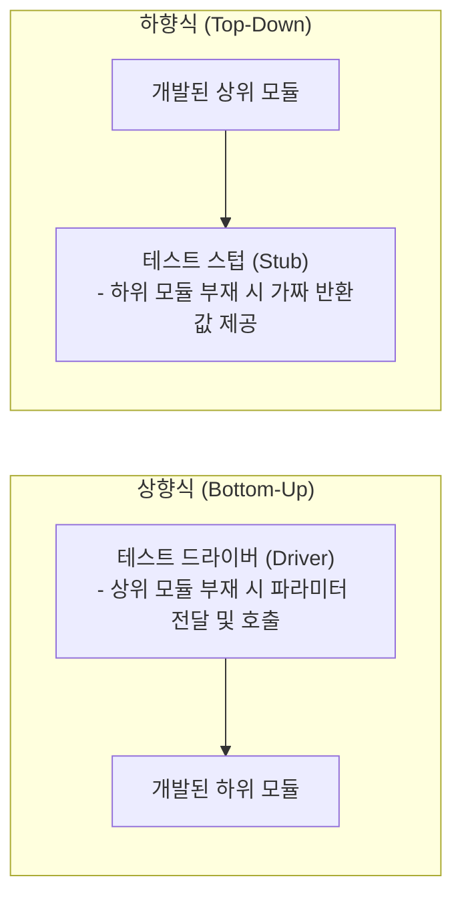

## 1. 출제 유형 개요: V-모델과 통합 테스팅 전략

통합 테스팅 영역에서는 **V-모델의 각 개발 단계가 어떤 테스트 레벨과 대응하는지**와 **상향식/하향식 통합 테스트에서 대리 모듈(Driver vs Stub)의 역할 구별**이 단골로 출제됩니다.

---

## 2. V-모델 개발 단계 $\leftrightarrow$ 테스트 레벨 1:1 대칭표

| 개발 단계 (왼쪽) | 대응하는 테스트 레벨 (오른쪽) | 주 검증 내용 |
| :--- | :--- | :--- |
| **요구사항 분석 (Requirements)** | **인수 테스트 (Acceptance)** & **시스템 테스트** | 비즈니스 요구사항 및 시스템 전체의 기능/비기능(성능, 보안) 충족 검증 |
| **시스템/아키텍처 설계 (Architecture)** | **통합 테스트 (Integration)** | 서브시스템 및 모듈 간의 인터페이스, 데이터 교환 규격 검증 |
| **상세 설계 (Detailed Design)** | **단위 테스트 (Unit)** | 개별 모듈/클래스 내부의 알고리즘과 로직 정확성 검증 |

---

## 3. 상향식 vs 하향식 통합 테스팅 초고속 판별

| 구분 | 상향식 통합 (Bottom-Up) | 하향식 통합 (Top-Down) |
| :--- | :--- | :--- |
| **진행 방향** | 최하위 모듈(Leaf) $\rightarrow$ 상위 모듈 결합 | 최상위 제어 모듈(Root) $\rightarrow$ 하위 모듈 결합 |
| **필요 도구** | **테스트 드라이버 (Test Driver)** | **테스트 스텁 (Test Stub)** |
| **도구의 역할** | 아직 개발되지 않은 **상위 모듈을 대행하여 하위 모듈을 호출하고 파라미터를 전달** | 아직 개발되지 않은 **하위 모듈을 대행하여 일시적으로 가짜 반환값을 제공** |
| **암기 공식** | **"상 - 드"** (상향식은 드라이버) | **"하 - 스"** (하향식은 스텁) |

---

## 4. 실전 기출 정밀 해설 (대표 2선)

### Q1. 가상 모듈 판별형 (정보처리기사)
> **Q. 단위 테스트에서 테스트 대상이 되는 하위 모듈을 호출하고, 파라미터를 전달하는 가상의 모듈로 상향식 테스트에 필요한 것은?**  
> ① 테스트 스텁(Stub) ② 테스트 슈트(Suite) ③ 테스트 케이스(Case) ④ 테스트 드라이버(Driver)  
> **공인 정답: ④ 테스트 드라이버(Driver)**  
> **초고속 판별**: "상향식 테스트", "하위 모듈을 호출하고 파라미터 전달" $\rightarrow$ **테스트 드라이버** 즉시 도출.

### Q2. 통합 테스트 방식 특징 비교형 (공무원 7급)
> **Q. 하향식 통합 테스트에 대한 설명으로 옳지 않은 것은?**  
> ① 깊이 우선(Depth-first) 또는 너비 우선(Breadth-first) 방식으로 통합할 수 있다.  
> ② 상위 모듈에서 하위 모듈 방향으로 제어 구조를 따라 통합한다.  
> ③ 하위 모듈의 인터페이스를 시험하기 위해 테스트 드라이버가 필요하다.  
> ④ 중요한 제어 로직과 사용자 인터페이스를 조기에 검증할 수 있다.  
> **공인 정답: ③**  
> **해설**: 하향식 통합 테스트에서는 아직 구현되지 않은 하위 모듈을 대신하는 **테스트 스텁(Stub)**이 필요합니다. 드라이버는 상향식입니다.
