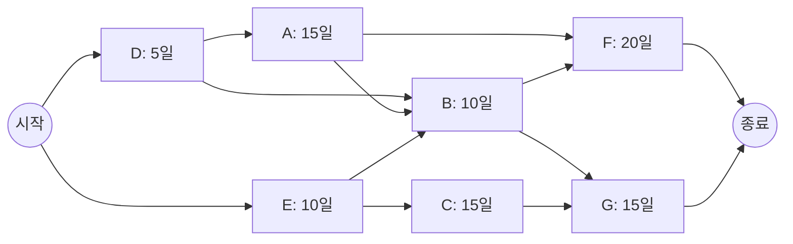

## 1. 출제 유형 개요: CPM 임계경로 계산

CPM(Critical Path Method) 문제는 네트워크 다이어그램이나 선행 작업 목록표를 제시하고 **"프로젝트 완료에 필요한 최소 시간"**을 계산하도록 요구합니다.

---

## 2. 임계경로(Critical Path)의 2대 수학적 절대 법칙

1. **최소 소요 시간 = 최장 경로의 길이 (The Longest Path)**:
   - 모든 선행 작업이 완료되어야 다음 작업을 시작할 수 있으므로, 시작 노드부터 종료 노드까지 걸리는 **경로 중 소요 기간의 합이 가장 큰 경로가 전체 프로젝트의 납기**를 결정합니다.
2. **임계경로 상 작업의 총 여유시간(Float / Slack Time)은 무조건 0**:
   - 이 경로 상의 작업이 하루라도 지연되면 프로젝트 전체 완료일이 하루 지연됩니다.
   - $\text{총 여유시간} = \text{가장 늦은 착수일(LS)} - \text{가장 빠른 착수일(ES)} = 0$

---

## 3. 선행 작업 테이블 실전 계산 풀이법

선행 작업이 복수로 얽혀 있을 때는 **"선행 작업들 중 가장 늦게 끝나는 완료 시간"**을 자신의 착수 시간으로 잡아야 합니다.

### 단계별 누적 완료 시간 계산 테크닉:
- **작업 X의 가장 빠른 시작일(ES)** = $\max(\text{모든 선행 작업들의 완료일(EF)})$
- **작업 X의 가장 빠른 완료일(EF)** = $\text{작업 X의 시작일(ES)} + \text{작업 X의 소요 기간}$

---

## 4. 실전 기출 정밀 해설 (대표 2선)

### Q1. CPM 네트워크 프로젝트 최소 완료 시간 계산 (2021 국가직 7급)
> **Q. 다음은 '갑' 프로젝트의 계획 단계에서 수립한 CPM 네트워크의 작업 목록표이다. '갑' 프로젝트 완료에 필요한 최소 시간은?**  
> 
> | 작업 | 선행작업 | 소요기간(일) |
> | :---: | :---: | :---: |
> | **A** | D | 15 |
> | **B** | A, D, E | 10 |
> | **C** | E | 15 |
> | **D** | - | 5 |
> | **E** | - | 10 |
> | **F** | A, B | 20 |
> | **G** | B, C | 15 |
> 
> ① 40일 ② 45일 ③ 50일 ④ 90일  
> **공인 정답: ③ 50일**  
> 
> **[초정밀 풀이 과정]**:  
> 1. 시작 작업: D(5일), E(10일)
> 2. 작업 A: 선행 D(5) → A 완료 = $5 + 15 = \mathbf{20\text{일}}$
> 3. 작업 C: 선행 E(10) → C 완료 = $10 + 15 = \mathbf{25\text{일}}$
> 4. 작업 B: 선행 A(20), D(5), E(10) → $\max(20, 5, 10) = 20\text{일}$에 시작! → B 완료 = $20 + 10 = \mathbf{30\text{일}}$
> 5. 작업 F: 선행 A(20), B(30) → $\max(20, 30) = 30\text{일}$에 시작! → F 완료 = $30 + 20 = \mathbf{50\text{일}}$
> 6. 작업 G: 선행 B(30), C(25) → $\max(30, 25) = 30\text{일}$에 시작! → G 완료 = $30 + 15 = \mathbf{45\text{일}}$
> 7. 전체 완료일: $\max(\text{F 완료: 50}, \text{G 완료: 45}) = \mathbf{50\text{일}}$!

### Q2. 임계경로 개념 진위 판별형 (정보처리기사)
> **Q. CPM 네트워크에서 임계경로(Critical Path)에 대한 설명으로 옳은 것은?**  
> ① 임계경로 상에 있는 작업들은 여유시간이 충분하다.  
> ② 시작부터 종료까지의 경로 중 소요 기간이 가장 짧은 경로이다.  
> ③ 임계경로 상의 어떤 작업이라도 지연되면 전체 프로젝트 기간이 연장된다.  
> ④ 임계경로는 비용을 최소화하기 위한 자원 할당 경로이다.  
> **공인 정답: ③** (임계경로 상 작업의 지연은 프로젝트 전체 지연으로 직결됩니다.)
