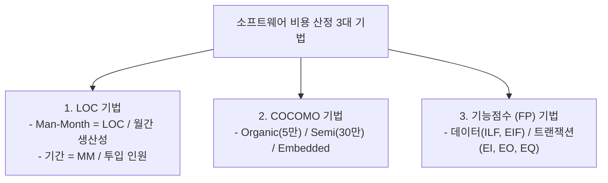

## 1. 출제 유형 개요: 정량적 비용 산정 공식

비용 산정 영역에서는 **원시 코드 라인 수(LOC)를 기반으로 노력(MM) 및 개발 기간을 계산하는 수식 문항**과 **보헴의 COCOMO 모델 규모별 3대 모드 짝짓기**가 단골로 출제됩니다.

---

## 2. LOC 기반 Man-Month(노력) 및 개발 기간 공식

- **총 노력 (Man-Month)**:
  $$\text{총 노력(MM)} = \frac{\text{예측 총 LOC}}{\text{프로그래머 월간 생산성(LOC/월)}}$$
- **개발 기간 (Months)**:
  $$\text{개발 기간} = \frac{\text{총 노력(MM)}}{\text{투입 프로그래머 수}}$$

### 추가 인력 투입(중도 투입) 함정 계산 테크닉:
개발 도중 추가 인력이 투입되는 경우, **"추가 인원수 $\times$ 투입률(%) $\times$ 실제 잔여 투입 개월 수"**를 계산하여 기본 MM에 더해주어야 합니다.

---

## 3. COCOMO 모델의 3대 개발 유형 (규모별 기준)

| 개발 모드 | 프로젝트 규모 기준 | 시스템 성격 및 예시 |
| :--- | :--- | :--- |
| **유기적 모드 (Organic)** | **5만 라인(50 KDSI) 이하** | 사무 처리용, 소규모 팀의 익숙한 업무용 소프트웨어 개발 |
| **반분리 모드 (Semi-detached)** | **30만 라인(300 KDSI) 이하** | 트랜잭션 처리 시스템, 운영체제 유틸리티, 중규모 프로젝트 |
| **임베디드 모드 (Embedded)** | **30만 라인 초과 또는 극한 제약** | 하드웨어 제어 시스템, 항공/국방 시스템, 초고신뢰성 요구 시스템 |

---

## 4. 실전 기출 정밀 해설 (대표 2선)

### Q1. 개발 지연 추가 인력 투입 Man-Month 계산 (2022 국가직 7급)
> **Q. 소프트웨어의 총 개발 기간은 16개월이며, 처음 6명의 개발 인력이 100% 투입되었다. 개발 지연으로 11개월 시작 시점에 3명 중 2명은 100%, 1명은 50%를 추가 투입하여 개발이 완료되었다. 이 소프트웨어 개발에 투입된 총 MM(Man-Month)은?**  
> ① 111 MM ② 112 MM ③ 113 MM ④ 114 MM  
> **공인 정답: ① 111 MM**  
> 
> **[초정밀 풀이 과정]**:  
> 1. 초기 6명 인력의 16개월 투입량:  
>    $$6\text{명} \times 16\text{개월} = \mathbf{96\text{ MM}}$$  
> 2. 추가 인력의 실제 근무 기간:  
>    11개월 '시작 시점'부터 16개월 '종료'까지 = **총 6개월간 근무** (11, 12, 13, 14, 15, 16월)  
> 3. 추가 투입된 인력 환산:  
>    $$2\text{명}(100\%) + 1\text{명}(50\%) = 2.0 + 0.5 = \mathbf{2.5\text{명}}$$  
> 4. 추가 인력의 총 노력:  
>    $$2.5\text{명} \times 6\text{개월} = \mathbf{15\text{ MM}}$$  
> 5. 전체 총 MM 합산:  
>    $$96 + 15 = \mathbf{111\text{ MM}}$$!

### Q2. LOC 기반 개발 기간 계산형 (2021 국가직 7급)
> **Q. LOC 기법에 의해 예측된 프로젝트의 총 라인 수가 80,000 LOC이고, 투입 개발자 수는 8명, 개발자 1인의 월간 생산성이 500 LOC일 때, 총 개발 기간은?**  
> ① 10개월 ② 15개월 ③ 20개월 ④ 25개월  
> **공인 정답: ③ 20개월**  
> **해설**:  
> 1. 총 노력(MM) = $80,000 / 500 = 160\text{ MM}$  
> 2. 개발 기간 = $160\text{ MM} / 8\text{명} = \mathbf{20\text{개월}}$
