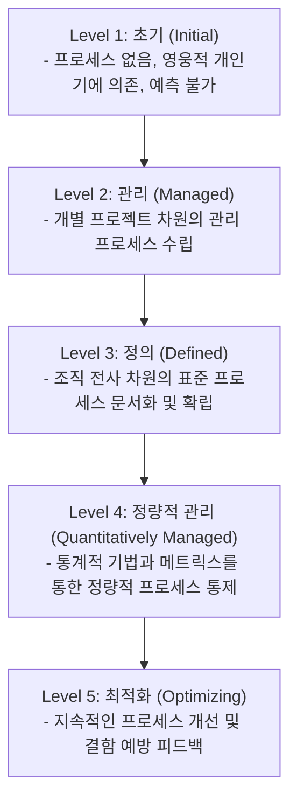

## 1. M7 소프트웨어 품질 및 프로세스 표준 출제 비중과 패턴

소프트웨어 품질과 프로세스 평가는 공무원 7급(전산직·데이터직)과 정보처리기사 소프트웨어공학 시험에서 **매회 1~2문항이 반드시 고정 출제되는 핵심 표준 영역**입니다.

이 단원은 장황한 서술보다 **국제 표준의 주특성-부특성 짝짓기 오류를 찾는 유형**과 **조직 성숙도 모델(CMMI/SPICE)의 단계별 명칭과 활동을 어긋나게 엮는 함정**이 정형화되어 있어, 핵심 키워드 판별 공식만 정확히 체득하면 0.5초 만에 정답을 골라낼 수 있는 전략적 단원입니다.

- **출제 비중**: **GRADE B (16문항, 전체 기출의 3.8%)**
- **3대 핵심 출제 축**:
  1. **ISO/IEC 25010 (구 9126) 8대 품질 주특성 & 부특성 매핑**: 기능 적합성, 신뢰성, 사용성, 성능 효율성, 유지보수성, 이식성, 호환성, 보안성
  2. **CMMI 5단계 성숙도 레벨 판별 공식 ('초-관-정-량-최')**: 레벨 2(프로젝트 차원) vs 레벨 3(조직 전사 차원) vs 레벨 4(정량적·통계적 통제) 구별
  3. **SPICE (ISO/IEC 15504) 6대 능력 레벨**: 0(불완전) $\rightarrow$ 1(수행) $\rightarrow$ 2(관리) $\rightarrow$ 3(확립) $\rightarrow$ 4(예측) $\rightarrow$ 5(최적화)

---

## 2. ISO/IEC 25010 (SQuaRE) 8대 제품 품질 주특기 족집게 비교표

소프트웨어 제품 품질 표준은 과거 **ISO/IEC 9126**(6대 주특성)에서 **ISO/IEC 25010 SQuaRE**(8대 주특성) 체계로 전면 개편되었습니다. 시험에서는 **특정 품질 요구사항이 주어졌을 때 어느 주특성/부특성에 해당하는지**, 혹은 **잘못 짝지어진 부특성을 찾는 문제**가 집중 출제됩니다.

> **공인 개념 체계**: ISO/IEC 25010 Systems and software engineering — Systems and software Quality Requirements and Evaluation (SQuaRE)  
> 📌 *참고 표준 출처*: [위키백과: ISO/IEC 9126](https://ko.wikipedia.org/wiki/ISO/IEC_9126) & [IT위키: ISO/IEC 25010](https://itwiki.kr/w/ISO/IEC_25010)

```text
[ISO/IEC 25010 8대 제품 품질 모델 구조]
  ├── 1. 기능 적합성 (Functional Suitability) : 완전성, 정확성, 적절성
  ├── 2. 신뢰성 (Reliability) : 성숙성, 결함 허용성, 회복성, 가용성
  ├── 3. 사용성 (Usability) : 적절성 인식(이해성), 학습 용이성, 조작 용이성, 사용자 오류 보호
  ├── 4. 성능 효율성 (Performance Efficiency) : 시간 반응성, 자원 활용성, 용량성
  ├── 5. 호환성 (Compatibility) : 공존성, 상호운용성
  ├── 6. 보안성 (Security) : 기밀성, 무결성, 부인방지, 책임성, 인증성
  ├── 7. 유지보수성 (Maintainability) : 모듈성, 재사용성, 분석성, 수정 용이성, 시험 용이성
  └── 8. 이식성 (Portability) : 적응성, 설치 용이성, 대체성
```

### 1) 8대 주특성 및 세부 부특성 기출 핵심 대조표

| 주특성 (Characteristic) | 정의 및 핵심 판별 기준 | 세부 부특성 (Sub-characteristics) | 시험에 자주 나오는 오답 짝짓기 함정 |
| :--- | :--- | :--- | :--- |
| **기능 적합성**<br>*(Functional Suitability)* | 명시된/묵시적 요구를 소프트웨어가 얼마나 온전히 만족하는가 | **기능 완전성, 기능 정확성, 기능 적절성** | "설치용이성, 적응성은 기능 적합성이다" (X $\rightarrow$ 이식성) |
| **신뢰성**<br>*(Reliability)* | 규정된 조건에서 규정된 기간 동안 성능 수준을 유지하는 능력 | **성숙성(Maturity), 결함 허용성(Fault Tolerance), 회복성(Recoverability), 가용성(Availability)** | "변경성, 시험용이성은 신뢰성이다" (X $\rightarrow$ 유지보수성)<br>"회복성은 사용성이다" (X $\rightarrow$ 신뢰성) |
| **사용성**<br>*(Usability)* | 사용자가 시스템을 이해하고 배우며 조작하기 쉬운 정도 | **적절성 인식(이해성), 학습 용이성, 조작 용이성, 사용자 인터페이스 미학, 접근성** | "결함 허용성은 사용성이다" (X $\rightarrow$ 신뢰성)<br>"성숙성은 사용성이다" (X $\rightarrow$ 신뢰성) |
| **성능 효율성**<br>*(Performance Efficiency)* | 사용된 자원의 양에 대비한 처리량 및 성능 수준 | **시간 반응성(응답/처리 시간), 자원 활용성(CPU/메모리 소비), 용량성** | "분석성은 효율성이다" (X $\rightarrow$ 유지보수성) |
| **호환성**<br>*(Compatibility)* | 동일한 환경에서 다른 제품과 정보를 교환하거나 환경을 공유하는 능력 | **공존성(Co-existence), 상호운용성(Interoperability)** | "이식성과 호환성은 동일한 개념이다" (X) |
| **보안성**<br>*(Security)* | 인가되지 않은 접근을 막고 데이터와 정보를 안전하게 보호하는 능력 | **기밀성, 무결성, 부인방지, 책임성, 인증성** | 보안성은 25010에서 독립 주특성으로 승격됨 |
| **유지보수성**<br>*(Maintainability)* | 소프트웨어의 결함을 고치거나 환경 변화에 맞춰 쉽게 수정할 수 있는 정도 | **모듈성, 재사용성, 분석성(Analysability), 수정 용이성(Modifiability), 시험 용이성(Testability)** | "회복성은 유지보수성이다" (X $\rightarrow$ 신뢰성)<br>"적응성은 유지보수성이다" (X $\rightarrow$ 이식성) |
| **이식성**<br>*(Portability)* | 다른 운영체제, 하드웨어, 소프트웨어 환경으로 얼마나 쉽게 옮겨갈 수 있는가 | **적응성(Adaptability), 설치 용이성(Installability), 대체성(Replaceability)** | "시험용이성은 이식성이다" (X $\rightarrow$ 유지보수성)<br>"부합성은 이식성이다" (X) |

---

## 3. CMMI 5단계 성숙도 모델 판별 공식: "초 - 관 - 정 - 량 - 최"

CMMI(Capability Maturity Model Integration)는 소프트웨어 개발 조직의 프로세스 능력과 성숙도를 평가하기 위한 모델입니다.

시험에서는 **단계별 명칭의 순서**와, 특히 **Level 2(관리)와 Level 3(정의), Level 4(정량적 관리)의 경계 차이점**을 묻는 문제가 반복 출제됩니다.



### 1) CMMI 단계별 기출 판별 시그니처

| 단계 | 공식 명칭 | 핵심 관점 및 평가 지표 (기출 시그니처) | 대표 오답 함정 |
| :---: | :--- | :--- | :--- |
| **Level 1** | **초기 (Initial)** | • 프로세스가 체계화되어 있지 않고 비공식적임<br>• 프로젝트 성공이 **개인의 영웅적 역량과 노력에 전적으로 의존**함<br>• 일정과 예산 초과가 빈번함 | "문서화된 프로세스가 조직 전체에 정착되어 있다" (X) |
| **Level 2** | **관리 (Managed)** | • **개별 프로젝트 단위**의 관리 체계가 수립됨<br>• 요구사항 관리, 프로젝트 계획 수립, 외주 관리, 형상 관리가 수행됨<br>• 유사 프로젝트 진행 시 이전 성공 사례를 반복(Repeatable)할 수 있음 | "조직 전사 차원의 표준 프로세스가 정립되어 있다" (X $\rightarrow$ Level 3) |
| **Level 3** | **정의 (Defined)** | • **조직 전체(전사 차원)의 표준 프로세스**가 공식 문서화되고 정립됨<br>• SEPG(Software Engineering Process Group)가 주도하여 전사 표준을 관리함<br>• 각 프로젝트는 전사 표준을 상황에 맞게 테일러링(Tailoring)하여 적용함 | "프로세스가 통계적·정량적으로 통제된다" (X $\rightarrow$ Level 4) |
| **Level 4** | **정량적 관리<br>(Quantitatively Managed)** | • 소프트웨어 프로세스와 산출물의 품질을 **정량적 측정 지표(Metrics)와 통계적 기법**으로 측정하고 제어함<br>• 프로세스 수행 결과를 정량적으로 예측 가능함 | "전사 표준 프로세스가 최초로 문서화된다" (X $\rightarrow$ Level 3) |
| **Level 5** | **최적화 (Optimizing)** | • 데이터 분석을 바탕으로 프로세스를 **지속적으로 개선(Continuous Process Improvement)**함<br>• 신기술 도입과 혁신적인 기법을 통해 결함을 사전에 예방함 | "개인 역량에 의존하여 프로젝트가 진행된다" (X $\rightarrow$ Level 1) |

> 💡 **[기출 판별 핵심: 레벨 2 vs 레벨 3 구별법]**  
> - **Level 2 (관리)**: 주체가 **"개별 프로젝트"**입니다. (각 프로젝트 매니저의 재량으로 관리됨)  
> - **Level 3 (정의)**: 주체가 **"조직/기업 전체 (전사 표준)"**입니다. 전사 표준 매뉴얼이 있고, 테일러링 지침이 제공됩니다.

---

## 4. SPICE (ISO/IEC 15504) 능력 수준 6단계 (Level 0 ~ 5)

SPICE(Software Process Improvement and Capability dEtermination)는 유럽 주도로 개발된 소프트웨어 프로세스 평가 및 개선 국제 표준(ISO/IEC 15504)입니다.

### 1) SPICE 6단계 능력 수준 비교

| 능력 수준 | 레벨 명칭 | 영문 명칭 | 기출 핵심 판별 기준 |
| :---: | :--- | :--- | :--- |
| **Level 0** | **불완전 (Incomplete)** | Incomplete | 프로세스가 구현되지 않았거나, 프로세스 목적을 달성하지 못한 상태 |
| **Level 1** | **수행 (Performed)** | Performed | 프로세스가 수행되어 작업 산출물이 산출되고 기본 목적을 달성함 |
| **Level 2** | **관리 (Managed)** | Managed | 작업 산출물이 계획·모니터링·조정되며 규정된 시간/자원 내에서 관리됨 |
| **Level 3** | **확립 (Established)** | Established | 표준화된 프로세스를 기반으로 조직 전체에 걸쳐 정의되고 구현됨 |
| **Level 4** | **예측 가능 (Predictable)** | Predictable | 프로세스가 **정량적 한계 내에서 지속적으로 실행되며 통계적으로 측정**됨 |
| **Level 5** | **최적화 (Optimizing)** | Optimizing | 비즈니스 목표 달성을 위해 프로세스가 지속적으로 개선되고 최적화됨 |

---

## 5. 핵심 판별 키워드 치트시트 (Cheatsheet)

시험 직전 지문의 키워드를 보고 0.5초 만에 정답을 판별하는 공식 치트시트입니다:

| 지문 키워드 / 시그니처 | 정답 판별 |
| :--- | :--- |
| *"결함 발생 시 규정된 성능 수준을 유지하고 정상 상태로 복구하는 능력"* | **신뢰성 (결함 허용성, 회복성)** |
| *"사용자가 소프트웨어의 기능을 쉽게 배우고 오작동 없이 편리하게 사용하는 정도"* | **사용성 (학습 용이성, 조작 용이성)** |
| *"오류 수정이나 기능 변경 시 수정이 쉽고 테스트하기 편한 정도"* | **유지보수성 (수정 용이성, 시험 용이성, 분석성)** |
| *"다양한 운영체제나 플랫폼 환경으로 쉽게 이전하여 동작시킬 수 있는 능력"* | **이식성 (적응성, 설치 용이성, 대체성)** |
| *"프로세스가 없고 개인의 영웅적 역량과 야근에 의존하는 단계"* | **CMMI Level 1 (초기 / Initial)** |
| *"개별 프로젝트 차원에서 요구사항 관리 및 비용·일정 통제가 이루어지는 단계"* | **CMMI Level 2 (관리 / Managed)** |
| *"조직 전사 차원의 표준 프로세스가 공식 문서화되고 테일러링되는 단계"* | **CMMI Level 3 (정의 / Defined)** |
| *"통계적 기법과 정량적 메트릭스를 적용하여 프로세스를 예측·통제하는 단계"* | **CMMI Level 4 (정량적 관리 / Quantitatively Managed)** |
| *"지속적인 프로세스 개선과 신기술 적용으로 결함을 선제 예방하는 단계"* | **CMMI Level 5 (최적화 / Optimizing)** |
| *"SPICE 능력 수준 중 프로세스가 정의된 표준 프로세스로 구현된 레벨"* | **SPICE Level 3 (확립 / Established)** |
| *"SPICE 능력 수준 중 통계적·정량적 기법으로 관리되는 레벨"* | **SPICE Level 4 (예측 가능 / Predictable)** |
