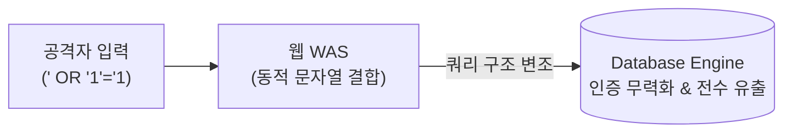
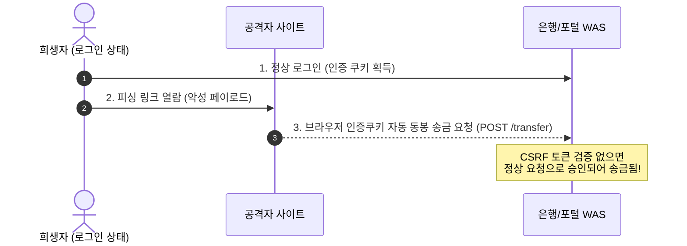

## 1. M8 시큐어코딩 & 구현 보안 출제 비중과 패턴

시큐어코딩(Secure Coding)과 구현 단계 보안은 공무원 7급(전산직·데이터직)과 정보처리기사 소프트웨어공학/소프트웨어개발 과목에서 **실제 코드 스니펫(Snippet)과 함께 반드시 출제되는 킬러 단원**입니다.

이 영역의 문제는 장황한 이론 암기보다 **행정안전부/KISA의 「SW 개발보안가이드」 7대 보안약점 분류**에 근거하여, **취약한 소스코드 예시를 제시하고 이를 해결하기 위한 안전한 방어 코드 시그니처(Signature)를 짝짓는 형태**가 지배적입니다.

- **출제 비중**: **GRADE B+ (공무원 7급 및 기사 필기/실기 고정 출제)**
- **3대 핵심 출제 축**:
  1. **3대 웹 취약점 원리 및 원천 방어 시그니처**:
     - **SQL Injection**: 동적 문자열 연결(`+`)의 취약성 vs 바인딩 파라미터(`PreparedStatement`)를 통한 구조적 분리
     - **XSS (크로스사이트 스크립팅)**: Stored / Reflected / DOM 기반 공격 vs 입출력 HTML Entity 인코딩 변환 & 쿠키 `HttpOnly`
     - **CSRF (사이트 간 요청 위조)**: 사용자 권한 도용 vs 일회용 CSRF Token 검증 및 SameSite 쿠키
  2. **동시성(Concurrency) 및 자원 관리 보안약점**:
     - **Race Condition (경쟁 상태)**: 상호배제(Mutex, `synchronized`) 미적용 시 발생하는 비동기 데이터 오염 방어
     - **자원 누수(Resource Leak)**: DB Connection / File IO 미해제 방어 (`try-with-resources`)
  3. **암호화 및 세션 안전성**:
     - 단방향 해시(SHA-256) + 솔팅(Salt) 적용, 대칭키(AES) vs 비대칭키(RSA), 세션 고정(Session Fixation) 방어

---

## 2. 행정안전부 SW 개발보안가이드 7대 보안약점 족집게 비교표

공공 소프트웨어 사업 및 국가직 7급 시험의 표준 레퍼런스는 행정안전부/KISA의 **7대 보안약점 기준**입니다. 시험에서는 특정 취약점이나 코드 예시가 주어졌을 때 **어느 보안약점 그룹에 속하는지 판별하는 문제**가 자주 나옵니다.

```text
[행정안전부 7대 SW 보안약점 체계]
  ├── 1. 입력데이터 검증 및 표현 : SQL Injection, XSS, CSRF, 경로 조작, 자원 삽입
  ├── 2. 보안기능 : 부적절한 인가, 취약한 암호화, 솔트 없는 해시, 패스워드 평문 저장
  ├── 3. 시간 및 상태 : 경쟁 상태(Race Condition), TOCTOU(검사 시점과 사용 시점 불일치)
  ├── 4. 에러처리 : 오류 메시지를 통한 정보 노출, 오류 상황 대응 부재
  ├── 5. 코드 오류 : 널 포인터 역참조(NPE), 부적절한 자원 해제(메모리/소켓 누수)
  ├── 6. 캡슐화 : 제거되지 않은 디버그 코드, 시스템 데이터 노출, 잘못된 세션 관리
  └── 7. API 오용 : DNS lookup 취약점, 취약한 API 호출
```

| 보안약점 분류 | 정의 및 핵심 판별 기준 | 대표적인 취약점 예시 | 시험 족집게 판별 키워드 |
| :--- | :--- | :--- | :--- |
| **1. 입력데이터 검증 및 표현** | 사용자/외부 입력값이 사전 검증 없이 쿼리나 명령어로 실행됨 | **SQL Injection, XSS, CSRF**, 경로 조작(Directory Traversal), 위험 파일 업로드 | `PreparedStatement`, `HTML Encoding`, `Whitelist 필터링` |
| **2. 보안기능** | 인증, 인가, 암호화, 권한 관리의 구현 결함 | 취약한 암호화 알고리즘(DES, MD5), 하드코딩된 비밀번호, 솔트(Salt) 없는 해시 | `AES-256`, `SHA-256 + Salt`, `PBKDF2`, `상세 에러 은폐` |
| **3. 시간 및 상태** | 다중 스레드/프로세스 환경에서 타이밍 및 상태 관리 결함 | **경쟁 상태(Race Condition)**, TOCTOU, 종료되지 않은 반복문 | `synchronized`, `상호배제(Mutex)`, `원자적 연산(Atomic)` |
| **4. 에러처리** | 예외 발생 시 시스템 내부 스택트레이스 노출 | 시스템 정보 노출(DB 스키마 노출), 빈 `catch` 블록(무시) | `사용자 친화적 공통 에러 페이지`, `로그 파일 분리` |
| **5. 코드 오류** | 개발자의 부주의로 인한 런타임 크래시 및 자원 고갈 | **Null Pointer Dereference (NPE)**, **부적절한 자원 해제** | `try-with-resources`, `null 체크`, `메모리 해제` |
| **6. 캡슐화** | 중요한 데이터나 기능을 외부에 불필요하게 노출 | Private 필드의 Public 게터 오용, 디버그용 코드 방치 | `방어적 복사(Defensive Copy)`, `디버깅 플래그 제거` |
| **7. API 오용** | 표준 API나 검증된 라이브러리의 잘못된 사용 | 취약한 난수 생성기(`Math.random()`), 잘못된 서명 검증 | `SecureRandom`, `표준 암호화 라이브러리` |

---

## 3. 3대 웹 취약점(SQL Injection·XSS·CSRF) 메커니즘과 방어 시그니처

### 1) SQL Injection (SQL 삽입 공격)

공격자가 사용자 입력 폼이나 URL 쿼리 파라미터에 조작된 SQL 구문을 주입하여, 백엔드 데이터베이스의 인증을 우회하거나 비인가 데이터를 유출/변조하는 공격입니다.



#### ❌ 취약한 코드 (동적 문자열 연결)
```java
// 입력값 id가 ' OR '1'='1' 일 경우 항상 참이 되어 전수 조회됨
String query = "SELECT * FROM users WHERE id = '" + userId + "' AND pw = '" + userPw + "'";
Statement stmt = conn.createStatement();
ResultSet rs = stmt.executeQuery(query);
```

#### ✅ 안전한 방어 코드 (PreparedStatement 바인딩)
```java
// SQL 문법 구조를 미리 컴파일하고, 입력값은 순수 리터럴(데이터)로만 취급
String query = "SELECT * FROM users WHERE id = ? AND pw = ?";
PreparedStatement pstmt = conn.prepareStatement(query);
pstmt.setString(1, userId);
pstmt.setString(2, userPw);
ResultSet rs = pstmt.executeQuery();
```

> **📌 시험 출제 포인트 (방어 우선순위)**:
> 1. **1순위 (원천 방어)**: `PreparedStatement` 및 ORM(MyBatis, JPA)의 파라미터 바인딩 (`#{id}`)
> 2. **2순위 (보조 방어)**: 입력값 특수문자 화이트리스트 검증
> 3. ⚠️ *오답 함정*: "에러 메시지를 은폐하거나 입력 길이를 제한하면 SQL Injection을 완전히 예방할 수 있다" (X $\rightarrow$ 원천 방어 불가능)

---

### 2) XSS (Cross-Site Scripting, 크로스사이트 스크립팅)

공격자가 작성한 악성 스크립트(`<script>`)가 웹 페이지에 포함되어, 해당 페이지를 열람하는 **다른 무고한 사용자의 웹 브라우저에서 실행**되도록 만드는 공격입니다.

| 유형 | 공격 경로 | 발생 위치 및 특징 |
| :--- | :--- | :--- |
| **저장형 XSS (Stored)** | 게시판 본문, 댓글 등 DB에 영구 저장 | 글을 읽는 모든 사용자가 피해를 입음 (파급력 가장 큼) |
| **반사형 XSS (Reflected)** | 검색어 URL 쿼리 파라미터에 스크립트 포함 | 공격 링크를 클릭한 특정 사용자에게 즉시 반사되어 실행 |
| **DOM 기반 XSS (DOM-based)** | 서버를 거치지 않고 브라우저 DOM 조작 | `document.write`, `innerHTML` 등을 취약하게 사용할 때 실행 |

#### ✅ 안전한 방어 시그니처
1. **HTML Entity 치환 (인코딩)**:
   - `<` $\rightarrow$ `&lt;`, `>` $\rightarrow$ `&gt;`, `&` $\rightarrow$ `&amp;`, `"` $\rightarrow$ `&quot;`, `'` $\rightarrow$ `&#x27;`
2. **쿠키 탈취 방지 (`HttpOnly`)**:
   - `Set-Cookie: SESSIONID=xyz; Secure; HttpOnly; SameSite=Lax`
   - 자바스크립트의 `document.cookie` 접근을 차단하여 세션 하이재킹 무력화
3. **CSP (Content Security Policy) 헤더 설정**:
   - `Content-Security-Policy: default-src 'self'; script-src 'self' https://trusted.cdn.com`

---

### 3) CSRF (Cross-Site Request Forgery, 사이트 간 요청 위조)

이미 로그인되어 인증된 세션(쿠키)을 보유한 사용자를 유인하여, 사용자가 모르는 사이에 **공격자가 의도한 비정상 요청(비밀번호 변경, 계좌 송금 등)을 해당 서버로 전송**하게 만드는 공격입니다.



#### ✅ 안전한 방어 시그니처
1. **CSRF Token 검증**:
   - 세션마다 고유하고 예측 불가능한 일회용 난수 토큰을 생성하여 폼 전송 시 동봉하고 서버에서 일치 여부 검증
2. **SameSite 쿠키 속성 적용**:
   - `SameSite=Strict` 또는 `SameSite=Lax` 설정으로 타 사이트에서 발생하는 크로스 사이트 요청 시 쿠키 전송 원천 차단
3. **중요 행위에 대한 재인증(CAPTCHA, 2차 비밀번호)** 요구

---

## 4. 동시성 오류(Race Condition)와 자원 관리 보안 패턴

### 1) 경쟁 상태 (Race Condition) & TOCTOU
- **원인**: 여러 스레드가 공유 자원(파일, static 변수, 계좌 잔액)에 동시에 접근하여 검사(Check) 시점과 사용(Use) 시점 사이에 다른 스레드가 값을 변경함 (Time of Check to Time of Use).
- **방어**: 임계 구역(Critical Section) 지정, `synchronized` 키워드, `ReentrantLock`, 트랜잭션 격리수준(Isolation Level) 상향.

### 2) 안전한 자원 해제 (Resource Leak 방지)
- **원인**: 파일 IO나 데이터베이스 Connection을 오픈한 후, 비즈니스 로직 도중 예외(Exception)가 발생하여 `close()`가 호출되지 않아 시스템 자원이 고갈됨.
- **방어**:
  ```java
  // Java 7+ try-with-resources: AutoCloseable 인터페이스 구현 객체 자동 해제
  try (Connection conn = dataSource.getConnection();
       PreparedStatement pstmt = conn.prepareStatement(sql)) {
      // 비즈니스 로직 수행 (예외 발생 시에도 안전하게 자동 close)
  } catch (SQLException e) {
      logger.error("DB 처리 중 에러 발생", e);
  }
  ```

---

## 5. 실전 기출 정밀 해설 (대표 2선)

### Q1. SQL Injection 공격의 특징과 원천 방어 (2021 국가직 7급 전산직)

> **Q. 웹 애플리케이션의 보안 취약점 중 SQL 삽입(SQL Injection) 공격에 대한 설명으로 가장 옳지 않은 것은?**  
> ① 동적 SQL을 생성할 때 사용자의 입력값이 쿼리문의 구조를 변조할 수 있는 취약점이다.  
> ② 파라미터화된 쿼리(Parameterized Query)를 사용하는 `PreparedStatement` 객체를 사용하면 효과적으로 방어할 수 있다.  
> ③ 웹 방화벽(WAF)을 설치하고 입력값 길이를 엄격히 제한하면 소스코드 수정 없이도 SQL 삽입 취약점을 완벽히 제거할 수 있다.  
> ④ 저장 프로시저(Stored Procedure)를 사용하더라도 프로시저 내부에서 문자열을 결합하여 동적 쿼리를 실행하면 SQL 삽입 공격에 취약할 수 있다.

- **정답**: **③**
- **정밀 해설**:
  - **오답 판별 (③)**: 웹 방화벽(WAF)이나 단순 길이 제한은 침입을 지연시키거나 알려진 패턴을 차단하는 **임시 완화책**일 뿐이며, 우회 기법(Blind SQL Injection, 인코딩 우회 등)이 존재하므로 소스코드 차원의 바인딩 파라미터화가 없으면 **취약점을 완벽히 제거할 수 없습니다.**
  - **정답 지문 검증**:
    - ①: 동적 쿼리 문자열 연결이 근본 원인입니다 (옳음).
    - ②: 쿼리 구문 컴파일 후 값만 바인딩하므로 가장 완벽한 방어책입니다 (옳음).
    - ④: 저장 프로시저 내부라도 `EXECUTE IMMEDIATE` 등으로 동적 결합을 하면 동일하게 취약합니다 (옳음).

---

### Q2. XSS와 CSRF의 공격 대상 및 방어 기법 비교 (정보처리기사 & 감리사)

> **Q. 웹 보안 취약점인 XSS(Cross-Site Scripting)와 CSRF(Cross-Site Request Forgery)에 대한 설명으로 가장 옳은 것은?**  
> ① XSS는 사용자의 권한을 도용하여 서버에 악의적인 트랜잭션을 요청하는 것이 주목적이다.  
> ② CSRF 공격을 방어하기 위해 모든 사용자 입력 폼의 특수문자를 HTML Entity로 치환 인코딩해야 한다.  
> ③ XSS 공격을 성공적으로 차단하면 해당 웹 애플리케이션은 CSRF 공격으로부터도 완전히 안전하다.  
> ④ 쿠키에 `SameSite` 속성을 설정하거나 요청마다 고유한 일회용 CSRF 토큰을 검증하면 CSRF 공격을 방어할 수 있다.

- **정답**: **④**
- **정밀 해설**:
  - **정답 검증 (④)**: CSRF는 사용자의 브라우저가 자동으로 동봉하는 인증 쿠키를 악용하므로, `SameSite` 속성으로 제3자 사이트에서의 쿠키 자동 전송을 차단하거나 서버가 발행한 일회용 토큰을 헤더/바디에서 검증하는 것이 정석 방어책입니다.
  - **함정 분석**:
    - ①: 사용자의 권한을 도용해 서버에 비정상 요청을 보내는 것은 **CSRF**입니다. XSS는 사용자의 브라우저에서 스크립트를 실행하여 세션 탈취, 피싱 폼 삽입, 악성코드 유포 등을 수행합니다.
    - ②: HTML Entity 치환은 **XSS**의 핵심 방어 기법입니다.
    - ③: XSS와 CSRF는 공격 메커니즘과 목적이 전혀 다른 취약점이므로, XSS를 방어했다고 해서 CSRF가 자동 방어되지 않습니다.

---

## 6. 시험 직전 1분 치트시트

```text
[NCS M8 시큐어코딩 1분 핵심 공식]
1. SQL Injection 방어 : PreparedStatement (? 바인딩), 동적 결합(+) 절대 금지
2. XSS 방어           : HTML Entity 치환 (< -> &lt;), 쿠키 HttpOnly (세션 탈취 차단)
3. CSRF 방어          : CSRF Token (일회용 난수 검증), SameSite=Strict/Lax
4. Race Condition 방어: synchronized, Mutex 상호배제
5. 자원 누수 방어     : try-with-resources (AutoCloseable 자동 close)
6. 비밀번호 저장      : 단방향 솔트 해시 (SHA-256 + Salt, PBKDF2, bcrypt)
```
