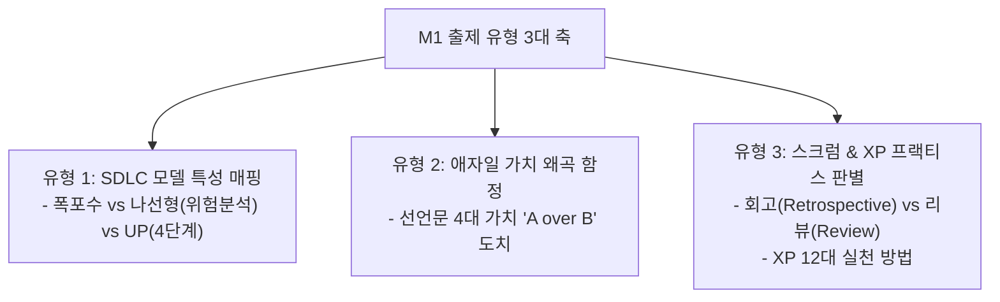

## 1. M1 문제 출제 유형 및 패턴 분석

NCS M1(개발 프로세스 & 방법론) 영역은 **개념의 상대적 가치 왜곡**과 **프로세스 활동 주체/시점의 혼동**을 노리는 유형이 90% 이상을 차지합니다.

---

## 2. 유형 1: SDLC 프로세스 모델 핵심 비교 (정리 노트)

| 모델 | 핵심 메커니즘 | 필수 키워드 | 기출 오답 포인트 |
| :--- | :--- | :--- | :--- |
| **폭포수 (Waterfall)** | 선행 단계 완료 후 다음 단계 진입 (순차적) | 정형화된 문서, 명확한 요구사항, 단계별 승인 | "요구사항 변경에 유연하게 대응한다" (X) |
| **나선형 (Spiral)** | 계획 $\rightarrow$ **위험분석** $\rightarrow$ 공학개발 $\rightarrow$ 고객평가 | **위험(Risk) 분석**, 대규모 고위험 R&D | 위험분석 단계 누락 또는 순서 변경 |
| **통합 프로세스 (UP)** | **도입(Inception) $\rightarrow$ 상세(Elaboration) $\rightarrow$ 구축(Construction) $\rightarrow$ 이행(Transition)** | 유스케이스 기반, 아키텍처 중심, 반복 점증 | 도입(범위/비용), 상세(아키텍처 확정), 이행(배포) 역할 혼동 |

> **[7급 기출 정밀 타격]**  
> *"소프트웨어 개발 단계를 도입, 상세, 구축, 이행으로 나누고 아키텍처를 조기에 확정하는 모델은?"* $\rightarrow$ **통합 프로세스(UP / RUP)**

---

## 3. 유형 2: 애자일 4대 가치 '상대적 우선순위' 함정

애자일 선언문(Agile Manifesto) 문제는 **"왼쪽과 오른쪽의 가치를 맞바꾸는"** 형태로만 출제됩니다.

| 공식 선언문 (더 높은 가치 부여) | 시험에 자주 나오는 오답 보기 (가치 왜곡) |
| :--- | :--- |
| **개인과 상호작용** (Individuals & interactions) | "프로세스와 도구에 더 높은 가치를 둔다" |
| **동작하는 소프트웨어** (Working software) | "포괄적인 문서화와 계획에 더 높은 가치를 둔다" |
| **고객과의 협력** (Customer collaboration) | "계약 협상과 명세서 준수에 더 높은 가치를 둔다" |
| **변화에 대응하기** (Responding to change) | "초기 수립된 계획을 엄격히 따르는 것을 우선한다" |

---

## 4. 유형 3: 스크럼 이벤트 & XP 12대 프랙티스 판별

### 4.1 스크럼 이벤트: 리뷰(Review) vs 회고(Retrospective)
- **스프린트 리뷰(Sprint Review)**: 대상은 **제품(Product)**. PO 및 이해관계자에게 완료된 기능을 시연하고 피드백 수렴.
- **스프린트 회고(Sprint Retrospective)**: 대상은 **팀과 프로세스(Team & Process)**. 일하는 방식, 도구, 소통 문제점을 점검하고 지속적 개선안 도출.

### 4.2 XP(eXtreme Programming) 5대 가치 & 12대 프랙티스
- **5대 가치**: 용기(Courage), 단순성(Simplicity), 의사소통(Communication), 피드백(Feedback), 존중(Respect)
- **12대 실천 방법 족집게 분류**:
  - **개발 실천**: 짝 프로그래밍(Pair Programming), TDD(테스트 주도 개발), 리팩토링(Refactoring), 단순 설계(Simple Design)
  - **관리/팀**: 사용자 스토리(User Story), 소규모 릴리스(Small Releases), 지속적 통합(CI), 공동 코드 소유권(Collective Ownership), 주 40시간 작업(Sustainable Pace)

---

## 5. 실전 기출 정밀 해설 (대표 2선)

### Q1. 애자일 선언문 가치 왜곡형 (정보처리기사)
> **Q. 다음 중 애자일(Agile) 소프트웨어 개발에 대한 설명으로 틀린 것은?**  
> ① 공정과 도구보다 개인과의 상호작용을 더 가치 있게 여긴다.  
> ② 동작하는 소프트웨어보다는 포괄적인 문서를 가치 있게 여긴다.  
> ③ 계약 협상보다는 고객과의 협력을 가치 있게 여긴다.  
> ④ 계획을 따르기보다 변화에 대응하기를 가치 있게 여긴다.  
> **정답: ②** (문서보다 동작하는 소프트웨어가 더 우선순위입니다.)

### Q2. 스크럼 프로세스 회고 판별형 (2020 국가직 7급)
> **Q. 스프린트가 끝나는 시점에 수행하며, 프로젝트 진행 과정에서 드러난 문제점이나 프로세스를 지속적으로 개선하기 위한 활동은?**  
> ① 스프린트 회고 ② 스프린트 리뷰 ③ 일일 스크럼 ④ 릴리스 계획  
> **정답: ①** (프로세스 개선은 '회고', 제품 시연은 '리뷰'입니다.)
