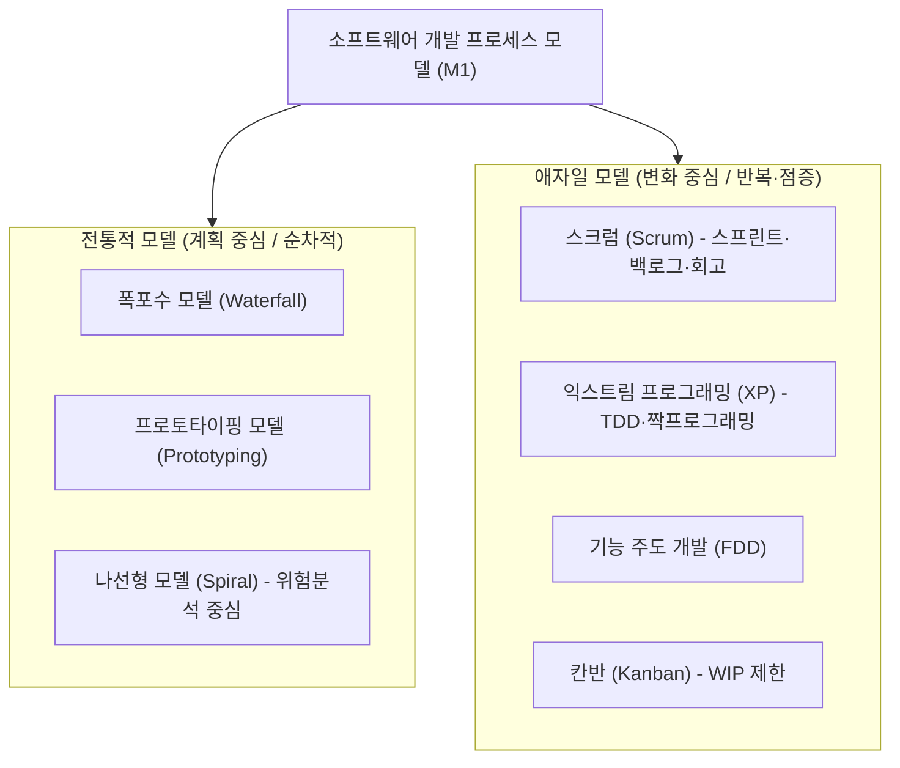

## 들어가는 말: "왜 지금 NCS 소프트웨어공학인가?"

공공기관 및 금융권의 디지털 전환(DX)과 함께 **NCS(국가직무능력표준) 기반 직무역량평가**에서 소프트웨어공학의 비중은 단순 암기를 넘어선 **현장 실무형 문제 해결 능력**을 검증하는 방향으로 고도화되고 있습니다.

특히 수험가와 실무에서 가장 흔히 마주치는 실패 원인은 다음 두 가지입니다:
1. **공기출 등 문제은행의 무분별한 키워드 중복 분류**: 동일한 문항이 3~4개 분류에 중복 노출되어 학습 우선순위를 왜곡함.
2. **이론과 실무 맥락의 단절**: 애자일 선언문의 4대 가치나 스크럼/XP의 프랙티스를 단순 단어로만 외워 실무 변형 문제에서 오답을 선택함.

본 아티클 시리즈는 **공무원 7급 전산직 심화 기출(인사혁신처 공인 정답 검증)**과 **정보처리기사 필기 최신 기출(ExamBomb 전수 수집 데이터)**에서 추출한 427개 정형 데이터셋 중 **[M1] 개발 프로세스 & 방법론(123문항)**의 핵심 킬러 문항을 집중 분석합니다.

---

## 1. M1 도메인 구조: 전통적 SDLC vs 애자일(Agile)

소프트웨어 생명주기(SDLC, Software Development Life Cycle) 모델은 크게 **계획 주도형(Plan-driven)**과 **변화 주도형(Change-driven / Agile)**으로 대별됩니다.

### 1.1 모델별 핵심 비교 축

| 비교 항목 | 폭포수(Waterfall) 모델 | 나선형(Spiral) 모델 | 애자일(Agile - Scrum/XP) |
| :--- | :--- | :--- | :--- |
| **핵심 철학** | 이전 단계 완료 후 다음 단계 진입 (순차적) | 위험(Risk)을 최소화하기 위해 반복 점증 | 고객과의 협력과 빠른 피드백, 변화 수용 |
| **요구사항 확정** | 프로젝트 초기에 완전 동결 전제 | 나선 회전마다 점진적 도출 | 언제든지 변경될 수 있음을 전제 |
| **적합한 프로젝트** | 요구사항이 명확하고 변경이 적은 대규모 | 대규모 시스템, 고위험/고난도 기술 연구개발 | 시장 변화가 빠르고 요구사항이 진화하는 프로젝트 |
| **핵심 산출물** | 각 단계별 방대한 정형 문서 | 위험 분석 보고서, 시제품(Prototype) | 동작하는 소프트웨어 (Working Software) |

---

## 2. 실전 기출 심층 분석 (ExamBomb & 7급 기출)

### 2.1 [정보처리기사 킬러 문항] 애자일 선언문 4대 가치의 왜곡

> **[문항 ID: EXAMBOMB_338 (2022년 1회)]**  
> **Q. 다음 중 애자일(Agile) 소프트웨어 개발에 대한 설명으로 틀린 것은?**  
> ① 공정과 도구보다 개인과의 상호작용을 더 가치 있게 여긴다.  
> ② 동작하는 소프트웨어보다는 포괄적인 문서를 가치 있게 여긴다.  
> ③ 계약 협상보다는 고객과의 협력을 가치 있게 여긴다.  
> ④ 계획을 따르기보다 변화에 대응하기를 가치 있게 여긴다.  
> **공인 정답: ②**

#### [오답 함정 및 개념 분석]
2001년 애자일 선언문(Agile Manifesto)의 4대 핵심 가치는 **"왼쪽에 있는 것도 가치가 있지만, 오른쪽에 있는 것에 더 높은 가치를 둔다"**는 상대적 우선순위 구조를 가집니다:
- **Individuals and interactions** over processes and tools
- **Working software** over comprehensive documentation
- **Customer collaboration** over contract negotiation
- **Responding to change** over following a plan

보기 ②는 주객이 전도되었습니다. 애자일은 문서를 무조건 거부하는 것이 아니지만, **"포괄적인 문서 작성에 시간을 뺏기기보다 동작하는 소프트웨어를 신속하게 배포하고 검증하는 것"**을 절대적 우선순위로 둡니다.

---

### 2.2 [공무원 7급 심화 문항] 스크럼 이벤트와 프로세스 개선

> **[문항 ID: GICHUL7_58102994_10 (2020 국가직 7급)]**  
> **Q. 다음 설명에 해당하는 스크럼(Scrum) 관련 활동은?**  
> 
> > 스프린트가 끝나는 시점이나 일정 주기로 수행한다. 이 활동을 통하여 프로젝트를 진행하는 과정에서 드러난 좋았던 점, 여러 가지 문제나 미진한 점 등을 도출한다. 이 활동을 통해 이미 설정된 프로세스로만 프로젝트를 진행하지 않고 프로세스를 지속적으로 개선하여 변화하는 비즈니스 환경에 보다 능동적으로 적응할 수 있도록 한다.
> 
> ① 스프린트 회고 (Sprint Retrospective)  
> ② 스프린트 리뷰 (Sprint Review)  
> ③ 일일 스크럼 미팅 (Daily Scrum)  
> ④ 릴리스 계획 (Release Planning)  
> **공인 정답: ①**

#### [오답 함정 및 개념 분석]
수험생들이 가장 많이 혼동하는 지점은 **② 스프린트 리뷰**와 **① 스프린트 회고**의 차이입니다:
- **스프린트 리뷰(Review)**: **제품(Product)**에 초점을 맞춥니다. 스프린트 동안 개발한 완료 산출물(Demo)을 제품 책임자(PO) 및 이해관계자에게 시연하고 피드백을 받아 제품 백로그를 갱신합니다.
- **스프린트 회고(Retrospective)**: **사람(People)과 프로세스(Process)**에 초점을 맞춥니다. 팀이 일한 방식, 협업 도구, 커뮤니케이션 문제점, 개선해야 할 행동 지침(Action Item)을 도출하는 내부 성찰 활동입니다. 지문에서 "프로세스를 지속적으로 개선"이라고 명시했으므로 정답은 회고(Retrospective)입니다.

---

### 2.3 [공무원 7급 심화 문항] XP(Extreme Programming) 12대 실천 방법

> **[문항 ID: GICHUL7_65445772_1 (2021 국가직 7급 2차)]**  
> **Q. 다음 특징을 가지는 소프트웨어 개발 방법론은?**  
> 
> > ○ 리팩토링(refactoring)  
> > ○ 사용자 스토리(user story)  
> > ○ 소규모 릴리즈(small release)  
> > ○ 짝 프로그래밍(pair programming)  
> > ○ 테스트 우선 개발(test-first development)  
> 
> ① COCOMO  
> ② 익스트림 프로그래밍(XP)  
> ③ 통합 프로세스(UP)  
> ④ 폭포수(waterfall) 모델  
> **공인 정답: ②**

#### [오답 함정 및 실천 원리]
익스트림 프로그래밍(XP)은 **켄트 벡(Kent Beck)**이 주창한 실천 중심의 경량 애자일 방법론입니다. 5가지 핵심 가치(용기, 단순성, 의사소통, 피드백, 존중)를 바탕으로 12대 프랙티스를 수행합니다:
1. **개발 주기**: Whole Team, Planning Game, Small Releases, Customer Tests
2. **개발 실천**: Simple Design, Pair Programming, Test-Driven Development (TDD), Refactoring
3. **인프라 관리**: Continuous Integration (CI), Collective Code Ownership, Coding Standards, Sustainable Pace (40시간 작업)

---

## 3. 실무 인사이트: 엔터프라이즈 환경에서의 방법론 선택 기준

현업에서 MSA(마이크로서비스)나 대규모 엔터프라이즈 프로젝트를 진행할 때, "100% 순수 폭포수"나 "100% 순수 스크럼"으로 운영되는 프로젝트는 거의 없습니다. 프로젝트의 성격에 따라 하이브리드 접근법을 취해야 합니다:

| 프로젝트 특성 | 권장 프로세스 접근 | 실무 주의사항 |
| :--- | :--- | :--- |
| **규제 준수 (금융/의료/국방)** | 하이브리드 (워터폴 계획 + 애자일 스프린트) | 감사(Audit)에 필요한 증빙 문서와 인터페이스 스펙(OpenAPI)을 선행 동결하되, 세부 모듈은 스프린트 개발 |
| **B2C SaaS 서비스** | 순수 스크럼 + CI/CD 자동화 | 1~2주 스프린트 단위로 MVP 배포 및 A/B 테스트 피드백 수용 |
| **고난도 알고리즘 / AI 모델 개발** | 나선형(Spiral) + 프로토타이핑 | POC(개념증명) 단계에서 위험 분석 및 성능 벤치마크를 조기에 검증 |

---

## 4. 요약 및 다음 모듈 예고

- **M1 모듈 요약**: 폭포수는 명확한 요구사항의 순차적 완성, 나선형은 위험 분석의 반복, 애자일은 짧은 주기 피드백과 동작하는 소프트웨어를 통한 고객 가치 창출입니다.
- **다음 연재**: **[M2] 요구사항 분석 & 명세 (Requirements Engineering)** — 유스케이스 다이어그램 관계(`<<include>>` vs `<<extend>>`), 기능/비기능 요구사항 분류 킬러 문항을 파헤칩니다.
