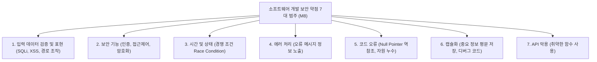

## 1. 소프트웨어 개발 보안(시큐어코딩)의 중요성

소프트웨어 배포 후 발생하는 보안 취약점의 75% 이상은 **설계 및 구현 단계의 부실한 입력값 검증과 자원 관리**에서 기인합니다. 행정안전부 및 KISA 가이드라인에 따른 소프트웨어 보안 약점 진단 기준이 공공 시험의 핵심입니다.



---

## 2. 3대 웹 취약점 원리와 시큐어코딩 패턴

### 2.1 SQL 인젝션 (SQL Injection)
- **공격 원리**: 사용자 입력값에 SQL 특수문자(`'`, `"` 등)를 삽입하여 데이터베이스 질의의 구조를 변조.
- **취약 코드**:
  ```java
  // 문자열 연결 방식 (동적 SQL) - 심각한 취약점
  String query = "SELECT * FROM users WHERE id = '" + userId + "' AND pw = '" + password + "'";
  ```
- **안전한 방어 코드**:
  ```java
  // 파라미터화된 쿼리 (PreparedStatement) 사용 - 컴파일 후 입력값은 순수 데이터로 바인딩됨
  String query = "SELECT * FROM users WHERE id = ? AND pw = ?";
  PreparedStatement pstmt = conn.prepareStatement(query);
  pstmt.setString(1, userId);
  pstmt.setString(2, password);
  ```

### 2.2 크로스 사이트 스크립팅 (XSS, Cross-Site Scripting)
- **공격 원리**: 검증되지 않은 악성 스크립트 코드가 웹 페이지에 삽입되어, 다른 사용자의 브라우저에서 실행되며 세션 쿠키를 탈취.
- **방어 기법**:
  - HTML 엔티티 치환: `<`, `>`, `&`, `"`, `'` 문자를 `&lt;`, `&gt;` 등으로 인코딩 변환.
  - 쿠키 보호: 민감한 세션 쿠키에 `HttpOnly`, `SameSite`, `Secure` 플래그 설정.

### 2.3 사이트 간 요청 위조 (CSRF, Cross-Site Request Forgery)
- **공격 원리**: 인증된 사용자의 권한을 도용하여 사용자가 의도하지 않은 악의적 요청(송금, 비밀번호 변경 등)을 서버로 전송.
- **방어 기법**:
  - 요청마다 일회용 무작위 토큰(CSRF Token)을 세션과 검증.
  - 중요 행위에 대해 재인증(비밀번호 재입력, CAPTCHA) 요구.

---

## 3. 동시성 제어 및 상태 관리 보안 (Race Condition)

- **경쟁 상태 (Race Condition)**:
  - 둘 이상의 프로세스/스레드가 공유 자원에 동시 접근하여 실행 순서에 따라 의도치 않은 결과나 보안 우회가 발생하는 약점.
  - **방어**: 임계 구역(Critical Section)에 대한 상호 배제(Mutex, Semaphore, `synchronized`) 동기화 처리 적용.

---

## 4. 실전 기출 분석

> **[문항 ID: EXAMBOMB_370 (정보처리기사 2022년 1회)]**  
> **Q. 소프트웨어 보안 취약점 중 SQL 삽입(SQL Injection) 공격을 예방하기 위한 가장 효과적인 방법은?**  
> ① 사용자 입력 데이터의 길이를 제한한다.  
> ② 에러 메시지를 사용자에게 상세히 노출한다.  
> ③ 파라미터화된 질의문(PreparedStatement)을 사용한다.  
> ④ 데이터베이스 계정에 관리자(DBA) 권한을 부여한다.  
> **공인 정답: ③**

- **해설**: SQL Injection을 원천 방어하는 가장 확실하고 표준적인 기법은 쿼리 구조를 미리 파싱·컴파일하고 사용자 입력을 별도의 파라미터로 처리하는 **PreparedStatement(파라미터화된 질의문)** 사용입니다.
