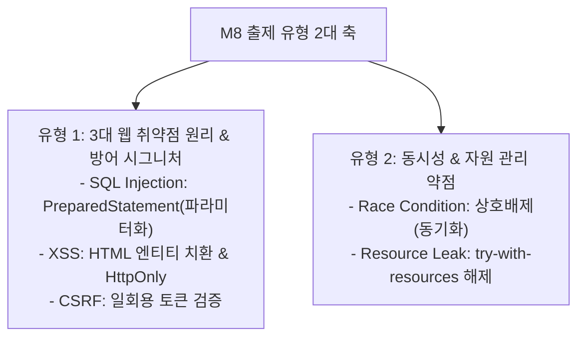

## 1. M8 구현 보안 문제 출제 유형 및 패턴 분석

M8(시큐어코딩 & 구현 보안) 영역은 행정안전부 소프트웨어 보안약점 진단 가이드라인에 기반하여, **취약한 코드와 이를 개선한 안전한 방어 코드의 시그니처를 짝짓는 유형**이 100% 출제됩니다.

---

## 2. 유형 1: 3대 웹 취약점 공격 원리와 방어 코드 매핑

| 취약점 | 공격 원리 (공격자가 노리는 지점) | 취약 코드 시그니처 | **가장 안전한 방어 코드 시그니처 (정답)** |
| :--- | :--- | :--- | :--- |
| **SQL Injection** | 사용자 입력값을 동적 문자열 결합(`+`)하여 SQL 쿼리 구조를 변조 | `String sql = "SELECT * FROM users WHERE id='" + id + "'";` | **`PreparedStatement` 바인딩 파라미터(`?`) 사용** `pstmt.setString(1, id);` |
| **XSS (크로스사이트 스크립팅)** | 검증되지 않은 외부 입력 스크립트가 타 사용자의 브라우저에서 실행됨 | `out.println("
" + param + "
");` | **HTML 엔티티 치환 (Encoding)** `&lt;`, `&gt;`, `&quot;` 치환 및 쿠키 `HttpOnly` 속성 |
| **CSRF (사이트간 요청위조)** | 희생자의 브라우저 권한(쿠키/세션)을 이용해 공격자가 원하는 요청 전송 | GET 방식으로 송금 등 주요 트랜잭션 수행 | **일회용 CSRF Token 검증**, POST 사용, 재인증 요구 |

> **[SQL 인젝션 방어 우선순위]**  
> 1순위: **PreparedStatement(파라미터화된 쿼리)**  
> 2순위: 특수문자 입력값 화이트리스트 필터링  
> (단순 길이 제한이나 에러 메시지 은폐는 원천 해결책이 아님!)

---

## 3. 유형 2: 동시성 오류(Race Condition)와 자원 누수 제어

1. **경쟁 상태 (Race Condition)**:
   - 두 개 이상의 스레드가 공유 자원에 동시에 접근하여 동기화 없이 값을 갱신할 때 발생.
   - **방어**: 임계 구역(Critical Section) 설정, `synchronized` 블록, Mutex/Semaphore를 통한 상호배제 보장.
2. **자원 누수 (Resource Leak)**:
   - DB 커넥션, 파일 핸들, 소켓을 열고 예외(Exception) 발생 시 닫지 않아 고갈됨.
   - **방어**: Java의 `try-with-resources` 구문 사용 또는 `finally` 블록에서 `close()` 강제.

---

## 4. 실전 기출 정밀 해설 (대표 2선)

### Q1. SQL Injection 원천 방어법 (정보처리기사)
> **Q. 소프트웨어 보안 취약점 중 SQL 삽입(SQL Injection) 공격을 예방하기 위한 가장 효과적인 방법은?**  
> ① 사용자 입력 데이터의 길이를 제한한다.  
> ② 에러 메시지를 사용자에게 상세히 노출한다.  
> ③ 파라미터화된 질의문(PreparedStatement)을 사용한다.  
> ④ 데이터베이스 계정에 관리자(DBA) 권한을 부여한다.  
> **정답: ③**  
> **해설**: SQL 쿼리문의 구조가 먼저 컴파일되고 입력값은 순수한 리터럴 데이터로만 처리되도록 강제하는 `PreparedStatement`가 가장 완벽한 방어책입니다.

### Q2. XSS 공격 방어 기법 (공무원 7급)
> **Q. 크로스 사이트 스크립팅(XSS) 취약점을 방어하기 위한 대책으로 가장 적절한 것은?**  
> ① 웹 페이지에 출력되는 모든 특수문자를 HTML Entity로 인코딩 변환한다.  
> ② 세션 타임아웃 시간을 무제한으로 연장한다.  
> ③ 데이터베이스 쿼리를 동적 문자열 연결 방식으로 작성한다.  
> ④ 클라이언트의 자바스크립트 실행 권한을 무조건 비활성화한다.  
> **정답: ①** (입력된 스크립트 태그 `<script>`가 브라우저에서 실행되지 않고 단순 문자로 표시되도록 HTML 엔티티로 치환합니다.)
