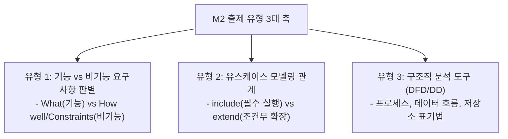

## 1. M2 문제 출제 유형 및 패턴 분석

M2(요구사항 분석) 영역은 **품질/제약조건을 기능으로 오인하게 만드는 함정**과 **UML 유스케이스 다이어그램 관계의 방향성 및 필수 여부**를 묻는 문제가 집중 출제됩니다.

---

## 2. 유형 1: 기능 vs 비기능 요구사항 족집게 판별 공식

수험생들이 가장 많이 틀리는 유형으로, **문장 구조에 현혹되지 않고 목적어와 동사의 성격**을 파악해야 합니다.

| 구분 | 기능 요구사항 (Functional) | 비기능 요구사항 (Non-Functional) |
| :--- | :--- | :--- |
| **핵심 성격** | 시스템이 직접 수행하는 **기능, 입출력, 데이터 연산 (What)** | 시스템이 준수해야 할 **품질 속성, 환경 제약, 보안/성능 (Constraint)** |
| **판별 키워드** | 계산한다, 조회한다, 전송한다, 등록한다, 발송한다 | 응답시간, 처리량(Throughput), 가용성(99.9%), 암호화 규격, 호환성 |
| **기출 킬러 예시** | - 사용자는 계좌 잔액을 조회할 수 있다. - 주문 완료 시 카카오톡 알림톡을 전송한다. | - 3초 이내에 검색 결과를 반환해야 한다. (성능) - 데이터베이스 비밀번호는 단방향 해시 암호화한다. (보안) - 시스템은 주 7일 24시간 중단 없이 운영되어야 한다. (가용성) |

---

## 3. 유형 2: 유스케이스 다이어그램 관계 (`<<include>>` vs `<<extend>>`)

| 관계 | 실행 필수성 | 화살표 방향 | 실무/시험 대표 사례 |
| :---: | :---: | :---: | :--- |
| **포함 관계 (`<<include>>`)** | **100% 필수** (기준 유스케이스 수행 시 무조건 실행) | **기준 $\rightarrow$ 포함된 유스케이스** (`[주문]` $\rightarrow$ `<<include>>` $\rightarrow$ `[결제]`) | - 글 작성 시 **로그인** - 도서 대출 시 **회원 인증** |
| **확장 관계 (`<<extend>>`)** | **조건부 선택** (특정 확장점 이벤트 발생 시에만 실행) | **확장 $\rightarrow$ 기준 유스케이스** (`[로그인 실패 알림]` $\rightarrow$ `<<extend>>` $\rightarrow$ `[로그인]`) | - 상품 결제 시 **쿠폰 적용** - 글 작성 중 **임시 저장** |

> **[화살표 방향 주의]**  
> `<<extend>>` 관계의 화살표는 **부가 기능을 제공하는 확장 유스케이스에서 원래의 기준 유스케이스 쪽으로 향함**을 시험에서 빈번하게 반대로 꼬아 출제합니다.

---

## 4. 유형 3: DFD (자료흐름도) 표기법 4요소

Yourdon/DeMarco 및 Gane/Sarson 표기법 비교는 기본 점수 획득 문항입니다.

- **프로세스 (Process)**: 원(Circle) 또는 둥근 사각형 $\rightarrow$ 입력 데이터를 출력 데이터로 변환.
- **자료 흐름 (Data Flow)**: 화살표(Arrow) $\rightarrow$ 데이터의 이동 방향.
- **자료 저장소 (Data Store)**: 평행선(Open Rectangle) $\rightarrow$ 머무르는 데이터 (DB, 파일).
- **단말 / 외부 엔티티 (External Entity)**: 사각형(Square) $\rightarrow$ 시스템 외부의 데이터 원천/도착지.

---

## 5. 실전 기출 정밀 해설 (대표 2선)

### Q1. 비기능 요구사항 판별형 (2020 국가직 7급)
> **Q. 다음 중 비기능적 요구사항에 해당하는 것은?**  
> ① 금융 거래 시 거래 내역을 저장하고 영수증을 발행해야 한다.  
> ② 시스템은 초당 500건 이상의 트랜잭션을 처리할 수 있어야 한다.  
> ③ 관리자는 회원의 권한을 수정하고 탈퇴시킬 수 있어야 한다.  
> ④ 시스템은 회원의 생년월일을 기준으로 적합한 보험 상품을 추천해야 한다.  
> **정답: ②** (처리량과 성능에 대한 기준을 정의한 문장은 비기능 요구사항입니다. ①, ③, ④는 시스템의 서비스 행위입니다.)

### Q2. 유스케이스 명세서 품질 요소 함정 (2022 국가직 7급)
> **Q. 유스케이스 명세서를 구성하는 항목에 대한 설명으로 옳지 않은 것은?**  
> ① 개요는 유스케이스가 제공하는 기능을 나타내며 액터를 포함한다.  
> ② 이벤트 흐름은 액터와 시스템 간의 상호작용 시나리오이다.  
> ③ 기능 요구사항은 성능, 신뢰성, 보안성 등 품질 요소를 나타낸다.  
> ④ 후행 조건은 유스케이스 완료 후 만족되어야 하는 상태이다.  
> **정답: ③** (성능, 신뢰성, 보안성은 '비기능 요구사항'입니다.)
