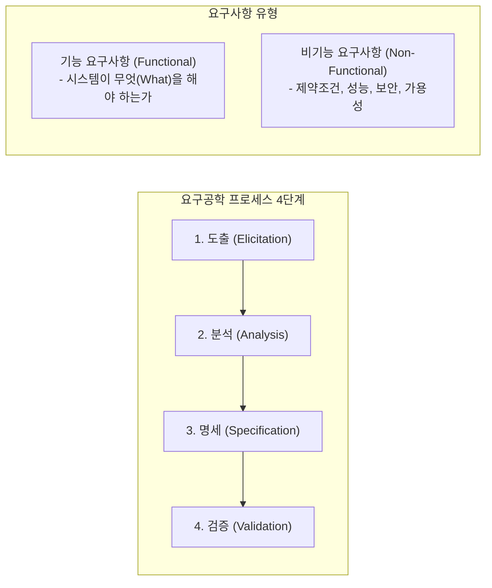
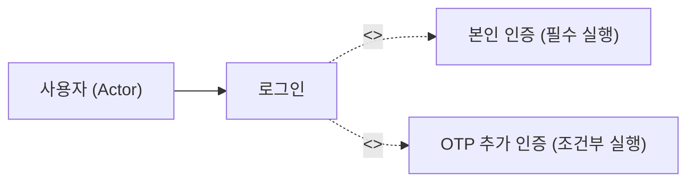

## 1. M2 요구사항 분석의 구조적 지도

소프트웨어 개발 프로젝트 실패의 50% 이상은 **부정확하거나 누락된 요구사항**에서 비롯됩니다. NCS 직무역량평가에서는 요구공학(Requirements Engineering)의 절차와 정형/비정형 명세, 기능/비기능 요구사항의 구별을 매 시험마다 출제합니다.

---

## 2. 킬러 개념 1: 기능 vs 비기능 요구사항 판별

수험생들이 가장 빈번하게 오답을 내는 포인트는 **시스템의 속성/제약조건을 기능으로 착각**하는 것입니다.

| 구분 | 기능 요구사항 (Functional) | 비기능 요구사항 (Non-Functional) |
| :--- | :--- | :--- |
| **정의** | 시스템이 직접 제공해야 하는 구체적인 서비스, 연산, 데이터 처리 | 시스템이 갖추어야 할 품질 속성, 시스템 환경 및 구현 제약 |
| **핵심 질문** | "시스템이 **무엇(What)**을 하는가?" | "시스템이 **어떤 기준(How well / Constraints)**으로 동작해야 하는가?" |
| **대표 사례** | - 사용자는 계좌 잔액을 조회할 수 있다. - 결제 승인 시 영수증을 PDF로 생성한다. | - 99.9% 가용성을 보장해야 한다. - 동시 접속자 10,000명 시 응답시간 1초 이내 - 비밀번호는 SHA-256 이상으로 단방향 암호화 |

> **[기출 함정]**  
> *"시스템은 개인정보를 암호화하여 저장해야 한다"* $\rightarrow$ **비기능 요구사항 (보안성 제약)**  
> *"시스템은 회원가입 시 SMS 인증번호를 발송해야 한다"* $\rightarrow$ **기능 요구사항 (서비스 행위)**

---

## 3. 킬러 개념 2: 유스케이스 다이어그램 관계 (`<<include>>` vs `<<extend>>`)

UML 유스케이스 모델링에서 두 관계는 실무와 시험 모두에서 혼동하기 쉽습니다.

1. **포함 관계 (`<<include>>`)**:
   - 하나의 유스케이스가 정상적으로 완료되기 위해 **반드시 실행되어야 하는 필수 유스케이스**입니다.
   - 예: `[주문하기]`는 반드시 `[결제하기]`를 포함합니다. 화살표는 원래 유스케이스에서 필수 포함 대상으로 향합니다.
2. **확장 관계 (`<<extend>>`)**:
   - 특정 조건이나 확장점(Extension Point)이 충족될 때만 **선택적으로 실행**되는 관계입니다.
   - 예: `[글 작성]` 중 오류 발생 시 `[임시저장]`을 수행. 화살표 방향은 **확장하는 쪽에서 기본 유스케이스로 향함**에 유의해야 합니다!

---

## 4. 실전 기출 분석

> **[문항 ID: GICHUL7_92873926_5 (2022 국가직 7급)]**  
> **Q. 유스케이스 명세서를 구성하는 항목에 대한 설명으로 옳지 않은 것은?**  
> ① 개요는 유스케이스가 제공하는 기능을 나타낸 것으로, 그 기능을 사용하는 사용자 액터까지 표현해야 한다.  
> ② 이벤트 흐름(시나리오)은 유스케이스 기능에 대한 액터와 시스템 간의 대화로, 문자나 순차 다이어그램을 사용해 표현한다.  
> ③ 기능 요구사항은 성능, 신뢰성, 보안성, 가용성 등 여러 요구 품질 요소를 나타낸다.  
> ④ 후행 조건은 유스케이스의 수행 완료 후에 만족되어야 하는 조건으로 상태나 수치의 바뀐 모습을 명확하고 구체적으로 기술해야 한다.  
> **공인 정답: ③**

- **해설**: 성능, 신뢰성, 보안성, 가용성은 **비기능 요구사항(품질 속성)**에 속합니다. 기능 요구사항은 시스템의 입출력과 동작 행위를 정의합니다.

---

## 5. 요약 및 실무 체크리스트

1. **요구공학 4단계**: 도출 $\rightarrow$ 분석 $\rightarrow$ 명세 $\rightarrow$ 검증 (순서 불변).
2. **기능 vs 비기능**: 서비스 행위(What)는 기능, 성능·품질·보안·제약(Quality/Constraint)은 비기능.
3. **유스케이스 관계**: 무조건 실행은 `include`, 조건부 실행은 `extend`.
