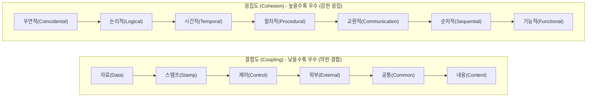

## 1. 모듈 독립성: 왜 결합도는 낮추고 응집도는 높여야 하는가?

소프트웨어 아키텍처의 기본 원칙은 **"낮은 결합도(Low Coupling), 높은 응집도(High Cohesion)"**입니다. 한 모듈의 수정이 다른 모듈에 미치는 파급 효과(Ripple Effect)를 최소화하기 위함입니다.



### 1.1 결합도(Coupling) 6단계 암기 공식: **"자 - 스 - 제 - 외 - 공 - 내"**
1. **자료 결합도 (Data)** [가장 약함, 최우수]: 모듈 간 파라미터로 단순 원시 타입(int, string 등) 값만 교환.
2. **스탬프 결합도 (Stamp)**: 모듈 간 배열이나 구조체, 객체 레퍼런스를 전달. (불필요한 필드까지 노출됨)
3. **제어 결합도 (Control)**: 한 모듈이 다른 모듈의 내부 실행 논리를 제어하는 플래그(flag)를 전달.
4. **외부 결합도 (External)**: 외부 프로토콜, 통신 인터페이스, 장치 제어기 등을 공유.
5. **공통 결합도 (Common)**: 전역 변수(Global Variable) 영역을 여러 모듈이 함께 참조하고 수정.
6. **내용 결합도 (Content)** [가장 강함, 최악]: 한 모듈이 다른 모듈의 내부 코드나 메모리를 직접 참조·수정.

### 1.2 응집도(Cohesion) 7단계 암기 공식: **"우 - 논 - 시 - 절 - 교 - 순 - 기"**
- **기능적 (Functional)** [최우수]: 모듈 내 모든 요소가 단 하나의 단일 목적을 수행 (예: 삼각함수 sin 계산).
- **순차적 (Sequential)**: 한 요소의 출력이 다음 요소의 입력으로 직접 연결.
- **교환/통신적 (Communication)**: 동일한 입력 데이터를 사용하여 서로 다른 처리를 수행.
- **절차적 (Procedural)**: 정해진 순서대로 실행되지만 요소 간 데이터 교환은 없음.
- **시간적 (Temporal)**: 특정 시간(초기화, 종료 시)에 한꺼번에 수행되는 기능들을 묶음.
- **논리적 (Logical)**: 유사한 성격의 기능(예: 모든 입출력 처리)을 하나의 모듈로 묶음.
- **우연적 (Coincidental)** [최악]: 서로 관련 없는 요소들이 우연히 한 모듈에 존재.

---

## 2. 객체지향 5대 원칙 (SOLID) 완전 해부

| 원칙 | 명칭 | 핵심 개념 | 위반 신호 (Code Smell) |
| :---: | :--- | :--- | :--- |
| **S** | **단일 책임 원칙 (SRP)** | 클래스는 단 하나의 변경 이유만 가져야 함 | 클래스 하나에 비즈니스 로직, DB 접근, UI 출력이 혼재 |
| **O** | **개방-폐쇄 원칙 (OCP)** | 확장에 열려 있고, 수정에는 닫혀 있어야 함 | 새 요구사항 추가 시 기존 `if/switch` 문을 계속 수정함 |
| **L** | **리스코프 치환 원칙 (LSP)** | 서브타입은 언제나 기본 타입으로 치환 가능해야 함 | 직사각형 상속 정사각형 클래스, 자식이 부모 메서드 예외 발생 |
| **I** | **인터페이스 분리 원칙 (ISP)** | 클라이언트가 사용하지 않는 인터페이스에 의존 금지 | 뚱뚱한 인터페이스(Fat Interface)로 빈 구현 메서드 다수 |
| **D** | **의존 역전 원칙 (DIP)** | 고수준 모듈은 저수준 모듈에 의존하면 안 되며 추상화에 의존 | Service가 구체적인 `MySQLRepository` 클래스를 직접 `new` |

---

## 3. 실전 기출 분석

> **[문항 ID: GICHUL7_92873926_25 (2022 국가직 7급)]**  
> **Q. 다음 두 함수 A()와 B() 사이에 형성되는 결합도로 옳은 것은?**  
> ```c
> int A() {
>     int a;
>     ...
>     B(a);
>     ...
> }
> int B(int x) {
>     ...
>     if (x > 0) /* send data */
>     else       /* receive data */
> }
> ```  
> ① 내용 결합 ② 자료 결합 ③ 스탬프 결합 ④ 제어 결합  
> **공인 정답: ④**

- **해설**: 함수 A가 넘겨준 인자 `a`의 값에 따라 함수 B 내부에서 분기(`if (x > 0)`)하며 처리 흐름(send or receive)을 직접 변경하고 있습니다. 이는 하위 모듈의 제어 로직을 호출 측이 결정하므로 **제어 결합도(Control Coupling)**입니다.
