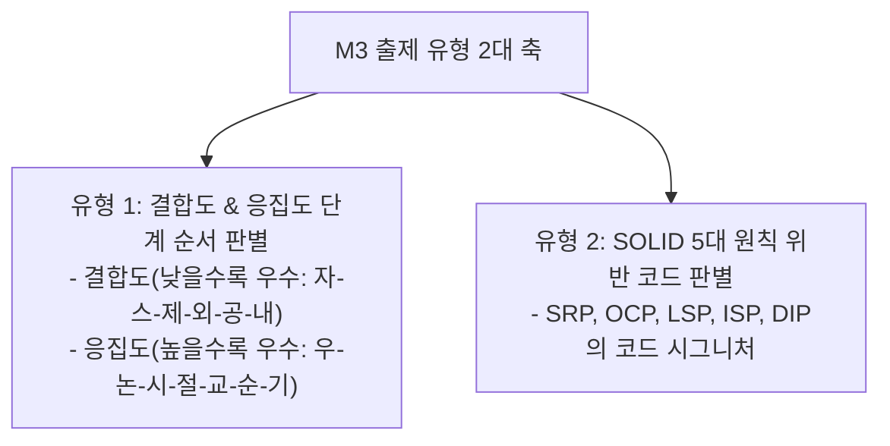

## 1. M3 문제 출제 유형 및 패턴 분석

M3 영역은 소프트웨어공학 전체에서 **가장 출제 비중(20%)이 높으며**, 모듈 간의 결합도/응집도 순서 판별과 객체지향 설계 5대 원칙(SOLID) 위반 코드를 직접 찾아내는 유형이 핵심입니다.



---

## 2. 유형 1: 결합도 6단계 & 응집도 7단계 초고속 판별법

### 2.1 결합도 (Coupling): 낮을수록 우수 (독립성 증가)
암기 공식: **"자 $\rightarrow$ 스 $\rightarrow$ 제 $\rightarrow$ 외 $\rightarrow$ 공 $\rightarrow$ 내"**

| 순위 | 결합도 명칭 | 데이터 전달 방식 | 판별 특징 |
| :---: | :--- | :--- | :--- |
| 1 (최우수) | **자료 (Data)** | 단일 원시 값(int, double 등) 전달 | 파라미터로 단순 값만 교환, 모듈 독립성 최고 |
| 2 | **스탬프 (Stamp)** | 배열, 구조체, 객체 레퍼런스 전달 | 불필요한 필드까지 모듈에 노출됨 |
| 3 | **제어 (Control)** | 제어 플래그(Flag), 명령어 전달 | 호출받은 모듈의 **내부 실행 로직(분기)을 호출 측이 결정** |
| 4 | **외부 (External)** | 외부 데이터 형식, 프로토콜, 통신 인터페이스 공유 | 외부 장치나 API 포맷에 종속됨 |
| 5 | **공통 (Common)** | 전역 변수(Global Variable) 공유 | 여러 모듈이 전역 메모리 영역을 직접 참조·수정 |
| 6 (최악) | **내용 (Content)** | 다른 모듈의 내부 코드, 라벨, 분기문 직접 참조 | 한 모듈의 코드를 다른 모듈에서 직접 점프하여 실행 |

### 2.2 응집도 (Cohesion): 높을수록 우수 (품질 증가)
암기 공식: **"우 $\rightarrow$ 논 $\rightarrow$ 시 $\rightarrow$ 절 $\rightarrow$ 교 $\rightarrow$ 순 $\rightarrow$ 기"** (우논시절교순기)
- **기능적 (Functional) [최우수]**: 단 하나의 단일 목적만 완벽하게 수행 (예: `Math.sin(x)`).
- **순차적 (Sequential)**: A 요소의 출력이 B 요소의 입력으로 직접 이어짐.
- **교환적 (Communication)**: 동일한 입력 데이터를 사용하여 서로 다른 연산을 수행.
- **절차적 (Procedural)**: 정해진 순서대로 실행되지만 요소 간 데이터 연결은 없음.
- **시간적 (Temporal)**: 특정 시점(초기화 `init()`, 종료 `cleanup()`)에 일괄 수행.
- **논리적 (Logical)**: 비슷한 성격의 작업(모든 출력 처리)을 한 모듈에 묶음.
- **우연적 (Coincidental) [최악]**: 아무런 논리적 연관 없이 마구 모아둔 모듈.

---

## 3. 유형 2: 객체지향 5대 원칙 (SOLID) 위반 코드 판별 시그니처

| 원칙 | 위반 코드 시그니처 (Finding) | 리팩터링 방향 |
| :--- | :--- | :--- |
| **SRP (단일 책임)** | 한 클래스 내에 `calculatePay()`, `saveToDB()`, `printReport()` 혼재 | 역할별 분리: `PayCalculator`, `PayRepository`, `PayReportFormatter` |
| **OCP (개방-폐쇄)** | 새 기능 추가 시 기존 클래스의 `switch (type)` 또는 `if-else` 블록 수정 | 인터페이스/추상 클래스 도입 후 다형성(Polymorphism)으로 확장 |
| **LSP (리스코프 치환)** | 부모 클래스를 상속받은 자식 메서드에서 `throw new UnsupportedException()` 던짐 | 잘못된 상속 제거, 합성(Composition) 사용 또는 인터페이스 분리 |
| **ISP (인터페이스 분리)** | 인터페이스 하나에 메서드가 수십 개라 구현 클래스가 빈 메서드(`{}`)로 채움 | 목적별로 얇고 작은 인터페이스 여러 개로 분할 |
| **DIP (의존 역전)** | 상위 모듈이 구체 클래스를 직접 `new MySQLOrderRepository()`로 생성하여 결합 | 상위 모듈은 `OrderRepository` 인터페이스에만 의존하고 DI 주입받음 |

---

## 4. 실전 기출 정밀 해설 (대표 2선)

### Q1. 제어 결합도 코드 판별형 (2022 국가직 7급)
> **Q. 다음 두 함수 A()와 B() 사이에 형성되는 결합도로 옳은 것은?**  
> ```c
> int A() {
>     int a;
>     ...
>     B(a);
>     ...
> }
> int B(int x) {
>     ...
>     if (x > 0) /* send data */
>     else       /* receive data */
> }
> ```  
> ① 내용 결합 ② 자료 결합 ③ 스탬프 결합 ④ 제어 결합  
> **정답: ④**  
> **분석**: 함수 B가 넘겨받은 매개변수 `x`의 값에 따라 `if (x > 0)`를 통해 내부 처리 흐름(send 또는 receive)을 분기하고 있습니다. 파라미터가 단순 데이터가 아니라 **하위 모듈의 실행 제어 플래그 역할**을 하므로 **제어 결합도**입니다.

### Q2. 결합도 순서 배열형 (2020 국가직 7급)
> **Q. 소프트웨어 설계 시 결합도가 낮은(우수한) 것부터 순서대로 바르게 나열한 것은?**  
> ① 자료 $\rightarrow$ 스탬프 $\rightarrow$ 제어 $\rightarrow$ 외부 $\rightarrow$ 공통 $\rightarrow$ 내용  
> ② 내용 $\rightarrow$ 공통 $\rightarrow$ 외부 $\rightarrow$ 제어 $\rightarrow$ 스탬프 $\rightarrow$ 자료  
> ③ 자료 $\rightarrow$ 제어 $\rightarrow$ 스탬프 $\rightarrow$ 공통 $\rightarrow$ 외부 $\rightarrow$ 내용  
> ④ 내용 $\rightarrow$ 외부 $\rightarrow$ 공통 $\rightarrow$ 제어 $\rightarrow$ 스탬프 $\rightarrow$ 자료  
> **정답: ①** ('자스제외공내' 암기 공식으로 3초 만에 해결)
