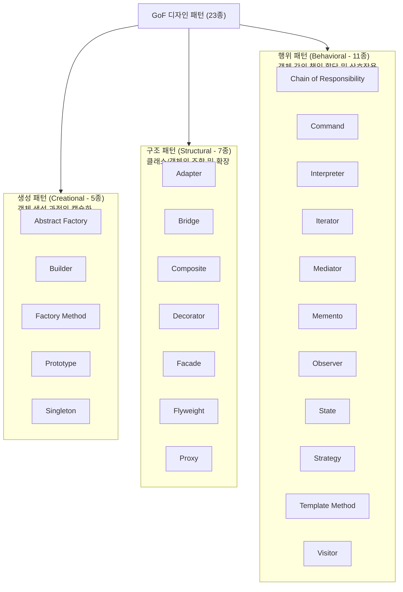

## 1. GoF(Gang of Four) 디자인 패턴 23종 분류 공식

NCS 및 공무원 7급, 정보처리기사에서 **패턴의 유형(생성/구조/행위)을 묻는 문제**는 거의 매 시험 1~2문항씩 반드시 출제됩니다.

### 1.1 패턴 유형별 초고속 암기법
- **생성 패턴 5개 (생-추-빌-팩-프-싱)**: Abstract Factory, Builder, Factory Method, Prototype, Singleton
- **구조 패턴 7개 (구-어-브-컴-데-파-플-프)**: Adapter, Bridge, Composite, Decorator, Facade, Flyweight, Proxy
- **행위 패턴 11개**: 생성과 구조 12개를 제외한 나머지 전부! (특히 Strategy, Observer, Template Method 다출제)

---

## 2. 헷갈리기 쉬운 대표 패턴 3대 맞대결

| 비교 패턴 | 핵심 의도 | 실무 적용 예시 |
| :--- | :--- | :--- |
| **Adapter vs Bridge** | **Adapter**: 이미 존재하는 서로 다른 인터페이스를 맞춰줌 (호환 목적) **Bridge**: 구현부와 추상화부를 분리하여 각각 독립적으로 확장 | 구형 결제 라이브러리 연동 (Adapter) OS별 UI 렌더러 분리 (Bridge) |
| **Strategy vs Template Method** | **Strategy**: 알고리즘 군을 인터페이스로 캡슐화하여 런타임 교체 **Template Method**: 상위 클래스에서 골격을 정의하고 하위 클래스에서 단계 구현 | 정렬 알고리즘 교체 (Strategy) Spring Framework 템플릿 콜백 (Template) |
| **Decorator vs Proxy** | **Decorator**: 기존 객체에 동적으로 새로운 책임/기능을 덧붙임 **Proxy**: 실제 객체에 대한 접근을 제어하거나 캐싱/가상화 | Java I/O 스트림 버퍼링 (Decorator) Spring AOP, Lazy Loading (Proxy) |

---

## 3. 대표 아키텍처 스타일

1. **MVC (Model-View-Controller)**:
   - Model: 비즈니스 로직과 데이터 상태 관리.
   - View: 사용자 화면 표현. 모델의 변경을 통지받아 반영.
   - Controller: 사용자 입력 처리 및 모델/뷰 조율.
2. **파이프-필터 (Pipe-Filter)**:
   - 데이터 스트림이 순차적인 필터를 거치며 변환. 각 필터는 독립적. (예: Unix 파이프라인, 이미지 처리 엔진)
3. **계층화 (Layered Architecture)**:
   - 상위 계층은 하위 계층의 서비스를 이용. 계층 간 결합도 완화. (예: Presentation $\rightarrow$ Business $\rightarrow$ Data Access)

---

## 4. 실전 기출 분석

> **[문항 ID: GICHUL7_92873926_17 (2022 국가직 7급)]**  
> **Q. 다음 디자인 패턴들을 GoF 패턴 분류에 따라 구분하였을 때, 생성 패턴, 구조 패턴, 행위 패턴의 개수를 순서대로 나열한 것은?**  
> 
> > Abstract Factory, Adapter, Bridge, Builder, Composite, Decorator, Iterator, Mediator, Observer, Prototype, Proxy, Singleton, Strategy, Visitor  
> 
> ① 3, 5, 6  
> ② 4, 5, 5  
> ③ 5, 3, 6  
> ④ 6, 4, 4  
> **공인 정답: ②**

- **해설**:
  - **생성 패턴**: Abstract Factory, Builder, Prototype, Singleton (총 **4개**)
  - **구조 패턴**: Adapter, Bridge, Composite, Decorator, Proxy (총 **5개**)
  - **행위 패턴**: Iterator, Mediator, Observer, Strategy, Visitor (총 **5개**)
  - 따라서 정답은 **② (4, 5, 5)** 입니다.
