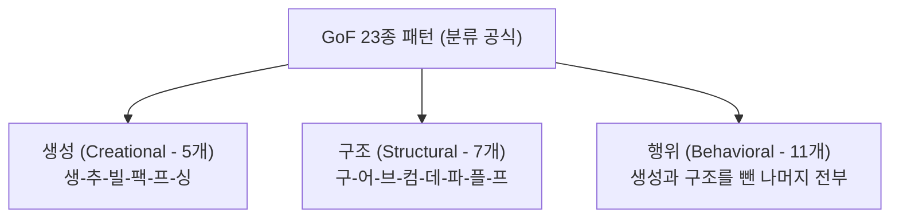

## 1. GoF 디자인 패턴 문제 출제 유형 및 패턴 분석

디자인 패턴 문제는 출제 유형이 명확하게 정형화되어 있습니다:
1. **패턴 분류형 (단순 암기)**: 특정 패턴이 생성/구조/행위 중 어디에 속하는가? (전체의 60%)
2. **패턴 의도 및 비교형 (개념 이해)**: 두 패턴의 설계 목적과 적용 시점의 차이는 무엇인가? (전체의 40%)

---

## 2. 유형 1: GoF 23종 패턴 유형별 초간편 암기 공식

### 2.1 생성 패턴 (5개): "생 - 추 - 빌 - 팩 - 프 - 싱"
- **추**상 팩토리 (Abstract Factory)
- **빌**더 (Builder)
- **팩**토리 메서드 (Factory Method)
- **프**로토타입 (Prototype)
- **싱**글톤 (Singleton)

### 2.2 구조 패턴 (7개): "구 - 어 - 브 - 컴 - 데 - 파 - 플 - 프"
- **어**댑터 (Adapter)
- **브**릿지 (Bridge)
- **컴**포지트 (Composite)
- **데**코레이터 (Decorator)
- **파**사드 (Facade)
- **플**라이웨이트 (Flyweight)
- **프**록시 (Proxy)

### 2.3 행위 패턴 (11개): 나머지 전부
- 책임 연쇄(Chain of Resp.), 커맨드(Command), 인터프리터(Interpreter), 이터레이터(Iterator), 중재자(Mediator), 메멘토(Memento), 옵저버(Observer), 상태(State), 전략(Strategy), 템플릿 메서드(Template Method), 비지터(Visitor)

---

## 3. 유형 2: 헷갈리기 쉬운 쌍둥이 패턴 핵심 대조

| 비교 축 | 패턴 A | 패턴 B | 결정적 차이점 (기출 키워드) |
| :--- | :--- | :--- | :--- |
| **인터페이스 변환 vs 확장 분리** | **Adapter** | **Bridge** | **Adapter**: 기존 클래스의 호환되지 않는 인터페이스를 맞춤. **Bridge**: 구현(Implementation)과 추상화(Abstraction)를 분리하여 독립 확장. |
| **객체 장식 vs 대리 접근** | **Decorator** | **Proxy** | **Decorator**: 객체에 동적으로 새로운 책임/기능을 추가(덧붙임). **Proxy**: 실제 객체에 대한 접근을 제어(가상화, 캐싱, 보안 권한). |
| **알고리즘 교체 vs 뼈대 유지** | **Strategy** | **Template Method** | **Strategy**: 알고리즘 자체를 인터페이스로 캡슐화하여 통째로 교체. **Template Method**: 상위 클래스에서 알고리즘의 골격(템플릿)을 정의하고 일부 단계만 오버라이딩. |

---

## 4. 실전 기출 정밀 해설 (대표 2선)

### Q1. 패턴 분류 및 개수 계산형 (2022 국가직 7급)
> **Q. 다음 패턴들을 GoF 분류에 따라 구분했을 때, 생성, 구조, 행위 패턴의 개수는?**  
> 
> > Abstract Factory, Adapter, Bridge, Builder, Composite, Decorator, Iterator, Mediator, Observer, Prototype, Proxy, Singleton, Strategy, Visitor  
> 
> ① 3, 5, 6  
> ② 4, 5, 5  
> ③ 5, 3, 6  
> ④ 6, 4, 4  
> **정답: ②**  
> **초고속 풀이**:  
> 1. 생성 패턴(추빌팩프싱 찾기): Abstract Factory, Builder, Prototype, Singleton = **4개**  
> 2. 구조 패턴(어브컴데파플프 찾기): Adapter, Bridge, Composite, Decorator, Proxy = **5개**  
> 3. 행위 패턴: Iterator, Mediator, Observer, Strategy, Visitor = **5개**  
> → **(4, 5, 5)** 도출 완료!

### Q2. 행위 패턴 판별형 (정보처리기사)
> **Q. GoF 디자인 패턴 중 행위(Behavioral) 패턴에 속하는 것은?**  
> ① Prototype ② Bridge ③ Flyweight ④ Visitor  
> **정답: ④** (Prototype은 생성, Bridge/Flyweight는 구조 패턴입니다.)
