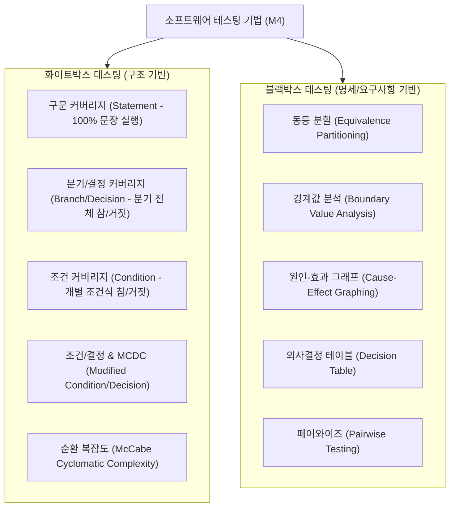

## 1. 테스트 기법의 두 축: 화이트박스 vs 블랙박스

소프트웨어 테스팅은 내부 로직(코드)을 들여다보는지에 따라 명확히 구분됩니다.

---

## 2. 계산 킬러 1: McCabe 순환 복잡도 (Cyclomatic Complexity)

제어 흐름 그래프(Control Flow Graph)에서 **독립적인 선형 경로의 개수**를 계산하는 핵심 공식입니다:

$$V(G) = E - N + 2P$$

- $E$: 간선(Edge)의 개수
- $N$: 노드(Node)의 개수
- $P$: 연결된 컴포넌트 수 (일반적으로 단일 프로그램은 $P=1$)
- **초간편 약산 공식**: $V(G) = \text{조건 분기문(Predicate Node) 개수} + 1 = \text{닫힌 영역(Region)의 개수} + 1$

---

## 3. 계산 킬러 2: 테스트 커버리지(Coverage) 포함 관계

1. **구문 커버리지 (Statement)**: 코드의 모든 실행 가능한 문장이 적어도 한 번은 실행됨.
2. **분기 커버리지 (Decision/Branch)**: 전체 조건식의 결과가 참(True)과 거짓(False)이 적어도 한 번씩 수행됨.
3. **조건 커버리지 (Condition)**: 전체 조건식 내부의 개별 조건식들이 각각 참/거짓을 적어도 한 번씩 가짐.
4. **수정 조건/분기 커버리지 (MC/DC)**:
   - 각 개별 조건식이 **다른 조건식의 영향을 받지 않고 전체 결과에 독립적으로 영향을 미치는** 조합을 테스트.
   - 항공, 국방, 철도 등 고신뢰성 임베디드 표준(DO-178B)에서 필수 요구.

> **[주의: 기출 절대 함정]**  
> "분기 커버리지를 만족하면 조건 커버리지를 만족한다?" $\rightarrow$ **거짓 (서로 포함하지 않음)**  
> "MC/DC를 만족하면 분기 커버리지와 조건 커버리지를 모두 만족한다?" $\rightarrow$ **참**

---

## 4. 실전 기출 분석

> **[문항 ID: GICHUL7_92873926_21 (2022 국가직 7급)]**  
> **Q. 화이트박스 테스트 커버리지에 대한 설명으로 옳은 것은?**  
> ① 문장 커버리지는 입력 데이터가 미리 정의한 유형에 적합한지를 검증하는 방법이다.  
> ② 동일한 프로그램에 대해 분기 커버리지를 달성하면 조건 커버리지를 달성한다.  
> ③ 동일한 프로그램에 대해 조건 커버리지를 달성하면 분기 커버리지를 달성한다.  
> ④ 동일한 프로그램에 대해 수정조건분기 커버리지(MCDC)를 달성하면 조건 커버리지를 달성한다.  
> **공인 정답: ④**

- **해설**: 분기 커버리지와 조건 커버리지는 서로를 보장하지 않습니다. 그러나 **MCDC(수정조건분기 커버리지)**는 개별 조건식의 독립적 평가를 보장하므로 **조건 커버리지와 분기 커버리지를 모두 충족**합니다.
