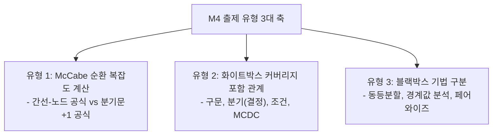
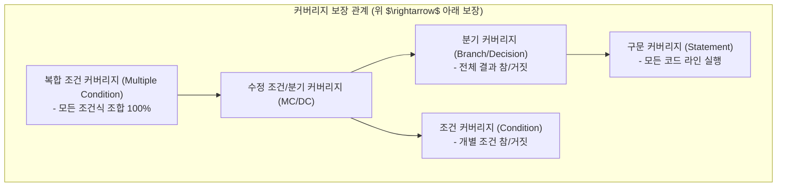

## 1. M4 테스팅 문제 출제 유형 및 패턴 분석

M4(테스팅 & 품질보증) 영역은 단순 암기 문항 외에도 **순환 복잡도 수치 계산**과 **테스트 커버리지 간의 포함 관계 진위 판별** 문제가 매년 수험생들의 발목을 잡는 킬러 문항입니다.

---

## 2. 유형 1: McCabe 순환 복잡도 (Cyclomatic Complexity) 계산 3법

제어 흐름 그래프에서 독립적인 기본 경로(Basis Path)의 수를 구하는 3가지 공식입니다. 상황에 맞게 가장 빠른 공식을 씁니다:

| 공식 번호 | 공식 명칭 | 수식 | 적용 상황 |
| :---: | :--- | :--- | :--- |
| **공식 1** | **간선-노드 기본 공식** | $$V(G) = E - N + 2P$$ | 그래프의 노드($N$)와 간선($E$) 수가 문제에 주어졌을 때 |
| **공식 2** | **분기 노드 공식 (초고속)** | $$V(G) = \text{조건 분기문(Predicate Nodes)} + 1$$ | 소스 코드(`if`, `while`, `for`)나 그래프의 분기점이 보일 때 |
| **공식 3** | **면적(Region) 공식** | $$V(G) = \text{닫힌 영역(Region)의 개수} + 1$$ | 그래프의 평면 영역을 눈으로 셀 수 있을 때 |

> **[주의: 복잡도 정의 함정]**  
> *"순환 복잡도는 각 모듈의 fan-out(제어도)을 측정하는 것이다?"* $\rightarrow$ **오답 (제어 흐름 그래프의 독립 경로 수를 선형적으로 측정하는 척도입니다)**

---

## 3. 유형 2: 화이트박스 커버리지 포함 관계 판별 (절대 함정)

커버리지 간의 상호 포함 관계를 묻는 문제가 반복 출제됩니다.

### 필수 암기 3대 진위 명제:
1. **분기 커버리지를 달성하면 조건 커버리지를 달성한다?** $\rightarrow$ **[거짓 X]** (전체 참/거짓만 만족하고 개별 조건의 참/거짓은 빠질 수 있음)
2. **조건 커버리지를 달성하면 분기 커버리지를 달성한다?** $\rightarrow$ **[거짓 X]** (개별 조건이 참/거짓을 거쳤으나 전체 결과는 계속 참일 수 있음)
3. **MCDC(수정조건분기)를 달성하면 분기 및 조건 커버리지를 모두 달성한다?** $\rightarrow$ **[참 O]**

---

## 4. 실전 기출 정밀 해설 (대표 2선)

### Q1. 커버리지 보장 관계 판별형 (2022 국가직 7급)
> **Q. 화이트박스 테스트 커버리지에 대한 설명으로 옳은 것은?**  
> ① 문장 커버리지는 입력 데이터가 미리 정의한 유형에 적합한지를 검증한다.  
> ② 동일 프로그램에 대해 분기 커버리지를 달성하면 조건 커버리지를 달성한다.  
> ③ 동일 프로그램에 대해 조건 커버리지를 달성하면 분기 커버리지를 달성한다.  
> ④ 동일 프로그램에 대해 수정조건분기(MCDC) 커버리지를 달성하면 조건 커버리지를 달성한다.  
> **정답: ④**  
> **해설**: 분기와 조건은 서로를 보장하지 못합니다. 그러나 MCDC는 개별 조건식의 독립성을 엄격히 입증하므로 조건 커버리지와 분기 커버리지를 모두 충족합니다.

### Q2. 순환 복잡도 개념 오류형 (2020 국가직 7급)
> **Q. T. McCabe의 순환 복잡도(Cyclomatic Complexity)에 대한 설명으로 옳지 않은 것은?**  
> ① 사이클로매틱 수는 각 모듈에 대한 제어도(fan-out)를 이용하여 측정한다.  
> ② 사이클로매틱 수는 코드 전체에서 독립적인 경로의 수를 선형적으로 측정한다.  
> ③ 그래프 이론을 기반으로 코드를 제어 흐름 그래프로 변환하여 속성을 계산한다.  
> ④ 원시코드의 구조적인 복잡성을 알아내는 측도이다.  
> **정답: ①** (순환 복잡도는 fan-out과 무관하며, 독립 경로의 수 $E - N + 2P$로 계산합니다.)
