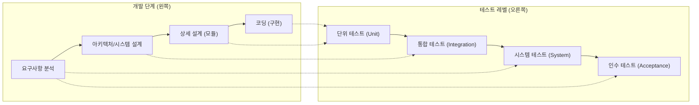
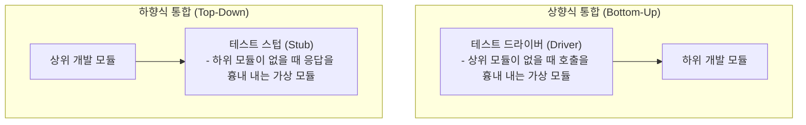

## 1. V-모델: 개발 단계와 테스트 레벨의 1:1 대칭

소프트웨어 개발 프로세스의 각 단계는 검증(Verification) 및 확인(Validation)을 위한 특정 테스트 레벨과 직접 대칭됩니다.

- **요구사항 분석** $\leftrightarrow$ **인수/시스템 테스트** (비즈니스 요구 충족 검증)
- **시스템/아키텍처 설계** $\leftrightarrow$ **통합 테스트** (모듈 간 인터페이스 검증)
- **상세 설계** $\leftrightarrow$ **단위 테스트** (개별 클래스/함수 로직 검증)

---

## 2. 통합 테스팅 전략: 상향식 vs 하향식 완벽 비교

모듈들을 결합하여 인터페이스 오류를 찾아내는 통합 테스트에서 가장 빈출되는 개념입니다.

| 비교 항목 | 하향식 통합 (Top-Down) | 상향식 통합 (Bottom-Up) |
| :--- | :--- | :--- |
| **방향** | 제어 계층의 최상위 모듈에서 하위로 이동 | 최하위 모듈(클러스터)에서 상위로 점진적 결합 |
| **필요 도구** | **테스트 스텁 (Stub)**: 하위 모듈 대신 일시적 반환값 제공 | **테스트 드라이버 (Driver)**: 하위 모듈을 호출하고 파라미터 전달 |
| **장점** | 주요 제어 로직과 사용자 인터페이스를 조기에 검증 | 하위 핵심 모듈(알고리즘, DB 연동 등)을 조기에 집중 테스트 가능 |
| **단점** | 하위 세부 입출력이 스텁으로 대체되어 정밀 검증 지연 | 최상위 시스템 인터페이스 검증이 늦어짐 |

> **[초간편 암기 공식]**  
> - **"하-스"**: **하**향식은 **스**텁(Stub)  
> - **"상-드"**: **상**향식은 **드**라이버(Driver)

---

## 3. 실전 기출 분석

> **[문항 ID: EXAMBOMB_358 (정보처리기사 2022년 1회)]**  
> **Q. 단위 테스트에서 테스트의 대상이 되는 하위 모듈을 호출하고, 파라미터를 전달하는 가상의 모듈로 상향식 테스트에 필요한 것은?**  
> ① 테스트 스텁(Test Stub)  
> ② 테스트 슈트(Test Suite)  
> ③ 테스트 케이스(Test Case)  
> ④ 테스트 드라이버(Test Driver)  
> **공인 정답: ④**

- **해설**: 하위 모듈을 호출하고 파라미터를 전달하는 주체는 상위 모듈 역할을 대행하는 **테스트 드라이버(Driver)**입니다. 상향식(Bottom-up) 테스팅의 핵심 도구입니다.
