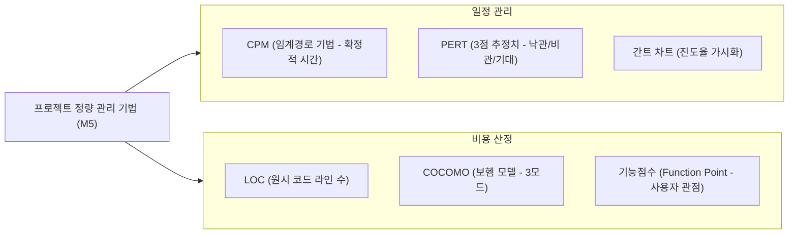

## 1. 프로젝트 관리의 삼각 제약과 정량화

소프트웨어 프로젝트 관리는 **범위(Scope), 시간(Time/일정), 비용(Cost)**의 균형을 맞추는 활동입니다. 시험에서는 주관적 추정이 아닌 **공학적 계산 공식**을 직접 묻습니다.

---

## 2. 계산 공식 1: LOC 기반 노력(Man-Month) 및 개발 기간 산정

가장 기본적이면서 자주 출제되는 인력 산정 공식입니다:

- **노력(Man-Month)**: $\text{노력(MM)} = \frac{\text{총 예측 LOC}}{\text{프로그래머 월간 평균 생산성(LOC/월)}}$
- **개발 기간**: $\text{개발 기간(개월)} = \frac{\text{노력(MM)}}{\text{투입 프로그래머 수}}$
- **개발 비용**: $\text{노력(MM)} \times \text{월간 단가}$

> **[기출 예제]**  
> 총 라인 수 36,000 LOC, 프로그래머 월간 생산성 300 LOC, 투입 프로그래머 6명:  
> $\text{총 노력} = \frac{36,000}{300} = 120 \text{ MM}$  
> $\text{개발 기간} = \frac{120}{6} = 20 \text{개월}$

---

## 3. 계산 공식 2: CPM(Critical Path Method) 임계경로 탐색

네트워크 다이어그램에서 시작 노드부터 종료 노드까지의 **가장 긴 경로(The Longest Path)**가 바로 **임계경로(Critical Path)**입니다.

- **임계경로의 의미**: 이 경로 상에 있는 작업이 하루라도 지연되면 **전체 프로젝트 완료일이 그대로 지연**됩니다.
- **여유시간(Float/Slack Time)**:
  - $\text{여유시간} = \text{가장 늦은 착수일(LS)} - \text{가장 빠른 착수일(ES)} = \text{가장 늦은 완료일(LF)} - \text{가장 빠른 완료일(EF)}$
  - **임계경로 상에 있는 작업의 총 여유시간은 언제나 0(Zero)**입니다.

---

## 4. COCOMO 모델의 3대 개발 유형 (보헴)

| 개발 모드 | 프로젝트 규모 | 시스템 성격 및 특징 |
| :--- | :--- | :--- |
| **유기적 모드 (Organic)** | **5만 라인(50 KDSI) 이하** | 사무 처리용, 소규모 팀의 익숙한 도메인 개발 |
| **반분리 모드 (Semi-detached)** | **30만 라인(300 KDSI) 이하** | 트랜잭션 처리, 운영체제 유틸리티, 중규모 프로젝트 |
| **임베디드 모드 (Embedded)** | **30만 라인 초과 또는 엄격한 제약** | 하드웨어 제어, 항공/국방 시스템, 초고난도 제약 |

---

## 5. 실전 기출 분석

> **[문항 ID: GICHUL7_92873926_24 (2022 국가직 7급)]**  
> **Q. 소프트웨어의 총 개발 기간은 16개월이며, 처음 6명의 개발 인력이 100% 투입되었다. 개발 지연으로 11개월 시작 시점에 3명 중 2명은 100%, 1명은 50%를 추가 투입하여 완료되었다. 투입된 총 MM(Man-Month)은?**  
> ① 111 MM ② 112 MM ③ 113 MM ④ 114 MM  
> **공인 정답: ①**

- **계산 풀이**:
  1. 기존 인력(6명)의 16개월 투입: $6 \times 16 = 96 \text{ MM}$
  2. 추가 투입 기간: 11개월 시작부터 16개월 종료까지 = **총 6개월간 추가 투입** (11, 12, 13, 14, 15, 16월)
  3. 추가 투입 인력: $2\text{명}(100\%) + 1\text{명}(50\%) = 2.5\text{명}$
  4. 추가 인력의 노력: $2.5 \times 6 = 15 \text{ MM}$
  5. 총 MM: $96 + 15 = \mathbf{111 \text{ MM}}$
