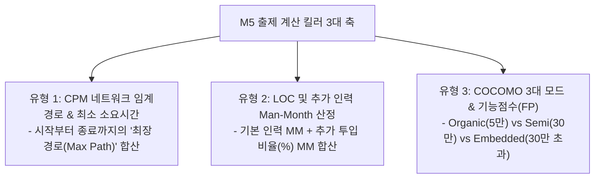

## 1. M5 프로젝트 관리 문제 출제 유형 및 패턴 분석

M5(프로젝트 관리) 영역은 소프트웨어공학 전 과목 중 **가장 계산 난이도가 높으며**, 4지선다형에서 직접 수치를 연산해야 하는 **계산 킬러 문항 3종**이 정형화되어 출제됩니다.

---

## 2. 유형 1: CPM(Critical Path Method) 임계경로 계산법

### 2.1 임계경로(Critical Path)의 수학적 원리
- 프로젝트의 시작부터 종료까지 연결되는 수많은 경로 중 **소요 기간의 합이 가장 긴 '최장 경로(Longest Path)'**가 바로 임계경로입니다.
- **핵심 법칙**:
  1. 임계경로의 총 소요 기간 = **프로젝트 완료에 필요한 최소 시간**
  2. 임계경로 상에 있는 작업의 **여유시간(Float / Slack Time)은 무조건 0**

### 2.2 실전 계산 트릭: 선행 작업 테이블 읽는 법
- 선행 작업이 없는 작업들을 시작 노드로 설정.
- 분기되는 경로들을 각각 끝까지 따라가며 소요 일수를 단순 덧셈한 후 **가장 큰 값**을 선택!

---

## 3. 유형 2: LOC 및 인력 투입 Man-Month 계산법

### 3.1 기본 공식
- $\text{총 노력(MM)} = \frac{\text{예측 총 LOC}}{\text{프로그래머 월간 생산성(LOC/월)}}$
- $\text{개발 기간(M)} = \frac{\text{총 노력(MM)}}{\text{투입 프로그래머 수}}$

### 3.2 추가 인력(부분 투입) 함정 계산
- 중도 투입 인력은 **"투입된 개월 수 $\times$ 투입 비율(%)"**을 별도로 계산하여 기본 MM에 가산해야 합니다.

---

## 4. 실전 기출 정밀 해설 (대표 2선)

### Q1. CPM 네트워크 최소 완료 시간 계산 (2021 국가직 7급)
> **Q. 다음 CPM 네트워크의 작업 목록표에서 프로젝트 완료에 필요한 최소 시간은?**  
> 
> | 작업 | 선행작업 | 소요기간(일) |
> | :---: | :---: | :---: |
> | **A** | D | 15 |
> | **B** | A, D, E | 10 |
> | **C** | E | 15 |
> | **D** | - | 5 |
> | **E** | - | 10 |
> | **F** | A, B | 20 |
> | **G** | B, C | 15 |
> 
> ① 40일 ② 45일 ③ 50일 ④ 90일  
> **정답: ③ 50일**  
> **정밀 풀이**:  
> 1. 경로별 누적 시간 계산:
>    - D(5) → A(15) = 20일
>    - B의 선행은 A(20일), D(5일), E(10일)이므로 가장 늦게 끝나는 **20일 시점**에 시작 가능! → B 완료 = $20 + 10 = 30$일
>    - F의 선행은 A(20일), B(30일)이므로 **30일 시점**에 시작! → F 완료 = $30 + 20 = \mathbf{50\text{일}}$
>    - G의 선행은 B(30일), C(E(10)+15=25일)이므로 **30일 시점**에 시작! → G 완료 = $30 + 15 = 45$일
> 2. 전체 최종 완료일은 가장 늦은 종료 작업 F의 완료일인 **50일**입니다.

### Q2. 개발 지연 인력 추가 투입 Man-Month 계산 (2022 국가직 7급)
> **Q. 총 개발 기간 16개월, 초기 6명 100% 투입. 11개월 시작 시점에 3명 중 2명 100%, 1명 50% 추가 투입하여 완료. 총 MM은?**  
> ① 111 MM ② 112 MM ③ 113 MM ④ 114 MM  
> **정답: ① 111 MM**  
> **정밀 풀이**:  
> 1. 기존 인력 MM: $6\text{명} \times 16\text{개월} = 96\text{ MM}$  
> 2. 추가 투입 기간: 11개월 시작부터 16개월 종료까지 = **총 6개월간** (11, 12, 13, 14, 15, 16월)  
> 3. 추가 인력 환산: $2\text{명}(100\%) + 1\text{명}(50\%) = 2.5\text{명}$  
> 4. 추가 인력 MM: $2.5\text{명} \times 6\text{개월} = 15\text{ MM}$  
> 5. 총 MM: $96 + 15 = \mathbf{111\text{ MM}}$
