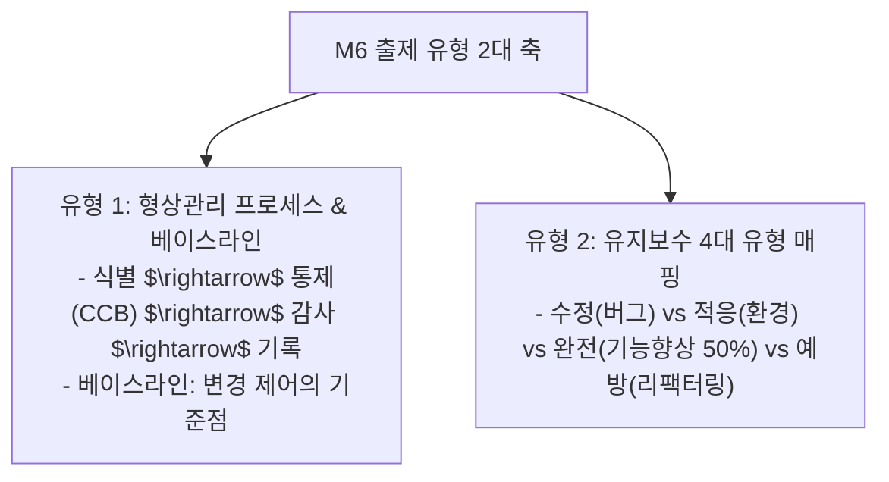

## 1. M6 형상관리 & 유지보수 출제 유형 및 패턴 분석

M6 영역은 출제 범위가 매우 좁고 명확하여, **단 두 가지 주제(형상관리 프로세스와 유지보수 4대 유형)**만 정확히 암기하면 100% 득점할 수 있는 전략적 효자 영역입니다.

---

## 2. 유형 1: 형상관리(SCM) 핵심 개념과 베이스라인

### 2.1 형상관리 4대 활동 (식-통-감-기)
1. **형상 식별 (Identification)**: 형상 항목(소스코드, 문서, 설계서 등)을 지정하고 고유 식별 번호 부여.
2. **형상 통제 (Control)**: 형상 변경 요구를 검토하고 **형상 통제 위원회(CCB, Configuration Control Board)**의 승인을 거쳐 반영.
3. **형상 감사 (Audit)**: 베이스라인의 무결성을 공식적으로 검증 (기능적 감사, 물리적 감사).
4. **형상 기록 / 보고 (Status Accounting)**: 변경 처리 상태와 이력을 문서화하여 이해관계자에게 보고.

### 2.2 베이스라인 (Baseline) 기출 시그니처 문구
- "프로젝트 진행의 중요한 이정표(Milestone)이자 상태를 정의한다."
- "계속되는 개발 또는 유지보수 작업의 기준이 된다."
- "**공식적인 변경 승인 절차(CCB) 없이는 변경할 수 없는** 확정된 산출물 집합이다."

---

## 3. 유형 2: 유지보수 4대 유형 판별 공식 (비용 50%의 주인공)

| 유지보수 유형 | 핵심 원인 (발생 트리거) | 시험에 출제되는 대표 지문 | 발생 비용 비율 |
| :---: | :--- | :--- | :---: |
| **완전 유지보수 (Perfective)** | 사용자의 **새로운 요구사항 추가**, 기존 기능 개선 및 성능 향상 | "사용자가 화면에 새로운 통계 그래프 조회를 요구하여 시스템을 수정하였다." | **50% 이상 (최대 비중!)** |
| **적응 유지보수 (Adaptive)** | OS 업그레이드, 하드웨어 교체, 컴파일러 등 **외부 환경 변화** | "서버의 운영체제가 Linux 6.x로 업그레이드됨에 따라 호환되도록 코드를 변경하였다." | 약 25% |
| **수정 유지보수 (Corrective)** | 개발/테스트 중 잡지 못한 **잠재적 결함 및 버그 패치** | "실행 도중 0으로 나누는 연산 오류가 발생하여 긴급하게 코드를 수정하였다." | 약 20% |
| **예방 유지보수 (Preventive)** | 소프트웨어의 복잡도를 낮추고 미래 유지보수성을 높이는 선제적 작업 | "가독성을 높이고 복잡도를 줄이기 위해 동작 변경 없이 리팩터링을 수행하였다." | 약 5% |

---

## 4. 실전 기출 정밀 해설 (대표 2선)

### Q1. 베이스라인 개념 판별형 (2022 국가직 7급)
> **Q. 다음 설명에 해당하는 것으로 옳은 것은?**  
> 
> > ○ 프로젝트 진행의 중요한 상태를 정의한다.  
> > ○ 프로젝트나 프로덕트가 특정 상태에 이르렀는지 나타낸다.  
> > ○ 계속되는 개발 또는 유지보수 작업의 기준이 된다.  
> > ○ 형상 항목에 대한 변경을 제어하는 메커니즘이다.  
> 
> ① VCS ② Baseline ③ CMMI ④ CI  
> **정답: ② Baseline** (변경 제어의 공식 기준점 = 베이스라인)

### Q2. 역공학 및 재공학 개념 구별형 (2021 국가직 7급)
> **Q. 코드만 남아있고 문서가 없을 때, 프로그램을 분석하여 소스코드로부터 설계서나 요구사항 명세서를 복원해내는 기법은?**  
> ① 역공학(Reverse Engineering) ② 리팩토링(Refactoring) ③ 재공학(Re-engineering) ④ 테스팅(Testing)  
> **정답: ① 역공학** (기존 소스코드로부터 상위 산출물인 설계/요구사항을 추출하는 것은 '역공학'입니다.)
