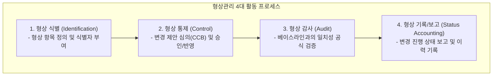

## 1. 형상관리(SCM, Software Configuration Management)

소프트웨어 개발 과정에서 발생하는 소스 코드, 문서, 설계서 등 모든 **산출물(형상 항목, Configuration Item)의 변경 이력을 통제하고 추적**하는 공학적 활동입니다.

### 1.1 베이스라인 (Baseline)의 정의
- 개발 생명주기의 특정 시점에 공식적으로 검토되고 승인된 규격서나 산출물입니다.
- **베이스라인이 확정된 이후의 변경은 오직 공식적인 형상 변경 절차(CCB, Configuration Control Board 심의)를 거쳐서만 수정**될 수 있습니다.

---

## 2. 유지보수(Maintenance)의 4대 유형

소프트웨어가 배포된 후 발생하는 유지보수 작업은 그 목적에 따라 4가지로 엄격히 구분됩니다:

| 유지보수 유형 | 발생 원인 및 목적 | 실무 대표 예시 | 출제 비중 |
| :---: | :--- | :--- | :---: |
| **수정 유지보수 (Corrective)** | 개발/테스트 단계에서 발견하지 못한 **잠재적 결함 및 버그 수정** | NullPointerException 장애 핫픽스 패치 | 20% |
| **적응 유지보수 (Adaptive)** | 운영체제, 하드웨어, 네트워크, DB 등 **외부 실행 환경 변화에 대응** | Windows 10 지원 종료에 따른 Windows 11 호환성 패치 | 25% |
| **완전 유지보수 (Perfective)** | 사용자의 **새로운 기능 요구, 성능 향상, 편의성 개선** | 결제 수단 추가(Apple Pay 연동), 조회 속도 2배 개선 | **50% (최대)** |
| **예방 유지보수 (Preventive)** | 소프트웨어의 복잡도를 낮추고 잠재 위험을 줄이기 위한 선제적 조치 | 코드 리팩터링, 기술 부채 해소 | 5% |

> **[기출 핵심 팁]**  
> 유지보수 비용 중 가장 큰 비중(50% 이상)을 차지하는 유형은 버그 수정(수정 유지보수)이 아니라 **사용자의 신규 요구사항 수용 및 기능 확장을 다루는 완전 유지보수(Perfective Maintenance)**입니다!

---

## 3. 실전 기출 분석

> **[문항 ID: GICHUL7_92873926_3 (2022 국가직 7급)]**  
> **Q. 다음 설명에 해당하는 것으로 옳은 것은?**  
> 
> > ○ 프로젝트 진행의 중요한 상태를 정의한다.  
> > ○ 프로젝트나 프로덕트가 특정 상태에 이르렀는지 나타낸다.  
> > ○ 계속되는 개발 또는 유지보수 작업의 기준이 된다.  
> > ○ 형상 항목에 대한 변경을 제어하는 메커니즘이다.  
> 
> ① VCS (Version Control System)  
> ② Baseline  
> ③ CMMI  
> ④ CI (Continuous Integration)  
> **공인 정답: ②**

- **해설**: 계속되는 개발의 기준점이자 변경 제어의 메커니즘 역할을 하는 공식 승인 산출물 상태는 **베이스라인(Baseline)**입니다.
