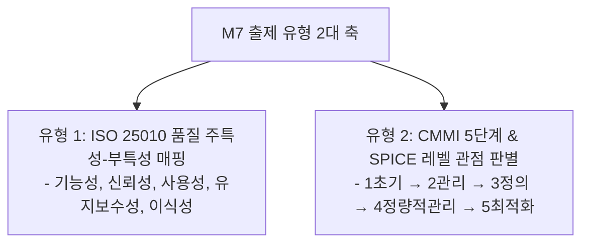

## 1. M7 품질 표준 문제 출제 유형 및 패턴 분석

M7 영역은 **국제 표준의 주특성-부특성 짝짓기 오류를 찾는 유형**과 **조직 성숙도 모델(CMMI/SPICE)의 단계별 명칭과 활동을 어긋나게 엮는 함정**이 매 시험 출제됩니다.

---

## 2. 유형 1: ISO/IEC 25010 (구 9126) 8대 품질 주특성 족집게 암기표

| 주특성 | 정의 및 의도 | 시험에 나오는 핵심 부특성 | 자주 출제되는 오답 짝짓기 |
| :--- | :--- | :--- | :--- |
| **기능 적합성** | 명시된/묵시적 요구를 만족하는 기능 제공 | 기능 완전성, 기능 정확성, 기능 적절성 | "설치용이성, 적용성은 기능성이다" (X → 이식성) |
| **신뢰성** | 규정된 조건에서 성능 수준을 유지하는 능력 | **성숙성, 결함 허용성(Fault Tolerance), 회복성** | "변경성, 시험용이성은 신뢰성이다" (X → 유지보수성) |
| **사용성** | 사용자가 시스템을 이해하고 조작하기 쉬운 정도 | **이해성(적절성 인식), 학습 용이성, 조작 용이성** | "성숙성은 사용성이다" (X → 신뢰성) |
| **성능 효율성** | 사용된 자원 양에 대비한 성능 수준 | 시간 반응성(응답시간), 자원 활용성, 용량성 | "분석성은 효율성이다" (X → 유지보수성) |
| **유지보수성** | 환경 변화나 오류 수정 시 쉽게 변경 가능한 정도 | **모듈성, 재사용성, 분석성, 수정 용이성(변경성), 시험 용이성** | "회복성은 유지보수성이다" (X → 신뢰성) |
| **이식성** | 다른 운영 환경(OS, 하드웨어)으로 쉽게 이전되는 정도 | **적응성(Adaptability), 설치 용이성(Installability), 대체성** | "부합성은 이식성이다" (X → 기능 적합성) |

---

## 3. 유형 2: CMMI 5단계 성숙도 레벨 판별 공식: "초 - 관 - 정 - 량 - 최"

| 레벨 | 명칭 | 핵심 관점 및 평가 기준 (기출 키워드) |
| :---: | :--- | :--- |
| **Level 1** | **초기 (Initial)** | 프로세스 없음. 개인의 역량과 영웅적 행동에 의존, 일정/비용 지연 빈번. |
| **Level 2** | **관리 (Managed)** | **개별 프로젝트 차원**의 관리 프로세스 수립 (요구사항, 일정, 비용 관리). |
| **Level 3** | **정의 (Defined)** | **조직 전사 차원**의 표준 프로세스가 문서화되고 체계적으로 확립됨. |
| **Level 4** | **정량적 관리 (Quantitatively Managed)** | 프로세스와 품질을 **정량적·통계적 메트릭스(Metrics)로 측정하고 제어**함. |
| **Level 5** | **최적화 (Optimizing)** | 지속적인 프로세스 개선, 신기술 도입, 조직적 피드백 루프 운영. |

> **[레벨 2 vs 레벨 3 구별 포인트]**  
> - "개별 프로젝트 차원의 계획과 관리" → **Level 2 (관리)**  
> - "조직 전사 표준 프로세스(SEPG)의 정의" → **Level 3 (정의)**

---

## 4. 실전 기출 정밀 해설 (대표 2선)

### Q1. SPICE 레벨 관점 오류 판별형 (2022 국가직 7급)
> **Q. SPICE 모델의 레벨과 측정 관점을 짝지은 것으로 옳지 않은 것은?**  
> ① 수행단계 － 해당 프로세스의 목적은 달성하지만 계획되거나 추적되지 않는다.  
> ② 관리단계 － 표준으로 정의된 프로세스를 사용하여 계획되고 관리한다.  
> ③ 예측단계 － 표준 프로세스 능력을 정량적으로 측정, 이해, 관리하여 품질의 정량적 관리가 가능하다.  
> ④ 최적화 단계 － 프로세스가 지속적으로 개선되고 최적화된다.  
> **정답: ②**  
> **해설**: "표준으로 정의된 프로세스를 사용하는 단계"는 **3단계(확립 단계)**입니다. 2단계(관리 단계)는 개별 프로세스 차원의 산출물 관리입니다.

### Q2. ISO 9126 품질 특성 짝짓기 오류형 (2022 국가직 7급)
> **Q. ISO/IEC 9126 모델의 품질 특성 요소로 잘못 짝지은 것은?**  
> ① 신뢰성 요소 － 성숙성, 결함허용성, 회복성  
> ② 유지보수성 요소 － 분석성, 변경성, 안정성  
> ③ 기능성 요소 － 적용성, 설치용이성, 부합성  
> ④ 사용성 요소 － 이해성, 학습용이성, 운영성  
> **정답: ③**  
> **해설**: 적용성(Adaptability)과 설치용이성(Installability)은 **이식성(Portability)**의 부특성입니다. 기능성 요소가 아닙니다.
