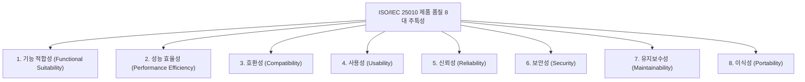

## 1. ISO/IEC 9126 & 25010 제품 품질 모델

소프트웨어 품질을 평가하기 위한 국제 표준으로, 구 ISO 9126의 6대 특성에서 발전하여 **ISO 25010은 8대 제품 품질 주특성(Main Characteristics)**을 정의합니다.

### 1.1 핵심 품질 주특성별 부특성 매핑
- **기능 적합성**: 기능 완전성, 기능 정확성, 기능 적절성
- **신뢰성**: 성숙성, 결함 허용성(Fault Tolerance), 회복성(Recoverability), 가용성
- **사용성**: 적절성 인식성, 학습 용이성, 조작 용이성, 사용자 오류 보호, UI 매력성
- **유지보수성**: 모듈성, 재사용성, 분석성, 수정 용이성(변경성), 시험 용이성
- **이식성**: 적응성(Adaptability), 설치 용이성(Installability), 대체성(Replaceability)

---

## 2. 조직 프로세스 성숙도 모델: CMMI 5단계

소프트웨어 개발 조직의 프로세스 능력과 성숙도를 1단계부터 5단계까지 평가합니다.

| 단계 | 레벨 명칭 | 조직의 핵심 특징 및 프로세스 상태 |
| :---: | :--- | :--- |
| **Level 1** | **초기 (Initial)** | 정의된 프로세스 없음. 개인의 역량과 영웅적 노력에 전적으로 의존. 일정/비용 예측 불가 |
| **Level 2** | **관리 (Managed)** | **프로젝트 차원**의 기본적인 관리 프로세스 확립 (일정, 요구사항, 비용 추적) |
| **Level 3** | **정의 (Defined)** | **조직 전사 차원**의 표준 프로세스가 문서화되고 체계화됨 |
| **Level 4** | **정량적 관리 (Quantitatively Managed)** | 프로세스와 제품 품질을 **통계적·정량적 지표(Metrics)로 측정하고 제어**함 |
| **Level 5** | **최적화 (Optimizing)** | 지속적인 프로세스 혁신과 피드백을 통해 **지속적 개선 및 신기술 도입** |

---

## 3. SPICE (ISO/IEC 15504) 능력 단계

SPICE는 프로세스 능력 수준을 6단계(0~5단계)로 구분합니다:
- **0단계 (불완전)**: 프로세스가 구현되지 않거나 목적 달성 실패.
- **1단계 (수행)**: 프로세스 목적은 달성하나 계획되거나 추적되지 않음.
- **2단계 (관리)**: 프로세스가 계획되고 산출물이 관리됨.
- **3단계 (확립)**: 표준 프로세스로 정의되어 수행됨.
- **4단계 (예측)**: 정량적으로 측정되고 통제됨.
- **5단계 (최적화)**: 비즈니스 목표에 맞추어 프로세스가 지속적으로 개선됨.

---

## 4. 실전 기출 분석

> **[문항 ID: GICHUL7_92873926_18 (2022 국가직 7급)]**  
> **Q. SPICE 모델의 레벨과 측정 관점을 짝지은 것으로 옳지 않은 것은?**  
> ① 수행단계 － 해당 프로세스의 목적은 달성하지만 계획되거나 추적되지 않는다.  
> ② 관리단계 － 표준으로 정의된 프로세스를 사용하여 계획되고 관리한다.  
> ③ 예측단계 － 표준 프로세스 능력을 정량적으로 측정, 이해, 관리할 수 있어 품질의 정량적 관리가 가능하다.  
> ④ 최적화 단계 － 프로세스가 지속적으로 개선되고 최적화된다.  
> **공인 정답: ②**

- **해설**: "표준으로 정의된 프로세스를 사용하는 단계"는 **3단계(확립 단계, Established)**입니다. 2단계(관리 단계, Managed)는 표준화 이전의 개별 프로젝트 단위 계획과 산출물 관리를 의미합니다.
