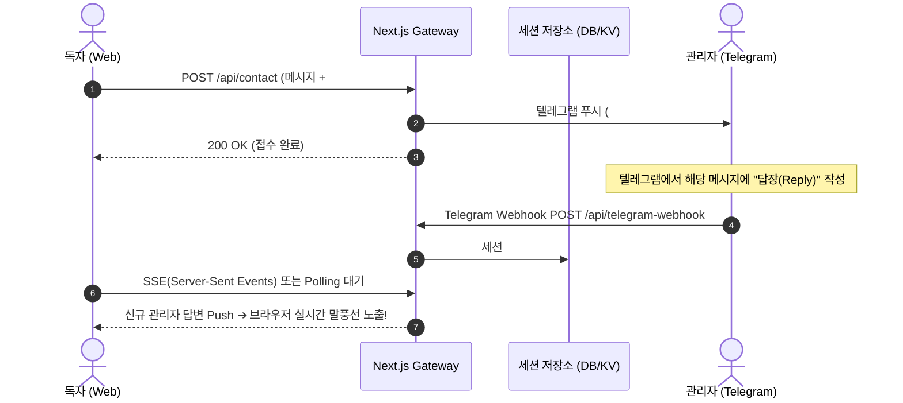

## 1. 들어가며: "웹사이트에 실시간 문의창 하나 달고 싶은데..."

기술 블로그나 포트폴리오 웹사이트를 운영하다 보면 독자나 채용 담당자, 협업 제안자로부터 즉각적인 피드백을 받고 싶을 때가 많습니다.

흔히 사용되는 기존 방식들은 다음과 같은 한계를 가지고 있습니다:
* **`mailto:` 링크**: 메일 클라이언트 앱이 강제로 실행되어 전환율이 급격히 떨어집니다.
* **외부 링크 (카카오 오픈채팅, 텔레그램 바로가기)**: 사용자가 현재 읽고 있던 블로그 화면을 이탈해야 합니다.
* **BaaS/외부 챗봇 SaaS**: 채널톡이나 인터콤 등은 유료 플랜이 필요하거나, 무료 플랜에서는 무거운 스크립트 번들이 로딩되어 웹 성능(Lighthouse 점수)을 갉아먹습니다.

그렇다면 **"독자는 블로그 화면을 떠나지 않고 가볍게 메시지를 보내고, 관리자는 주머니 속 텔레그램 메신저로 즉시 알림을 받아 확인하는 시스템"**을 우리 기술 스택(Next.js App Router + Vercel) 안에서 가장 안전하게 만들 수는 없을까요?

이번 아티클에서는 **브라우저에 텔레그램 Bot Token을 단 1글자도 노출하지 않고**, Serverless WAS 게이트웨이를 통해 실시간 메시지 발송과 세션 기반 응답을 구현하는 방법을 단계별로 공유합니다.

---

## 2. 아키텍처: 왜 프론트엔드 직접 호출은 금기인가?

### 나쁜 예: 브라우저에서 Telegram API 직접 호출
텔레그램의 `sendMessage` API는 사용법이 매우 간단합니다.
```typescript
// ❌ 절대 해서는 안 되는 구현!
fetch(`https://api.telegram.org/bot${BOT_TOKEN}/sendMessage`, { ... })
```
만약 브라우저 클라이언트 JS에 봇 토큰(`BOT_TOKEN`)을 환경변수(`NEXT_PUBLIC_*`)로 심어두면, 악의적인 방문자가 개발자 도구(F12) 콘솔에서 토큰을 추출해 **봇을 탈취하거나 대량 스팸을 발송하는 관리자 권한을 획득**하게 됩니다.

### 정석 아키텍처: Zero-Secret WAS API 게이트웨이

```mermaid
flowchart LR
    A["독자 브라우저<br/>(Client Session)"] -->|1. POST /api/contact<br/>(토큰 없음! 오직 본문 + 세션ID)| B["Next.js WAS 게이트웨이<br/>(Vercel Serverless)"]
    B -->|2. Secret Env 주입<br/>(TELEGRAM_BOT_TOKEN)| C["Telegram Bot API<br/>(https://api.telegram.org)"]
    C -->|3. 실시간 Push| D["내 스마트폰 / 텔레그램 앱"]
    B -.->|4. 접수 확인 JSON 반환| A
```

* **Client**: 시크릿을 전혀 알지 못합니다. 본인 브라우저의 내부 엔드포인트(`/api/contact`)로만 메시지를 보냅니다.
* **Serverless WAS**: 서버 런타임 환경변수(`process.env`)에서만 안전하게 시크릿을 꺼내어 검증과 HTML 새니타이징 후 텔레그램 API로 중계합니다.

---

## 3. 1단계: 텔레그램 봇 생성 및 시크릿 준비

1. 텔레그램 앱에서 **@BotFather**를 검색합니다.
2. `/newbot` 명령어를 입력하고 봇의 이름과 유저네임(예: `MyBlogContactBot`)을 지정합니다.
3. 생성 완료 시 발급되는 HTTP API 토큰(`123456789:ABCdefGhIJK...`)을 복사합니다.
4. 내 개인 텔레그램 계정의 고유 ID(`chat_id`)를 확인하기 위해 **@userinfobot**에 메시지를 보내 내 ID(숫자)를 확인합니다.

---

## 4. 2단계: Serverless WAS 게이트웨이 API 구현

Next.js App Router 환경의 `src/app/api/contact/route.ts`에 보안 중계 엔드포인트를 작성합니다.

```typescript
// src/app/api/contact/route.ts
import { NextRequest, NextResponse } from 'next/server';

// XSS 및 텔레그램 HTML 태그 파싱 오류 방지
function escapeHtml(str: string): string {
  return str
    .replace(/&/g, '&amp;')
    .replace(/</g, '&lt;')
    .replace(/>/g, '&gt;');
}

export async function POST(req: NextRequest) {
  try {
    const body = await req.json();
    const { name, contact, message, sessionId } = body;

    if (!message || typeof message !== 'string' || message.trim() === '') {
      return NextResponse.json(
        { success: false, error: '메시지 내용을 입력해주세요.' },
        { status: 400 }
      );
    }

    // 서버 런타임 환경변수에서만 시크릿 조회 (브라우저 번들에 절대 포함 안 됨)
    const botToken = process.env.TELEGRAM_BOT_TOKEN;
    const chatId = process.env.TELEGRAM_CHAT_ID;

    if (!botToken || !chatId) {
      return NextResponse.json({
        success: true,
        reply: '테스트 환경: 메시지가 성공적으로 접수되었습니다. (데모 모드)',
      });
    }

    const senderName = escapeHtml((name && String(name).trim()) || '방문자');
    const senderContact = escapeHtml((contact && String(contact).trim()) || '미제공');
    const senderMessage = escapeHtml(String(message).trim());
    const sessionTag = escapeHtml((sessionId && String(sessionId).slice(0, 8)) || 'direct');
    const now = new Date().toLocaleString('ko-KR', { timeZone: 'Asia/Seoul' });

    // 텔레그램 포맷 메시지 조립
    let telegramText = `💬 <b>[domlog] 블로그 웹 실시간 문의</b>\n`;
    telegramText += `━━━━━━━━━━━━━━━━━━━━\n`;
    telegramText += `• <b>발신자</b>: ${senderName}\n`;
    telegramText += `• <b>회신처</b>: ${senderContact}\n`;
    telegramText += `• <b>세션 ID</b>: #${sessionTag}\n`;
    telegramText += `• <b>시각</b>: ${now}\n`;
    telegramText += `• <b>내용</b>:\n${senderMessage}\n`;
    telegramText += `━━━━━━━━━━━━━━━━━━━━`;

    // 백엔드에서 텔레그램 API로 중계 발송
    const response = await fetch(`https://api.telegram.org/bot${botToken}/sendMessage`, {
      method: 'POST',
      headers: { 'Content-Type': 'application/json' },
      body: JSON.stringify({
        chat_id: chatId,
        text: telegramText,
        parse_mode: 'HTML',
      }),
    });

    if (!response.ok) {
      throw new Error(`Telegram API responded with ${response.status}`);
    }

    return NextResponse.json({
      success: true,
      reply: '소중한 메시지가 엔지니어에게 실시간 전송되었습니다! 남겨주신 연락처 또는 확인 후 신속히 답변드리겠습니다.',
    });
  } catch (err: any) {
    return NextResponse.json(
      { success: false, error: '메시지 전송에 실패했습니다.' },
      { status: 500 }
    );
  }
}
```

---

## 5. 3단계: 본문 간섭 없는 플로팅 챗봇 UI 설계

UX 관점에서 챗봇 UI를 붙일 때 가장 주의해야 할 점은 **본문 콘텐츠 가독성 및 클릭 간섭(Pointer Events)**입니다.

1. **`pointer-events-none` 컨테이너**: 전체 플로팅 래퍼는 클릭 이벤트를 통과시키고, 실제 버튼과 열린 채팅창 패널에만 `pointer-events-auto`를 주어 본문 읽기를 방해하지 않습니다.
2. **세션 유지 (`sessionId`)**: 컴포넌트 마운트 시 고유 세션 ID(`Math.random().toString(36).substring(2, 10)`)를 발급하여 같은 사용자가 연속해서 남기는 질문들의 맥락을 묶어줍니다.

```tsx
// src/components/FloatingChatBot.tsx (요약 발췌)
'use client';

import { useState, useRef, useEffect } from 'react';
import { MessageSquare, X, Send, Bot, User, Loader2 } from 'lucide-react';

export function FloatingChatBot() {
  const [isOpen, setIsOpen] = useState(false);
  const [messages, setMessages] = useState<ChatMessage[]>([
    {
      id: 'welcome',
      sender: 'bot',
      text: '안녕하세요! 👋 기술 문의나 협업 제안을 남겨주시면 텔레그램으로 즉시 알림이 전달됩니다.',
      time: '방금',
    },
  ]);
  const [inputMessage, setInputMessage] = useState('');
  const [contactInfo, setContactInfo] = useState('');
  const [isSending, setIsSending] = useState(false);

  const handleSendMessage = async (e: React.FormEvent) => {
    e.preventDefault();
    if (!inputMessage.trim() || isSending) return;

    // 1. 유저 메시지 즉시 렌더링
    const userText = inputMessage.trim();
    setMessages(prev => [...prev, { id: Date.now().toString(), sender: 'user', text: userText, time: '방금' }]);
    setInputMessage('');
    setIsSending(true);

    // 2. 서버리스 WAS 게이트웨이 호출 (시크릿 없음)
    try {
      const res = await fetch('/api/contact', {
        method: 'POST',
        headers: { 'Content-Type': 'application/json' },
        body: JSON.stringify({
          contact: contactInfo || '익명',
          message: userText,
        }),
      });
      const data = await res.json();
      if (data.success) {
        setMessages(prev => [...prev, { id: Date.now().toString(), sender: 'bot', text: data.reply, time: '방금' }]);
      }
    } finally {
      setIsSending(false);
    }
  };

  return (
    <aside className="fixed bottom-20 md:bottom-8 right-4 sm:right-6 md:right-8 z-50 flex flex-col items-end pointer-events-none">
      {isOpen && (
        <div className="pointer-events-auto mb-3 w-[calc(100vw-2rem)] sm:w-96 h-[480px] rounded-3xl glass-panel border border-sky-500/40 shadow-2xl flex flex-col overflow-hidden">
          {/* 채팅 헤더, 대화 스크롤 영역, 입력 폼 */}
        </div>
      )}
      <button
        onClick={() => setIsOpen(!isOpen)}
        className="pointer-events-auto flex items-center gap-2 px-4 py-3 rounded-full bg-sky-500 text-slate-950 font-bold text-xs sm:text-sm shadow-2xl shadow-sky-500/40 hover:bg-sky-400"
      >
        <MessageSquare className="w-4 h-4" />
        <span>문의하기</span>
      </button>
    </aside>
  );
}
```

---

## 6. 한 걸음 더: 양방향 실시간 대화로 확장하려면?

현재 구현된 시스템은 **"독자 전송 ➔ 텔레그램 즉시 수신 및 확인 응답"**의 단방향 알림 세션입니다.

만약 **"관리자가 텔레그램에서 답장을 쳤을 때, 독자의 웹 브라우저 화면에 실시간으로 답장이 나타나게"** 하려면 어떻게 확장할 수 있을까요?



1. **텔레그램 웹훅 등록**: `setWebhook` API로 `https://your-domain.com/api/telegram-webhook`을 등록합니다.
2. **답장 파싱**: `reply_to_message` 객체에서 원본 세션 ID(`#session-xxx`)를 정규식으로 추출합니다.
3. **SSE / Supabase Realtime 브로드캐스트**: 해당 세션 채널을 구독 중인 브라우저로 관리자의 텍스트를 실시간 푸시합니다.

브라우저는 여전히 텔레그램 봇의 존재나 토큰을 전혀 알 필요 없이, 순수 웹 소켓이나 SSE 엔드포인트만 바라보며 완벽한 1:1 라이브 채팅을 경험할 수 있습니다.

---

## 7. 마치며

외부 SaaS 라이브러리를 무작정 추가하는 대신, 우리가 이미 배포 중인 **서버리스 백엔드를 얇은 보안 게이트웨이로 활용**하면:
1. **보안성**: 시크릿 유출 가능성 0%
2. **성능**: 수백 킬로바이트의 무거운 서드파티 스크립트 제거
3. **사용자 경험**: 사이트 이탈 없는 직관적인 문의 인터페이스

를 단 수십 줄의 코드로 우아하게 달성할 수 있습니다. 작은 블로그 프로젝트라도 보안과 성능을 타협하지 않는 아키텍처를 직접 경험해 보시길 권장합니다.
